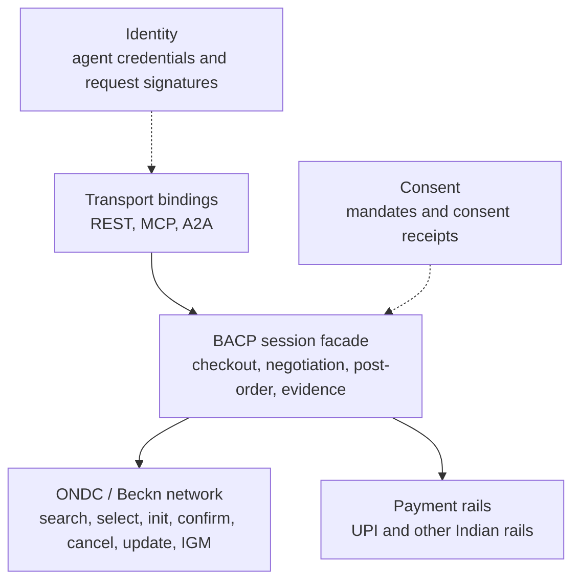
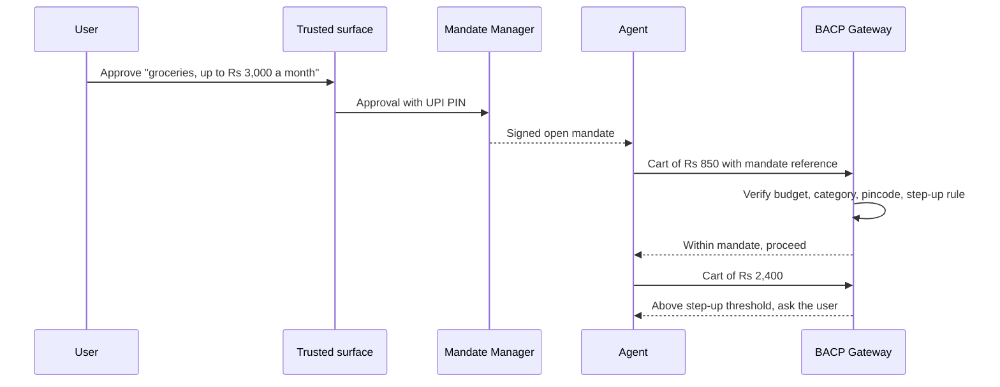
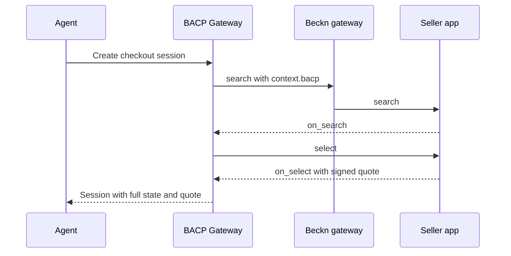
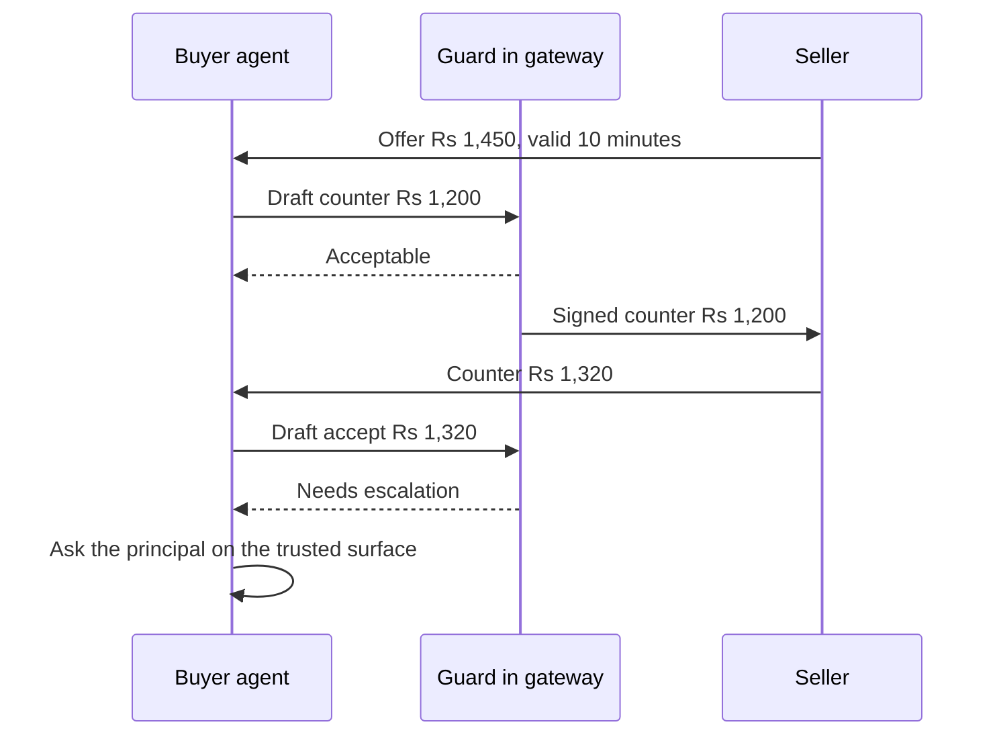
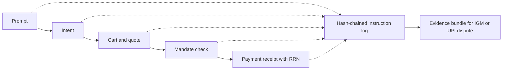

# Core Concepts

This page explains the main ideas in BACP in plain terms. The [specification](../specification/overview/index.md) gives the normative rules. Where this page and the specification differ, the specification wins.

!!! note "Status"
    BACP is a **Draft**. Some rules below depend on decisions that are still open. They are listed on the [open questions](../specification/open-questions.md) page.

## The idea in one paragraph

An AI agent that shops for someone in India needs to do four things the existing rails do not support: prove **who it is**, prove **what it is allowed to do**, show **whether its principal was present**, and show **what personal data the principal agreed to share**. BACP adds these four things as signed artefacts that travel with ordinary ONDC/Beckn messages and ordinary UPI payments. The rails stay in charge of what they already do. BACP adds the agent layer and the evidence.

## Layers

BACP is built in layers. Each layer reuses an existing standard or rail where one exists.

Solid arrows are calls. Dotted arrows are trust dependencies: every call is checked against a mandate and a signed agent identity.

## Actors

| Actor | Role in BACP |
|---|---|
| **User** (principal) | The person or business the agent acts for. Approves mandates, answers step-ups and enters the UPI PIN or other authentication factor. Can pause or revoke a mandate at any time. |
| **Agent** | The AI runtime, text or voice. It finds products, builds carts, negotiates and asks for payment. BACP treats it as **untrusted**: it never holds a PIN or OTP, never signs consent and is never an authentication factor. |
| **Agent provider** | The legal entity that operates the agent. It holds the agent's credential, keeps the signing key out of the agent's reach, discloses that the user is dealing with an AI, and offers a human handoff. |
| **Buyer app (BAP) with a BACP Gateway** | The registered ONDC buyer app that hosts the gateway. It verifies agent signatures and mandates in deterministic code, talks Beckn to the network and keeps the evidence. |
| **Seller app (BPP) and seller** | Publish catalogues, quote, fulfil, handle cancellations and returns, issue GST invoices and respond to grievances. |
| **Mandate Manager** | Turns the user's approval into a signed mandate and consent receipt, tracks use and revocation, and publishes status. It does not see order or payment payloads. |
| **Trusted surface** | A non-agentic screen, usually the user's UPI or banking app, where the user reviews and approves a mandate and authenticates. |
| **Payer PSP, issuer and NPCI** | Execute the payment and enforce rail limits. In BACP the payer PSP also returns a signed receipt with the UPI RRN. They see the payee and amount, not the basket. |

See the [glossary](../specification/glossary.md) for the full list of terms.

## Mandates

A **mandate** is a signed, immutable statement of what an agent may do for its principal. It is the centre of BACP. Every action the gateway takes is checked against one.

BACP's mandates are wire-compatible with the open and closed mandates of the Agent Payments Protocol (AP2), and follow the consent-artefact model of Account Aggregator.

- An **open** mandate sets constraints for future actions when the user will not be present: a budget per day, week or month, allowed categories, sellers and delivery pincodes, a step-up threshold, and an expiry.
- A **closed** mandate approves one exact cart or one exact payment.
- A **checkout** mandate authorises what may be bought. A **payment** mandate authorises how it may be paid. A separate **negotiation** mandate holds bargaining bounds, including the walk-away price, which never leaves the buyer's side.
- Each mandate records whether the human was **present (HP)** or **not present (HNP)**.
- A mandate can be **paused, revoked or exhausted**. Revocation reaches the gateway quickly, and the gateway stops all in-flight sessions under that mandate.

Read more: [Mandates and Consent](../specification/mandates.md).

## The gateway: an agent layer over Beckn

ONDC and Beckn are asynchronous. A buyer app sends `search` or `select` and receives `on_search` or `on_select` later, from many sellers. Agents work better with a synchronous session that always returns the full, authoritative state.

The **BACP Gateway** provides that. It runs inside, or on behalf of, a registered buyer app and:

- exposes checkout sessions with familiar verbs (create, update, complete, cancel) and full-state responses;
- turns each call into the matching Beckn messages, carrying agent data in a namespaced `context.bacp` extension that existing network participants can ignore;
- verifies the agent's signature, credential and mandate before anything leaves the gateway;
- adds what Beckn leaves optional: mandatory idempotency keys, a replay cache, and request signatures bound to callbacks;
- records every step in the instruction log.

The gateway does not change Beckn. A seller app that does not understand BACP can still serve an agent order, because the core Beckn messages are unchanged. Read more: [Sessions and Checkout](../specification/checkout/index.md) and [Beckn / ONDC Binding](../specification/transports/beckn.md).

## Payment handlers

India has many ways to pay, and they have very different rules about when a human must be present. BACP describes each one as a **payment handler**: a data record that states the rail, the regulator, the limits, the authentication model, the refund route and the settlement evidence. Limits are configuration, not code.

Handlers fall into binding classes:

| Class | Meaning | Examples |
|---|---|---|
| **O** (open-eligible) | A standing authority whose limits the rail enforces. May back an open mandate, so the agent can pay without the user present. | UPI Reserve Pay, UPI Circle, UPI AutoPay, UPI One-Time Mandate, card e-mandate, NACH, e-RUPI |
| **C** (closed) | Needs the user's own authentication for this one payment. | UPI intent and QR, cards, net banking, BNPL, 123PAY |
| **A** (assisted or device-bound) | Only on the payer's own device or at an assisted counter. Never usable by a remote agent. | UPI Lite, card present, tap and pay |
| **D** (deferred) | The order can be placed now, and payment happens later with a human. | Cash on delivery, pay on delivery by UPI |
| **N** (non-paying) | Financing, verification or tracking only. | TReDS, letter of credit, GeM payment tracking |

The agent never sees a PIN, OTP, card number or bank credential. The payment leg sent to the PSP carries only the payee, amount, mandate reference and a hash of the checkout, so the payment rail stays basket-blind.

Read more: [Payments](../specification/payments/index.md), [Handler Registry](../specification/payments/handler-registry.md) and [Rail Bindings](../specification/payments/rails.md).

## Negotiation

Much of Indian trade is negotiated: mol-bhav in a market, price rounds with a distributor, an RFQ to several suppliers, a reverse auction for a public buyer. BACP supports these as declared **modes**: fixed price, posted dynamic price, alternating offers, sealed and iterated RFQs, English, reverse-L1 and Dutch auctions, and scheme claims such as bank offers and slab discounts.

Three rules make agent negotiation safe:

1. **Only structured, signed and expiring messages bind.** Chat, voice and model explanations are advisory and are logged, but they never form a contract.
2. **The language model proposes and a deterministic guard decides.** Every firm counter, acceptance or bid is checked against the negotiation mandate outside the model. The model sees only a verdict: acceptable, not acceptable, or needs escalation.
3. **The reservation price never leaves the buyer's side.** The seller sees only a signed attestation that the deal is within bounds.

Silence is never acceptance: a negotiation that gets no reply expires. Indian commercial rules such as MRP ceilings and the MSMED payment-days limit are checked as validators, not left as guidance.

Read more: [Negotiation](../specification/negotiation/index.md) and [RFQ and Auctions](../specification/negotiation/rfq-and-auctions.md).

## Evidence

When an agent makes a mistake, someone has to work out what happened. BACP makes that possible by design.

- The **instruction log** is a hash-chained record of each stage: the user's prompt, the agent's interpreted intent, the cart, the mandate checks, the step-ups and the payment.
- **Receipts** are signed by the party that acted. A payment receipt is signed by the PSP and carries the UPI RRN and UTR, or the equivalent reference for other rails.
- An **evidence bundle** joins these together. An agent can attach it when it raises a grievance through ONDC's Issue and Grievance Management (IGM) flow, and it can be joined to the RRN for a UPI dispute.

BACP does not decide who is liable when an agent errs within a valid mandate. It makes the evidence complete so that the parties, the networks and the regulators can decide. Read more: [Evidence and Instruction Log](../specification/evidence.md).

## Identity and signing

Every agent carries an **agent credential** bound to its operator's legal entity and to the buyer app that hosts it. Every agent request is signed with HTTP Message Signatures (RFC 9421), with separate signature tags for browsing, paying and post-order actions. On the network leg, the buyer app still signs Beckn messages with its registry key as usual.

Read more: [Identity and Request Signing](../specification/identity-and-signing.md).

## Where to go next

- [Getting Started](../specification/getting-started.md) walks through a first integration.
- [BACP and India's DPI](india-dpi.md) explains how BACP uses each Indian rail.
- [BACP and other protocols](other-protocols.md) compares BACP with UCP, AP2, ACP and others.
