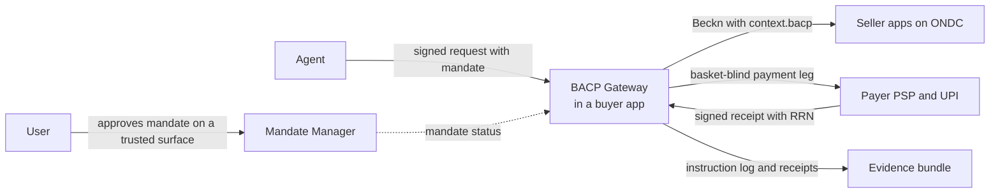

# Bharat Agentic Commerce Protocol

**BACP lets an AI agent discover, negotiate, buy, pay for, return and raise grievances about goods and services in India, on behalf of a person or a business, within limits that person or business has signed.**

!!! warning "Status: Draft, open for review"
    BACP is a **draft** specification. It is open for public review and is **not ready for production use**. Some rules depend on decisions that are still open. Read the [specification](specification/overview/index.md) and the [open questions](specification/open-questions.md), and send feedback on [GitHub](https://github.com/bacp-dev/bacp).

[Read the specification](specification/overview/index.md){ .md-button .md-button--primary }
[Core concepts](documentation/core-concepts/){ .md-button }
[View on GitHub](https://github.com/bacp-dev/bacp){ .md-button }

## Why BACP

India already has the rails that agentic commerce needs. ONDC and Beckn provide an open commerce network with order, cancel, return and grievance flows. UPI moves money at population scale and already has standing-authority primitives such as UPI Circle, Reserve Pay and AutoPay. Account Aggregator consent shows how to make permission explicit, purpose-bound and revocable. The DPDP Act sets the rules for personal data.

None of these rails knows about agents. A network message identifies the buyer app, not the agent that acted. A payment carries no record of what the user allowed the agent to do. Nothing standard says whether a human was present, how a user revokes an agent, or how a dispute can reconstruct what the agent was told.

Global agentic-commerce protocols solve parts of this problem, but they are built around cards and around single merchants. They do not cover UPI, cash on delivery, GST, Indian-language voice or the ONDC network.

BACP is a thin agent layer over the Indian rails. It replaces none of them. It adds four things to every transaction:

- **who** the agent is, as a signed and registered credential;
- **on whose authority** it acts, and within what limits, as a signed mandate;
- **whether a human was present** when it acted;
- **what the user agreed to share**, as a DPDP consent receipt.

Every step leaves verifiable evidence, so that a dispute can be traced from the user's instruction to the UPI reference number.

## Who it is for

| You are | What BACP gives you |
|---|---|
| **An agent builder** | One way to discover, check out, negotiate, pay and raise grievances across the ONDC network, over REST, MCP or A2A, without a separate integration for each seller. |
| **A buyer app (BAP)** | A gateway model for hosting agents safely: a deterministic mandate verifier, signed agent requests, and idempotency and replay protection on top of Beckn. |
| **A seller or seller app (BPP)** | Agent orders you can trust: a declared and signed agent, a mandate reference, a hash of the cart the user approved, and structured negotiation that never leaks the buyer's walk-away price. |
| **A PSP, bank or issuer** | A clean binding between an agent mandate and the UPI and other Indian payment primitives you already run, with a basket-blind payment leg and signed receipts. |
| **A regulator or policy team** | A concrete, reviewable proposal for how agent commerce can meet RBI authentication rules, DPDP consent, e-commerce consumer protection and grievance timelines. |

## Key features

-   **Mandate-bound agents**

    ---

    An agent acts only under a signed mandate, open or closed, with budgets, allow-lists, step-up thresholds and fast revocation. The agent is never an authentication factor.

    [Mandates and consent →](specification/mandates.md)

-   **Native UPI and all Indian rails**

    ---

    Open mandates bind to UPI Circle, Reserve Pay, AutoPay and One-Time Mandate. A registry of payment handlers covers cards, net banking, wallets, BBPS, e-RUPI, NACH, cash on delivery and B2B credit.

    [Payments →](specification/payments/index.md)

-   **Built on ONDC/Beckn**

    ---

    BACP rides on Beckn's search, select, init, confirm, cancel, update and IGM flows. Agent data travels in a namespaced extension that existing network participants can ignore.

    [Beckn / ONDC binding →](specification/transports/beckn.md)

-   **Negotiation the way India trades**

    ---

    Mol-bhav, B2B price rounds, RFQs, reverse auctions and schemes. The language model proposes and a deterministic guard decides. The reservation price never leaves the buyer's side.

    [Negotiation →](specification/negotiation/index.md)

-   **DPDP-grade consent**

    ---

    Mandates follow Account Aggregator consent semantics: immutable, purpose-bound, use-counted and revocable. Every data share produces a consent receipt in the user's language.

    [Security and privacy →](specification/security-and-privacy.md)

-   **Verifiable evidence and IGM**

    ---

    A hash-chained instruction log and rail-anchored receipts link the prompt, intent, cart, mandate and UPI RRN. Agents raise grievances through ONDC IGM with that evidence attached.

    [Evidence →](specification/evidence.md)

## How it fits together

[Core concepts](documentation/core-concepts/) explains each part. [BACP and India's DPI](documentation/india-dpi/) explains what BACP takes from each rail, and [BACP and other protocols](documentation/other-protocols/) explains how it relates to UCP, AP2, ACP, A2A and MCP.

## An independent, open proposal

BACP is an independent open proposal. It is not issued, endorsed or operated by NPCI, ONDC, RBI or any other public body, and it has no production adopters yet. Where it relies on a rail or a regulation, it describes that rail as publicly documented and leaves the rail's own rules in charge.

The specification, schemas and tools are developed in the open at [github.com/bacp-dev/bacp](https://github.com/bacp-dev/bacp) under the Apache License 2.0. See [Status and Roadmap](documentation/roadmap/) for what comes next.
