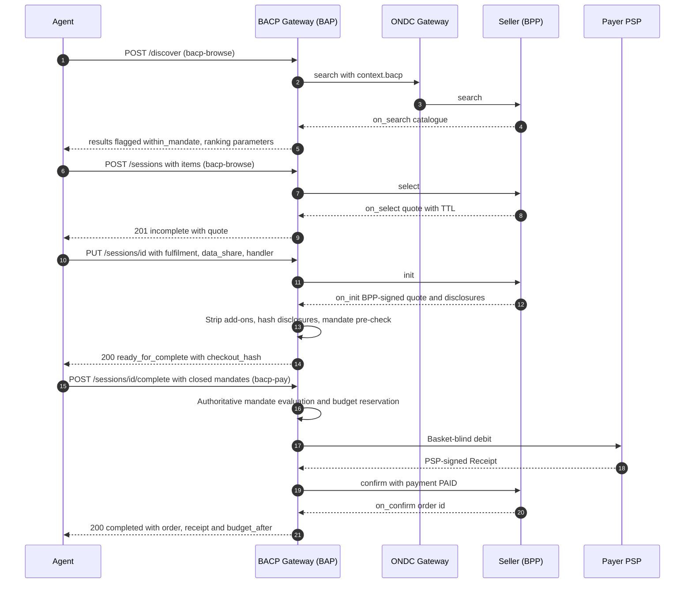
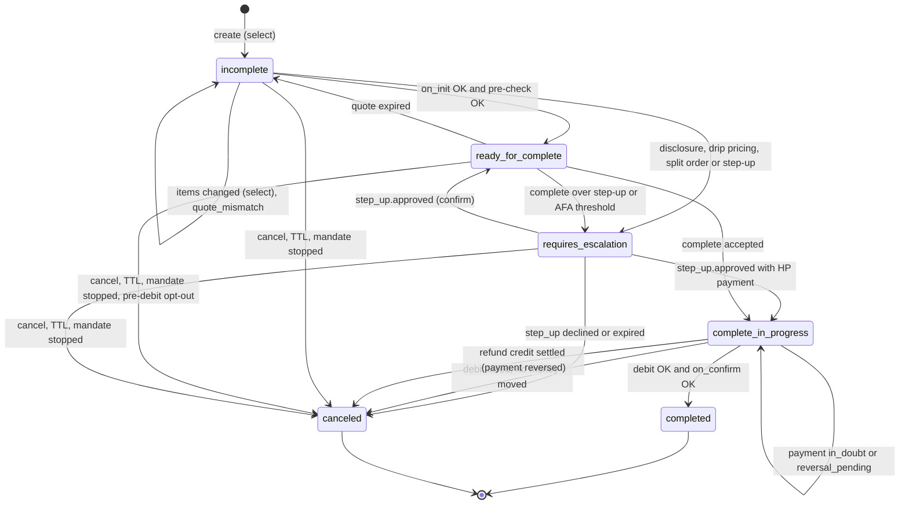

# Sessions and Checkout

!!! warning "Draft"
    This page is part of the `draft` specification. Rules marked **Proposed** depend on an
    open question and may change before the first dated release.

A **checkout session** is the gateway's synchronous, authoritative view of one purchase in
progress. The agent talks to the gateway with UCP-style session verbs. The gateway translates each
call into signed Beckn/ONDC actions, waits for the `on_*` callbacks, evaluates the mandate, moves
money on the payment rail, and returns the **full session state** every time.

This page covers discovery, the session lifecycle, `complete`, and the payment saga. Mandates are
described in [Mandates and Consent](../mandates.md). What happens after an order exists is in
[Orders and Post-order](post-order.md). The REST operations are defined in the BACP OpenAPI document (`services/bacp.openapi.yaml`)
and summarised in [REST](../transports/rest.md).

## Flow overview



## Verbs and Beckn mapping {#beckn-mapping}

| BACP verb | REST | Beckn / ONDC action | Mandate `action_scope` | Signature tag |
|---|---|---|---|---|
| `bacp.discover` | `POST /discover` | `search` → `on_search` (through the ONDC gateway and registry lookup) | `DISCOVER` (optional) | `bacp-browse` |
| `bacp.checkout.create` | `POST /sessions` | `select` → `on_select` (quote with TTL) | `QUOTE` | `bacp-browse` |
| `bacp.checkout.update` | `PUT /sessions/{session_id}` | `select` when items change; `init` → `on_init` for fulfilment, billing and payment terms | `ORDER`, `SHARE_DATA` | `bacp-browse` |
| `bacp.checkout.get` | `GET /sessions/{session_id}` | none (gateway state) | n/a | `bacp-browse` |
| `bacp.checkout.complete` | `POST /sessions/{session_id}/complete` | rail debit through the PSP, then `confirm` → `on_confirm` with `payment.status = PAID` and the rail reference | `ORDER`, `PAY` | `bacp-pay` |
| `bacp.checkout.cancel` | `POST /sessions/{session_id}/cancel` | none (no order exists yet) | n/a | `bacp-browse` |
| `bacp.human_handoff` | (agent UI) | `support` → `on_support` | n/a | `bacp-browse` |

Every committing Beckn message the gateway sends (`init`, `confirm`, and post-order `update`,
`cancel`, `issue`) carries `context.bacp` with the agent, `presence`, `idempotency_key`,
`ai_disclosure: true`, the current InstructionLog `log_head`, and the `mandate_ref`
(required on `init`, `confirm`, `update`, `cancel` and `issue`). The Beckn binding, including the
`message.order.tags[]` mirror for networks that reject unknown context keys, is in
[Beckn / ONDC Binding](../transports/beckn.md).

The gateway derives each Beckn `message_id` as
`UUIDv5(message_id_namespace, agent_id | idempotency_key | action)`, so a retried call re-sends an
identical message. A BACP-aware receiver **MUST** NACK a duplicate `message_id` within its `ttl`,
and the gateway treats that NACK as "already received".

## Discover {#discover}

`POST /discover` sends a Beckn `search` and aggregates `on_search` results until `max_wait_ms`.
Each result is flagged `within_mandate` when the request names a `mandate_ref`, and the response
carries the ranking parameters (for example distance, price and seller rating) and whether any
result is `sponsored`. Discovery moves no money and shares no personal data. See
[Discovery and Profiles](../discovery.md).

## Session create and update

### Create {#create}

`POST /sessions` names the seller (`bpp_id`, `provider_id`), the items, the `presence` and
optionally the `mandate_ref`, `channel`, `language` and `webhook_url`. The gateway sends `select`
and returns `201` with the quote from `on_select`.

```json
{
  "transaction_id": "6f1c2a8e-0c7b-4f7e-9d0e-1b2c3d4e5f60",
  "bpp_id": "bpp.kirana.example.in",
  "provider_id": "P-112",
  "items": [
    {"id": "I-ATTA-2KG", "quantity": 1},
    {"id": "I-MILK-1L", "quantity": 1},
    {"id": "I-TOOR-500G", "quantity": 1}
  ],
  "presence": "HNP",
  "mandate_ref": "mdt_CHK7Q2W9X4K1M3",
  "channel": "voice",
  "language": "hi-IN",
  "webhook_url": "https://agents.vaani.example.in/bacp/hooks"
}
```

Response (`201`, abridged to two line items):

```json
{
  "id": "ses_01HZXB",
  "transaction_id": "6f1c2a8e-0c7b-4f7e-9d0e-1b2c3d4e5f60",
  "status": "incomplete",
  "presence": "HNP",
  "bpp_id": "bpp.kirana.example.in",
  "provider_id": "P-112",
  "mandate_ref": "mdt_CHK7Q2W9X4K1M3",
  "line_items": [
    {"id": "I-ATTA-2KG", "quantity": 1,
     "unit_price": {"value": 11000, "currency": "INR"},
     "total": {"value": 11000, "currency": "INR"}},
    {"id": "I-MILK-1L", "quantity": 1,
     "unit_price": {"value": 6800, "currency": "INR"},
     "total": {"value": 6800, "currency": "INR"}}
  ],
  "totals": [{"type": "total", "amount": {"value": 26700, "currency": "INR"}}],
  "quote": {"id": "Q-55", "ttl": "PT10M", "expires_at": "2026-10-20T19:11:00+05:30"},
  "messages": [
    {"type": "disclosure", "code": "ai_disclosure",
     "content": {"hi-IN": "Aap ek AI sahayak se baat kar rahe hain. Kisi insaan se baat karne ke liye: https://vaani.example.in/human"},
     "param": "$.human_handoff_url",
     "resolution": "recoverable"}
  ]
}
```

### Update (PUT) {#update}

`PUT /sessions/{session_id}` is a **full replace** of the agent-editable fields: `items`,
`fulfilment`, `billing`, `data_share` and `payment.handler`. A PUT whose items differ from the
current ones triggers a new `select`. A PUT with fulfilment triggers `init`. On `on_init` the
gateway:

1. verifies that the quote is signed by the BPP's registry key, and computes
   `checkout_hash = sha-256(JCS(quote))` over that BPP-signed quote ([checkout_hash](#checkout-hash));
2. checks `data_share` against the mandate's `data_scopes`, `SHARE_DATA` scope and active
   ConsentReceipt ([Data minimisation](../mandates.md#consent)), before any data leaves for the
   seller;
3. checks that `payment.handler`, after alias resolution, is the open mandate's rail binding
   (`403 mandate_scope_mismatch` at `$.payment.handler` otherwise);
4. declines every pre-ticked add-on, re-runs `init` without it, and reports
   `preticked_addon_removed` (`warning`, `recoverable`). A seller that keeps a declined add-on is
   treated as a NACK;
5. compares prices against `on_select`. A changed unit price or a new fee line (packing,
   convenience, COD fee) gives `drip_pricing_detected` (`requires_buyer_review`);
6. requires the mandatory disclosures: `seller_name`, `total_price`, `return_terms`,
   `cancellation_terms`, `country_of_origin`, `expected_delivery` and `price_breakup`
   (`seller_address` and `grievance_officer` **SHOULD** be present). It hashes them into
   `disclosures.hash`. A missing one gives `disclosures_missing` (`requires_buyer_review`);
7. runs split-order detection and the advisory mandate pre-check
   ([Deterministic evaluation](../mandates.md#evaluation)). The pre-check **MUST NOT** reserve
   budget.

Outcomes: `ready_for_complete` when everything passes; `requires_escalation` with a `confirm`
step-up when drip pricing, missing disclosures, a split order or a step-up threshold is found (the
session **MUST NOT** reach `ready_for_complete` with missing disclosures); a 403 error when the
mandate rejects; `incomplete` with `quote_mismatch` when the seller's quote does not match the
requested quantities.

```json
{
  "items": [
    {"id": "I-ATTA-2KG", "quantity": 1},
    {"id": "I-MILK-1L", "quantity": 1},
    {"id": "I-TOOR-500G", "quantity": 1}
  ],
  "fulfilment": {"type": "Delivery", "address_ref": "addr_home", "pincode": "560034"},
  "data_share": {
    "consent_receipt_ref": "cr_A1B2C3D4E5F6G7",
    "fields": ["NAME", "PHONE", "DELIVERY_ADDRESS"]
  },
  "payment": {"handler": "upi.reservepay.block"}
}
```

Response (`200`, abridged):

```json
{
  "id": "ses_01HZXB",
  "transaction_id": "6f1c2a8e-0c7b-4f7e-9d0e-1b2c3d4e5f60",
  "status": "ready_for_complete",
  "presence": "HNP",
  "bpp_id": "bpp.kirana.example.in",
  "mandate_ref": "mdt_CHK7Q2W9X4K1M3",
  "line_items": [
    {"id": "I-ATTA-2KG", "quantity": 1,
     "unit_price": {"value": 11000, "currency": "INR"},
     "total": {"value": 11000, "currency": "INR"}}
  ],
  "totals": [
    {"type": "subtotal", "amount": {"value": 26700, "currency": "INR"}},
    {"type": "delivery", "amount": {"value": 3500, "currency": "INR"}},
    {"type": "total", "amount": {"value": 30200, "currency": "INR"}}
  ],
  "quote": {
    "id": "Q-55",
    "ttl": "PT10M",
    "checkout_hash": "sha-256:Y2hlY2tvdXQtaGFzaC1rYWlyYW5hLTg4MjMxLXF1b3Rl",
    "bpp_signature": "eyJhbGciOiJFUzI1NiJ9.eyJxIjoiUS01NSJ9.c2ln"
  },
  "disclosures": {
    "seller_name": "Shree Ganesh Kirana",
    "total_price": {"value": 30200, "currency": "INR"},
    "return_terms": "Returnable within 2 days if damaged",
    "cancellation_terms": "Free before dispatch",
    "expected_delivery": "PT2H",
    "country_of_origin": {"default": "IN"},
    "price_breakup": [{"type": "total", "amount": {"value": 30200, "currency": "INR"}}],
    "hash": "sha-256:ZGlzY2xvc3VyZXMtaGFzaC1rYWlyYW5hLTg4MjMxLXg"
  },
  "payment": {"handler": "upi.reservepay.block", "collected_by": "BAP", "type": "ON-ORDER",
              "status": "not_started"},
  "messages": [
    {"type": "disclosure", "code": "ai_disclosure",
     "content": {"en-IN": "You are talking to an AI assistant. To talk to a human: https://vaani.example.in/human"},
     "param": "$.human_handoff_url", "resolution": "recoverable"},
    {"type": "warning", "code": "preticked_addon_removed",
     "content": {"en-IN": "Removed pre-selected 'Delivery insurance Rs 15' (not in mandate)"},
     "param": "$.line_items[3]", "resolution": "recoverable"}
  ]
}
```

### checkout_hash binding {#checkout-hash}

`checkout_hash` is `sha-256` over the JCS form of the **BPP-signed quote** returned in `on_init`.
It is the anchor that binds every later artefact to one basket and one price:

- the agent copies it into both closed mandates ([Closing](../mandates.md#closing)), together with
  the exact quote total;
- `complete` **MUST** carry the same `checkout_hash`; any difference returns
  `403 mandate_scope_mismatch` at `$.checkout_hash`;
- if `accepted_disclosures_hash` is sent, it **MUST** equal `disclosures.hash`;
- the payment leg to the PSP carries `checkout_hash` instead of the basket, and the PSP's Receipt
  repeats it;
- the rail allows at most one debit per `checkout_hash`;
- the evidence bundle recomputes it from the BPP-signed quote ([Evidence](../evidence.md#bundle)).

`checkout_hash` is the hash of the quote, **not** of an accepted negotiation offer. Nothing in
BACP asserts that `checkout_hash` equals an `offer_hash`.

## Session state machine {#state-machine}



| From | Event | To | Messages and notes |
|---|---|---|---|
| (none) | `POST /sessions`, `on_select` received | `incomplete` | `ai_disclosure` |
| `incomplete` | PUT with new items (`select`) | `incomplete` | `quote_mismatch` if the seller's quote differs from the request |
| `incomplete` | PUT, `on_init` signed, disclosures complete, pre-check allows | `ready_for_complete` | `preticked_addon_removed`, `pre_debit_notice` where applicable |
| `incomplete` | PUT finds drip pricing, missing disclosures, a split order, or a step-up threshold | `requires_escalation` | `drip_pricing_detected`, `disclosures_missing`, `split_order_suspected`, `step_up_required` |
| `ready_for_complete` | `complete` over a step-up threshold, AFA threshold, or split order | `requires_escalation` | `step_up_required` |
| `ready_for_complete` | `complete` after the quote's `expires_at` has passed | `incomplete` | `quote_expired` (re-select) |
| `ready_for_complete` | `complete` before a pre-debit notice matures | `ready_for_complete` | `pre_debit_notice`; no money moves |
| `requires_escalation` | `step_up.approved` without payment (confirm) | `ready_for_complete` | `step_up_approved`; agent completes with `step_up_id` |
| `requires_escalation` | `step_up.approved` with HP closed mandates and PSP receipt | `complete_in_progress` | continues to `confirm` |
| `requires_escalation` | `step_up.declined`, or `complete` after `expires_at` | `canceled` | `step_up_declined` or `step_up_expired`; no money moves |
| `ready_for_complete` | `complete` accepted by the atomic evaluation | `complete_in_progress` | `payment.status: initiated` |
| `complete_in_progress` | Debit succeeds and `on_confirm` arrives | `completed` | `budget_after` |
| `complete_in_progress` | PSP refuses or fails the debit | `canceled` | `payment_failed`; reservation released |
| `complete_in_progress` | PSP times out | `complete_in_progress` | `payment_in_doubt`; reservation kept |
| `complete_in_progress` | Debited, `on_confirm` still missing after re-send | `complete_in_progress` | `debited_not_confirmed`; `payment.status: reversal_pending` |
| `complete_in_progress` | PSP reports the refund credit as settled | `canceled` | `payment.status: reversed` |
| any open state | `POST /sessions/{id}/cancel` | `canceled` | `session_canceled` |
| any open state | Mandate revoked, paused or expired | `canceled` | `mandate_revoked`, `mandate_paused`, `mandate_expired` |
| `ready_for_complete` | Principal opts out of a pre-debit notice | `canceled` | `pre_debit_opt_out` (`requires_buyer_input`); no rail traffic |

The open states are `incomplete`, `ready_for_complete` and `requires_escalation`. Calling
`complete` on an `incomplete` session returns `409 session_state_conflict`; the agent **MUST** PUT
the session first. Cancelling a session that is `complete_in_progress` or `completed` also returns
`409 session_state_conflict`; the agent cancels the order instead.

### Payment sub-states

Inside `complete_in_progress`, `payment.status` follows the payment saga:

| `payment.status` | Meaning |
|---|---|
| `not_started` | No debit attempted yet. |
| `initiated` | The atomic evaluation passed; the debit has been sent. |
| `debited` | A PSP-signed success receipt has been applied. |
| `confirmed` | `on_confirm` received; the session is `completed`. |
| `in_doubt` | The PSP timed out; the outcome is unknown. |
| `failed` | The debit failed; no money moved. |
| `reversal_pending` | Debited, but the seller never confirmed; a refund to source is in progress. |
| `reversed` | The refund credit has settled; the session is `canceled`. |

## Messages and full-state responses {#messages}

BACP uses two channels:

- **Protocol failures** return 4xx or 5xx with a flat `Error {type, code, message, param}`, where
  `param` is an RFC 9535 JSONPath into the request.
- **Business outcomes** return 200 or 201 with the **full session state** plus `messages[]`. Each
  message has `type` (`error`, `warning`, `info`, `disclosure`), `code`, `content` (a
  multilingual map keyed by BCP 47 tag), an optional `param`, and `resolution`.

`resolution` tells the agent what it may do:

| `resolution` | Agent behaviour |
|---|---|
| `recoverable` | The agent may fix and retry on its own. |
| `requires_buyer_input` | The agent **MUST** ask the principal for something new (a new mandate, a new instrument). |
| `requires_buyer_review` | The principal **MUST** review; the agent **MUST NOT** proceed on its own. |
| `unrecoverable` | Stop; this intent cannot succeed. |

Every response, and every `session.updated` webhook, is a complete snapshot: the agent never needs
to merge partial updates. Readers **MUST** ignore unknown fields. The full code list is in
[Errors](../errors.md).

### AI disclosure and human handoff {#ai-disclosure}

The first entry of every session's `messages[]` **MUST** be the AI disclosure: `type: disclosure`,
`code: ai_disclosure`, its `content` taken from the AgentCredential's `disclosure.ai_notice` in
the session's language, followed by the `human_handoff_url`, with
`param: $.human_handoff_url`. The disclosure is also carried on the network as
`context.bacp.ai_disclosure: true`. The agent **MUST** present the disclosure to the principal
and **MUST** offer the human handoff. A handoff on the network maps to Beckn `support` →
`on_support`.

## Complete {#complete}

`POST /sessions/{session_id}/complete` (tag `bacp-pay`) is the only call that moves money.

```json
{
  "presence": "HNP",
  "checkout_mandate": "eyJhbGciOiJFUzI1NiJ9.eyJ2Y3QiOiJpbi5iYWNwLm1hbmRhdGUuY2hlY2tvdXQuMSJ9.c2ln",
  "payment_mandate": "eyJhbGciOiJFUzI1NiJ9.eyJ2Y3QiOiJpbi5iYWNwLm1hbmRhdGUucGF5bWVudC4xIn0.c2ln",
  "checkout_hash": "sha-256:Y2hlY2tvdXQtaGFzaC1rYWlyYW5hLTg4MjMxLXF1b3Rl",
  "accepted_disclosures_hash": "sha-256:ZGlzY2xvc3VyZXMtaGFzaC1rYWlyYW5hLTg4MjMxLXg"
}
```

`checkout_mandate` and `payment_mandate` are the closed mandates as attached compact JWS
([Closing](../mandates.md#closing)). After an approved confirm step-up the body also carries
`step_up_id`. The agent MAY add `kb_jwt`.

The gateway, in order:

1. **Decodes the closed mandates** and checks they are signed by the session agent's `cnf` key and
   narrow the session's open mandates (`403 mandate_invalid_signature` or
   `mandate_scope_mismatch`).
2. **Checks the session state.** A canceled session returns its state (or the mandate error that
   canceled it). A session that is already `complete_in_progress` or `completed` re-runs the
   closed-mandate checks and then returns `403 mandate_scope_mismatch` (one debit per checkout).
   An open step-up that is not approved returns the unchanged `requires_escalation` state; an
   expired one cancels the session with `step_up_expired`.
3. **Checks the quote TTL.** If the quote's `expires_at` has passed, the session returns to
   `incomplete` with `quote_expired` and nothing else happens.
4. **Checks the collector and bindings**: the collecting party is an authorised PA or bank, and
   `checkout_hash`, disclosures hash, closed-mandate amounts and `auth_binding` all match.
5. **Verifies the InstructionLog chain** (`403 log_chain_invalid`).
6. **Runs the atomic section** per open mandate: split-order detection, the authoritative
   evaluation against exposure, consumption of the closed Payment Mandate, the budget
   reservation, and the move to `complete_in_progress`
   ([Usage ledger](../mandates.md#usage-ledger)).
7. **Debits the rail** after the atomic section. The debit instruction is basket-blind: payee,
   amount, closed-mandate reference and hash, `checkout_hash`, `transaction_id`.
8. **Applies the PSP-signed receipt** to the ledger, computes `budget_after`, sends the
   `payment.receipt` webhook (with a `ReceiptRef`), and sends Beckn `confirm` with
   `payment.status: PAID`, the rail reference, and `context.bacp.mandate_ref`.
9. **On `on_confirm`** records the order and returns `completed`.

Response (`200`, abridged):

```json
{
  "id": "ses_01HZXB",
  "transaction_id": "6f1c2a8e-0c7b-4f7e-9d0e-1b2c3d4e5f60",
  "status": "completed",
  "presence": "HNP",
  "order_id": "ORD-KIR-88231",
  "line_items": [
    {"id": "I-ATTA-2KG", "quantity": 1,
     "unit_price": {"value": 11000, "currency": "INR"},
     "total": {"value": 11000, "currency": "INR"}}
  ],
  "totals": [{"type": "total", "amount": {"value": 30200, "currency": "INR"}}],
  "payment": {
    "handler": "upi.reservepay.block",
    "collected_by": "BAP",
    "type": "ON-ORDER",
    "status": "confirmed",
    "receipt": {
      "receipt_id": "rcpt_PAY0000000001",
      "receipt_type": "payment",
      "iss": "psp.example.in",
      "issued_at": "2026-10-20T19:02:11+05:30",
      "result": "success",
      "reference": "sha-256:cGF5bWVudC1tYW5kYXRlLWNsb3NlZC0wMDAwMDAwMDAx",
      "mandate_ref": "mdt_PAYC0000000001",
      "open_mandate_ref": "mdt_PAY7Q2W9X4K1M3",
      "transaction_id": "6f1c2a8e-0c7b-4f7e-9d0e-1b2c3d4e5f60",
      "order_id": "ORD-KIR-88231",
      "checkout_hash": "sha-256:Y2hlY2tvdXQtaGFzaC1rYWlyYW5hLTg4MjMxLXF1b3Rl",
      "amount": {"value": 30200, "currency": "INR"},
      "payee": {"vpa": "vaani.collect@examplebank", "name": "Vaani Voice Commerce Pvt Ltd"},
      "rail": {
        "type": "upi.reservepay.block",
        "rail_ref": "SBMD-HDFX-000123456",
        "rrn": "629318004417",
        "utr": "629318004417",
        "npci_txn_id": "NPCIEX0000000001",
        "psp_confirmation_id": "PSPCONF-77812",
        "status": "SUCCESS"
      },
      "signature": {
        "role": "psp",
        "kid": "psp.example.in|ukid-1|es256",
        "alg": "ES256",
        "value": "eyJhbGciOiJFUzI1NiJ9.eyJyIjoxfQ.c2ln"
      }
    },
    "budget_after": [{"period": "P1M", "remaining": {"value": 269800, "currency": "INR"}}]
  },
  "messages": [
    {"type": "disclosure", "code": "ai_disclosure",
     "content": {"en-IN": "You are talking to an AI assistant. To talk to a human: https://vaani.example.in/human"},
     "param": "$.human_handoff_url", "resolution": "recoverable"},
    {"type": "info", "code": "budget_after",
     "content": {"en-IN": "Remaining mandate budget: P1M Rs 2698"},
     "param": "$.payment.budget_after", "resolution": "recoverable"}
  ]
}
```

### Step-up on complete

When the evaluation calls for a step-up the gateway returns `200` with
`status: requires_escalation` and **no money moves**:

```json
{
  "id": "ses_01HZXE",
  "transaction_id": "0b9d3f4a-1111-4c1e-8a7b-2d3e4f5a6b7c",
  "status": "requires_escalation",
  "presence": "HNP",
  "line_items": [
    {"id": "I-OIL-5L", "quantity": 1,
     "unit_price": {"value": 135000, "currency": "INR"},
     "total": {"value": 135000, "currency": "INR"}}
  ],
  "totals": [{"type": "total", "amount": {"value": 135000, "currency": "INR"}}],
  "step_up": {
    "step_up_id": "stp_01HZXA",
    "kind": "confirm",
    "reason": "above_step_up_threshold",
    "summary": {"hi-IN": "Rs 1,350 ka order aapki Rs 1,200 ki seema se zyada hai. Kripya UPI app mein pushti karein."},
    "trusted_surface_url": "https://psp.example.in/approve/stp_01HZXA",
    "expires_at": "2026-10-22T18:40:00+05:30"
  },
  "messages": [
    {"type": "disclosure", "code": "ai_disclosure",
     "content": {"en-IN": "You are talking to an AI assistant. To talk to a human: https://vaani.example.in/human"},
     "param": "$.human_handoff_url", "resolution": "recoverable"},
    {"type": "error", "code": "step_up_required",
     "content": {"en-IN": "User confirmation required on Trusted Surface"},
     "param": "$.step_up", "resolution": "requires_buyer_review"}
  ]
}
```

The step-up flow, the two kinds (`confirm`, `rail_auth`) and split-order detection are specified in
[Mandates: Step-up](../mandates.md#step-up). In the A2A and MCP bindings a step-up surfaces as A2A
`AUTH_REQUIRED` and MCP `insufficient_scope` ([MCP and A2A](../transports/mcp-a2a.md)).

### Timeout, in-doubt and reconciliation {#in-doubt}

If the PSP does not answer the debit, the outcome is unknown:

- `payment.status` becomes `in_doubt` and the session stays `complete_in_progress` with message
  `payment_in_doubt` (`recoverable`). The budget reservation is **kept**.
- The gateway **MUST NOT** attempt a new debit until the outcome is known. It reconciles with the
  PSP by the debit's idempotency key and applies the PSP-signed result: success continues to
  `confirm`; failure releases the reservation and cancels the session with `payment_failed`.
- The agent **MUST NOT** retry with a new Idempotency-Key. It calls `GET /sessions/{id}` or waits
  for `session.updated`. A retry with the **same** key returns the same state and never re-debits.

### Debited but not confirmed {#debited-not-confirmed}

If the debit succeeds but `on_confirm` does not arrive, the gateway re-sends the identical
`confirm` (same `message_id`) once. If it is still missing:

- the session **MUST** stay `complete_in_progress` with `payment.status: reversal_pending`,
  `reversal_deadline` set to the debit time plus 5 days, and message `debited_not_confirmed`
  (`warning`, `recoverable`);
- the gateway **MUST** start a refund to source immediately, citing the original rail reference
  (`original_rrn` for UPI). Issuing the refund Receipt does not by itself end the session;
- when the PSP reports the refund credit as settled, `payment.status` **MUST** become `reversed`
  and the session **MUST** become `canceled`;
- the `debited_not_confirmed` message **SHOULD** state the rail's turnaround time and the
  principal's entitlement to compensation of ₹100 per day of delay for a failed UPI merchant
  payment not reversed in time.

The signal that confirms refund settlement, and the saga for rails other than UPI, are open
([Q-49](../open-questions.md#q-49)).

### Deferred settlement after a pre-debit notice {#pre-debit-notice}

Some rails require the payer to be told about a debit at least 24 hours before it happens. This
applies when the binding's effective `pre_debit_notice` is `required_24h` (e-mandate rails such as
UPI AutoPay) or `bacp_policy_24h` (NACH). It also applies, until the legal position is settled
([Q-03](../open-questions.md#q-03)), to the second and every later unattended debit on a
UPI Reserve Pay or one-time-mandate binding whose notice requirement is `unknown`; the first debit
is covered by the block-creation authorisation. A deployment MAY switch that last default off per
rail only by an explicit, logged policy decision, and conformance runs **MUST** keep it on.

Such sessions follow a **notice-gated** checkout:

1. When the session first becomes `ready_for_complete`, the gateway **MUST** issue the notice and
   relay it as the webhook `pre_debit.notice` and the message `pre_debit_notice`. The session
   shows `payment.scheduled_debit_at`.
2. A `complete` before the notice matures **MUST** move no money. It returns `200` with message
   `pre_debit_notice` (`recoverable`, `param: $.payment.scheduled_debit_at`).
3. After the notice matures the agent **MUST** re-quote (PUT the session). The gateway **MUST**
   reuse the matured notice only if the new amount is at most the notified amount; otherwise a new
   notice is needed.
4. If the principal opts out on the Trusted Surface (`rail.debit_opt_out`), the gateway **MUST**
   cancel the session with `pre_debit_opt_out` (`requires_buyer_input`) and send nothing to the
   rail.

The agent **MUST** relay a pre-debit notice to the principal and **MUST NOT** dismiss it. See
[Rail Bindings](../payments/rails.md).

## Idempotency, retries and races {#idempotency}

Every `POST` and `PUT` **MUST** carry an `Idempotency-Key` of 22 to 64 printable ASCII characters,
which **SHOULD** carry at least 128 bits of entropy. Keys are scoped to (agent, method, path).

| Situation | Result |
|---|---|
| No key, or a key of the wrong length | `400 idempotency_key_required` |
| Same key, same body (semantic equality, `null` ≠ absent) | The stored response, with header `Idempotent-Replayed: true` |
| Same key, different body | `422 idempotency_conflict`; use a new key only for a new intent |
| Same key while the first request is still running | `409 idempotency_in_flight` with `Retry-After`; retry with the same key |
| Idempotency store unavailable | `503 idempotency_store_unavailable`; writes fail closed |
| Per-agent key or in-flight quota exceeded | `429 quota_exceeded` with `Retry-After` |

Keys are kept at least 24 hours (48 hours recommended). 5xx responses are never stored.

**Lost responses.** After a lost or timed-out response the agent **MUST** call
`GET /sessions/{session_id}` first, and **MUST** retry `complete` only with the **same** key. A new
key means a new purchase intent and is evaluated afresh. A `504 bpp_timeout` leaves the session
retrievable; the agent GETs it and retries with the same key.

**Exactly one winner.** However many `complete` calls race:

- With the **same** key, exactly one executes; the others get `409 idempotency_in_flight` or the
  replayed response.
- With **different** keys on the same session, at most one debit happens: the closed Payment
  Mandate is consumed atomically and the rail accepts one debit per `checkout_hash`. The losers get
  `403 mandate_scope_mismatch`.
- Across **different sessions** under one open mandate, the atomic section serialises evaluation
  and reservation, so the settled total never exceeds any budget; the calls that would exceed it
  get `403 mandate_exhausted` and move no money.

A gateway **MUST NOT** return a server error because of concurrent access to its own state, and
**SHOULD** keep idempotency, nonce and reservation state in a shared atomic store when it runs as
several instances.

## Webhooks

The gateway sends `session.updated` (full session snapshot), `payment.receipt`,
`pre_debit.notice` and `mandate.status_changed` to the agent's `webhook_url`. Webhooks are signed
by the gateway (RFC 9421) with Standard Webhooks headers and retried with backoff. A webhook body
**MUST NOT** embed a signed Receipt: it carries a `ReceiptRef` (`receipt_id`, `receipt_hash`,
`receipt_type`, `result`, and where present `amount`, `refund_state` and `rail`). The agent fetches
the full receipt with `GET /sessions/{id}` and **MUST** check that its hash equals `receipt_hash`
before relying on it ([Evidence: Receipts](../evidence.md#receipts)).

## Error responses

| Status | Codes |
|---|---|
| 400 | `invalid_request`, `idempotency_key_required`, `mandate_schema_invalid`, `receipt_invalid` |
| 401 | `signature_invalid`, `replay_detected`, `agent_unregistered`, `agent_credential_revoked` |
| 403 | mandate errors ([Mandates](../mandates.md#error-codes)), `rail_limit_exceeded`, `collector_not_authorised`, `log_chain_invalid` |
| 404 | `not_found` |
| 409 | `idempotency_in_flight`, `session_state_conflict` |
| 413 | `request_too_large` (body above 256 KiB) |
| 422 | `idempotency_conflict` |
| 429 | `quota_exceeded` |
| 502 | `bpp_nack` |
| 503 | `idempotency_store_unavailable` |
| 504 | `bpp_timeout` |

See [Errors](../errors.md) for the full registry.
