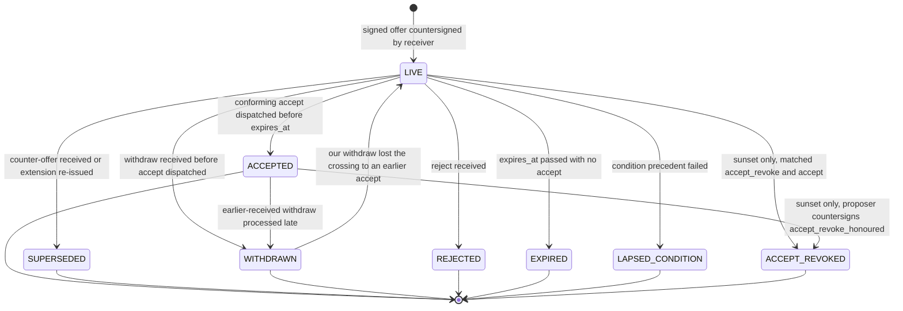
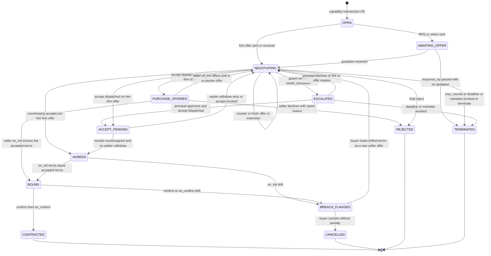

# Negotiation

!!! info "Version 2026-10-17"
    This page is part of BACP version `2026-10-17`. Rules marked **Proposed** depend on an open question and may change in a later dated release.

The negotiation module lets an agent bargain, request quotations and bid on behalf of a principal, the way trade happens in India today: mol-bhav at a kirana or a weaver's shop, DM bargaining on social commerce, RFQ → quotation → PO in B2B procurement, and reverse auctions on government platforms. It sits **before** checkout. A negotiation ends in an agreed term sheet that the seller then binds in its signed `on_init` quote, and only that signed quote enters the [checkout session](../checkout/index.md) and the [payment flow](../payments/index.md).

RFQs and auctions build on this page and are specified in [RFQ and Auctions](rfq-and-auctions.md). Which modes, payment handlers and validators apply to each kind of trade is set by the [trade profiles](../trade-profiles.md).

## Principles

1. **Only structured, signed and expiring messages bind.** Chat, voice, counterparty free text and LLM rationale are advisory. They carry `binding: false`, are logged as hashes, and never change a term sheet.
2. **The model proposes and a deterministic engine decides.** A guard outside the LLM evaluates every outgoing firm counter-offer, acceptance, bid and award, and every incoming offer, against the principal's negotiation mandate. The model sees only a verdict.
3. **The reservation price never leaves the principal's side.** The seller verifies only a signed `within_bounds` attestation. No message, error, webhook or log line sent to anyone else carries the reservation price or the ceiling.
4. **Indian law is enforced as validators, not left as guidance.** MRP ceilings, the MSMED credit cap, the dark-pattern rules of the Central Consumer Protection Authority (CCPA), cash limits and bid-rigging screens are checks that block, escalate or flag.
5. **Contract-law alignment.** Offer, revocation, lapse and acceptance follow the Indian Contract Act, 1872, ss.4–7 (see [Indian Contract Act timing](#indian-contract-act-timing)).
6. **Silence is never acceptance.** A negotiation that receives no reply ends `TERMINATED` at its deadline, never `AGREED`.

## Negotiation modes

Every session declares its mode up front. The enum is `negotiation-session.json#/$defs/Mode`.

| `mode` | How trade does it today | Mechanics in BACP | Acceptance or award |
|---|---|---|---|
| `fixed` | Catalogue checkout, MRP goods | One firm offer (the `on_select` quote). The buyer may only accept, reject or let it lapse. | Buyer `accept` |
| `posted_dynamic` | Rail flexi-fare, airline buckets, Tatkal | A firm offer with short validity and a quota or class. A price change after expiry is a new offer, never a silent charge. | Buyer `accept` within validity |
| `alternating` | Mol-bhav, DM bargaining, car dealers, B2B price rounds | Alternating firm or indicative offers. One live offer at a time, `max_rounds`, absolute deadline. | Either side accepts the live offer |
| `rfq_sealed` | B2B RFQ, GeM e-bid, sealed tenders | Structured RFQ to N sellers, sealed commit–reveal quotations with a deposit, landed-cost comparison | Award after `response_by` ([RFQ](rfq-and-auctions.md#rfq)) |
| `rfq_iterated` | Shortlist and "best and final" | `rfq_sealed`, then alternating rounds with a shortlist. Each shortlisted seller is its own bilateral session under the parent `rfq_id`. | As above |
| `english` | Mandi open outcry, eNAM, disposal auctions | Ascending price-only bids on a neutral auctioneer's clock with anti-sniping | Highest valid bid at close, then the seller's explicit acceptance ([Auctions](rfq-and-auctions.md#auctions)) |
| `reverse_l1` | GeM reverse auction after technical evaluation | Descending bids. Bidders see the current L1 price only, never who bid it. | Lowest bid at close |
| `dutch` | Perishables, end-of-day clearance | Published non-increasing price ticks | First conforming acceptance by auctioneer receipt time |
| `scheme` | Bank offers, coupons, QPS "buy 10 get 1", slab and target schemes | No bargaining. The buyer asserts machine-readable schemes with eligibility proofs. The seller agrees or disagrees per scheme, and stacking rules apply. | Seller `Agree` per scheme, then a normal `accept` |

A coupon code on a plain checkout session is not `scheme` mode: it is a code that the seller applies or rejects ([Discounts](../checkout/index.md#discounts)). Discounts that depend on the payment instrument or on a buyer assertion stay in `scheme` mode.

A `sealed_first_price` auction is negotiated under mode `rfq_sealed`, and a mandate that allows sealed auctions MUST list `rfq_sealed` in `modes_allowed`.

## Capability advertisement

A BPP advertises `bacp.negotiation` as a provider tag in `on_search`, mirrored into its profile. The BAP declares its own set in `/.well-known/bacp` (see [Discovery and Profiles](../discovery.md)). The schema is `negotiation-session.json#/$defs/Capability`:

| Field | Meaning |
|---|---|
| `negotiable_issues[]` | JSON Pointers into the term sheet, e.g. `/lines/*/unit_price`, `/payment/credit_days` |
| `modes[]` | Supported modes |
| `max_rounds`, `round_timeout` | Round limits |
| `min_offer_validity` | Shortest validity the advertiser will issue |
| `sig_algs[]`, `firm_quote_supported` | Signing algorithms; whether firm quotes are offered |
| `accepted_handlers[]` | Payment handlers the seller accepts, which feed the [handler intersection](../payments/handler-registry.md) |
| `pricing_ai_vendor` | Any third-party pricing or negotiation AI the participant uses |

Rules:

- A session MUST use the **intersection** of the two adverts.
- Any issue not in the intersected `negotiable_issues` is **fixed**. A counter-offer that changes a fixed issue MUST be refused with `NEG_ISSUE_NOT_NEGOTIABLE`.
- `max_rounds` defaults to 10 for B2C and 30 for B2B.
- `min_offer_validity` has a floor of `PT5M` in **every** profile. A counterparty's advert MAY lengthen it and MUST NOT shorten it: the effective value is the larger of `PT5M` and the declared value.
- An empty mode intersection returns `capabilities_incompatible`, and the agent falls back to `fixed`.

## The negotiation mandate

A negotiation is bounded by a **negotiation mandate** that is separate from the checkout mandate described in [Mandates and Consent](../mandates.md).

**Why separate.** AP2- and Verifiable-Intent-compatible verifiers fail closed on constraint types they do not know. Adding negotiation constraints to the checkout or payment mandate would make those verifiers reject it. BACP therefore carries the `bacp.neg.*` constraints in their own mandate:

- `vct: in.bacp.mandate.negotiation.1`, `kind: negotiation`, schema [`mandate-negotiation.json`](https://bacp.dev/schemas/mandate-negotiation.json);
- signed by the principal on the Trusted Surface and countersigned by the Mandate Manager, like every other mandate;
- for `role: buyer`, linked to the open checkout mandate by `checkout_mandate_ref`, which MUST be present. For `role: seller` (a reverse-auction bidder, a farmer selling a lot), `checkout_mandate_ref` MUST be absent, because a seller has no checkout mandate.

Both mandates are evaluated, and **the stricter bound wins**: the checkout mandate's budgets, allow-lists and step-up rules still apply to a negotiated deal.

**Autonomous acceptance.** The notice that the principal approves on the Trusted Surface when the negotiation mandate is set up MUST say that the agent may accept a firm offer without the principal when the guard returns `acceptable`. It MUST also give the fixed consequence sentence of each [`acceptance_revocation`](#acceptance-revocation) value ([Render input](../human-participants.md#ts-render)), so that the principal knows what such an acceptance means before any is sent.

The negotiation mandate is verified only by the principal's own guard and credential provider. It is **never** disclosed to the counterparty. It travels to the seller only as a `within_bounds` attestation (see [Binding to checkout](#binding-to-checkout)).

```json title="mandate-negotiation.buyer.json"
--8<-- "source/examples/mandate-negotiation.buyer.json"
```

### Constraints

`constraints.negotiation` (`$defs/NegotiationConstraints`) holds every bound. Unknown keys fail closed.

| Key | Meaning |
|---|---|
| `role` | `buyer` or `seller` |
| `modes_allowed[]` | The modes this mandate permits |
| `price.total_max` | Buyer ceiling on `all_in_total`. Required for buyers. |
| `price.total_min` | Seller floor on `all_in_total`. Required for sellers. |
| `price.unit_max[]`, `price.unit_min[]` | Per-item bounds |
| `price.reservation` | The walk-away price. See [Reservation price](#reservation-price). Required for buyers. |
| `price.max_increase_pct_after_first_quote` | Drip-pricing tripwire. Default 0 for B2C. |
| `quantity[]` | Minimum, maximum and largest acceptable MOQ per item |
| `delivery.*` | `deliver_by_latest`, allowed slots and Incoterms, whether partial delivery is allowed, maximum delivery charge |
| `payment.*` | `handlers_allowed[]`, `max_advance_pct`, `credit_days_min` / `credit_days_max`, `max_delay_interest_pa_pct`, `emi_allowed`, `credit_funding_allowed`, `cod_allowed`, `cod_max_open_orders`, `collected_by_allowed[]`, `credit_ledger{ledger_id, max_outstanding}` |
| `after_sales.*` | Minimum return window, minimum warranty, installation, allowed return types |
| `quality.*` | Allowed grades; whether inspection or hallmarking is required |
| `commission.*`, `deposit.*`, `schemes.*` | Commission cap and who may pay it; deposit cap and refundability; allowed scheme funders. `schemes.count_conditional_cashback` is the constant `false`. |
| `process.*` | `max_rounds`, `deadline`, `counterparty_allowlist`, `auction_max_bid`, `rfq_min_responses`, `rfq_min_window`, `award_rule`, `firm_counter_allowed` |
| `step_up.*` | `any_violation`, `between_reservation_and_max` and `agreed_issue_reopened` are the constant `true`. `new_counterparty_above` and `drip_pct` are set per mandate. |

`revocation.on_revoke` is the constant `withdraw_live_firm_offers`: when the mandate is revoked, the gateway MUST send `withdraw` for every live firm offer of that principal (see [Mandate revocation](#mandate-revocation)).

### Reservation price

The reservation price is the principal's private walk-away value.

- `price.reservation` is an SD-JWT selectively disclosable claim with `sd: true`, `disclosure: "never"` (a constant) and `held_by` ∈ `policy_engine` | `trusted_surface`.
- It MUST NOT be disclosed to the counterparty, to any seller-side verifier, to a payment processor or to the LLM. The model receives only the guard verdict.
- Its relation to `total_max` is:

| Offered `all_in_total` (buyer) | Guard outcome |
|---|---|
| At or better than `reservation` | `acceptable`. The agent may accept without the principal. |
| Between `reservation` and `total_max` | `needs_escalation`, reason `negotiation_between_reservation_and_max`. The principal decides on the Trusted Surface. |
| Beyond `total_max` | `needs_escalation`, reason `negotiation_out_of_mandate`. The agent MUST NOT emit a firm counter-offer or bid at this value. A principal approval here is a fresh closed approval with an RBI-compliant factor. |

For a seller mandate the directions are reversed (`total_min` is the floor).

A mandate that sets `disclosure` to anything other than `never`, or a buyer mandate without a reservation, is invalid:

??? failure "Invalid: disclosed reservation (`mandate-negotiation.disclosed.invalid.json`)"
    ```json
    --8<-- "source/examples/mandate-negotiation.disclosed.invalid.json"
    ```

## Term sheet

Every binding offer carries a multi-issue **term sheet**, schema [`termsheet.json`](https://bacp.dev/schemas/termsheet.json). Amounts are integer paise in INR.

**Issue envelope.** Every negotiable issue is wrapped as `{value, negotiable, status, proposed_by}`, where `status` ∈ `Assert | Agree | Disagree | Terminate`. This generalises ONDC's per-term status handshake for payment terms to every issue. The envelope and the groups are closed (`additionalProperties: false`), so a reservation value, a utility weight or any undeclared field cannot ride inside a term sheet. Extra issues go only under namespaced `extensions`, and the guard fails closed on any extension issue that is not in `Agree`.

| Group | Issues |
|---|---|
| **Price** `lines[]`, `charges[]`, `all_in_total` | `unit_price`; `tax_inclusive`; `gst_rate_pct`; read-only `mrp`; `retail_package_mrp_required`; `price_breaks[]`; `line_total`; every charge with `mandatory` and `first_disclosed_round`. `all_in_total` is required from round 1 and MUST equal Beckn `quote.price`. `pricing_basis` ∈ `list`, `volume`, `negotiated`, `personalised`, `auction`, `scheme`, `posted_dynamic`. |
| **Quantity** `lines[]` | `quantity`, `unit` (`each`, `kg`, `quintal`, `set`, `hour`, …), `moq`, `tolerance_pct`, `option_clause_pct` (GeM-style ± quantity option), `price_breaks[]` |
| **Fulfilment** `delivery.*` | `fulfilment_type`; `deliver_by` or `slot{start, end, hold_until}`; `tat`; `incoterm` (plus `FOR_DESTINATION`, Indian domestic practice and not an Incoterm); `named_place`; `partial_allowed`; `delivery_charge`; `late_delivery_penalty` |
| **Payment** `payment.*` | `options[]`, each with its own `all_in_total` (e.g. prepaid against COD); `selected_option_id`; `schedule[]` tranches with an amount or `pct` and `due{event, offset_days}`; `advance_pct`; `credit_days`; `credit_reference_event`; `early_pay_discount`; `delay_interest_pa_pct`; `emi`; `collected_by`; `settlement_basis` and `settlement_window`; `withholding_amount`; `cod{allowed, fee, rto_fee}`; `cross_border_instrument`; `credit_ledger` |
| **Returns** `returns.*` | Window, type (refund, replace, credit note, exchange only), restocking fee, return-shipping payer, open-box delivery |
| **Warranty and penalties** `warranty_penalty.*` | Warranty months and type, extended-warranty price, liquidated damages (% per week, cap), PBG %, retention %, maximum liability, arbitration, jurisdiction |
| **Quality** `quality`, `lines[].quality` | Spec reference, grade, assay, inspection, rejection terms, HUID required |
| **Scope** `scope.*` | Deliverables, milestones, inspect-then-quote, inspection fee, revisions, change-order policy, no-show policy |
| **Schemes** `schemes.applied[]` | Funder, benefit type, eligibility proof (as a hash), stacking group, exclusivity, `conditional` (conditional cashback never counts in `all_in_total`), claim lifecycle |
| **Commission** `commission[]` | Broker, arhtiya, VLE or reseller commission: basis, value, who pays, `deducted_at_source` |
| **Deposit** `deposit` | Token, booking, security, EMD, refundable deposit or caution money; refundability; deduction policy; holder; `linked_agreement_ref` |
| **Cancellation, tax and documents, conditions** | ONDC-style `cancellation.terms`; `tax_docs` (e-invoice, e-way bill, TDS section); `conditions_precedent[]`; optional `fx` disclosure view (settlement stays INR) |
| **Parties** `parties.*` | `buyer`, `seller` and, where they differ, `ordering_entity`, `consignee`, `paying_authority`, `intermediaries[]` |

A tranche structure such as "30% advance, 70% net-45 from GRN" is two `schedule[]` entries: one `on_order`, one `on_acceptance` with `offset_days: 45`.

```json title="termsheet.b2c-saree.json"
--8<-- "source/examples/termsheet.b2c-saree.json"
```

### Credit terms and MSMED limits

If the seller is a Udyam **micro or small** enterprise in **manufacturing or services**, every credit offset (`credit_days` and every tranche `offset_days`) MUST be at most **45 days** from acceptance or deemed acceptance. MSMED Act, 2006, s.15 says the period agreed in writing "in no case … shall exceed forty-five days from the day of acceptance or the day of deemed acceptance". The term-sheet schema encodes this rule, and the validator also runs in code.

- Where no written agreement exists, payment is due within 15 days of acceptance: before the "appointed day" of s.2(b).
- The day of acceptance is the day of actual delivery, or, if the buyer objects in writing within 15 days of delivery, the day the supplier removes the objection. With no written objection within 15 days, the day of deemed acceptance is the day of actual delivery (s.2(b), Explanation).
- Medium enterprises are never covered: the Act's "supplier" is a micro or small enterprise (s.2(n)).
- **Traders.** The Ministry of MSME Office Memorandum of 02-07-2021 lets retail and wholesale traders register on Udyam but says their benefits "are to be restricted to Priority Sector Lending only". BACP therefore does not apply the cap to a trader seller, and the validator only warns. Whether that memorandum excludes traders from s.15 as a matter of law is open ([Q-21](../open-questions.md#q-21)).
- A firm offer that breaches the cap is blocked with `NEG_MSMED_CREDIT_CAP`. A buyer's own draft only warns.
- A buyer-signed GRN is REQUIRED for the `on_acceptance` event and for every MSMED-applicable sale. It records the delivery date and any written objection. The acceptance date that starts the clock is the delivery date, or the date an objection recorded within 15 days of delivery was removed. How an objection travels on the network is open ([Q-21](../open-questions.md#q-21)).
- The credit ledger computes the statutory due date, compound interest at three times the bank rate on overdue amounts (s.16), and the income-tax deduction flag for late payments to micro and small enterprises. See [Credit and Split Tender](../payments/credit-and-split-tender.md).

```json title="termsheet.b2b-net30.json (small manufacturer, net-30 from GRN)"
--8<-- "source/examples/termsheet.b2b-net30.json"
```

??? failure "Invalid: net-60 to a micro manufacturer (`termsheet.net60-micro.invalid.json`)"
    ```json
    --8<-- "source/examples/termsheet.net60-micro.invalid.json"
    ```

An interest-bearing EMI MUST carry `no_cost: false`, and EMI, BNPL and credit-funded options MUST carry the lender, APR and KFS reference (`termsheet.emi-nocost.invalid.json` fails the schema). Loan acceptance itself is always human-present (see [Credit and Split Tender](../payments/credit-and-split-tender.md)).

## Messages

All negotiation messages are defined by [`offer.json`](https://bacp.dev/schemas/offer.json), a `oneOf` discriminated by `type`.

| `type` | Sent by | Purpose |
|---|---|---|
| `offer` | Either side | A fresh offer (no `in_reply_to`) |
| `counter_offer` | Either side | Rejects the live offer and makes a new one. MUST cite the live offer in `in_reply_to`. |
| `bid` | Bidder | An auction bid (`auction_id` required) |
| `accept` | Offeree | Absolute acceptance of exactly one live offer. Carries no terms. |
| `reject` | Offeree | Rejects the live offer with a typed `reason_code`. `final: true` ends the negotiation. |
| `withdraw` | Offeror | Revokes the offeror's own offer before acceptance is complete |
| `terminate` | Either side or auctioneer | Ends the negotiation (`max_rounds`, `deadline`, `principal_instruction`, `mandate_revoked`, `no_agreement`, `auction_closed_no_award`, `rfq_not_awarded`) |
| `request_extension` | Offeree | Asks the offeror to extend `expires_at`. Silence means no extension. |
| `accept_revoke` | Acceptor | Revokes an acceptance before it reaches the proposer, only where the offer allows it |
| `bid_commit`, `bid_reveal`, `bid_retract` | Bidder | Sealed-bid commitment and reveal; open-outcry retraction ([Auctions](rfq-and-auctions.md#auctions)) |

### Common envelope

Every message carries `msg_id`, `negotiation_id`, `transaction_id` (the Beckn `context.transaction_id`), `round`, `dispatched_at`, `received_at` (filled by the receiver), `from{role, np_id, agent_id, offeror_kind}`, `signatures[]` and, once received, `counter_signature`.

- **Signing.** A message MUST carry the sending network participant's registry signature (`role: bap` or `bpp`): a detached JWS over the JCS of the message without `signatures`, `counter_signature` and `received_at`. The gateway MUST NOT hold or use an agent's key. The agent's own act is evidenced by its RFC 9421 request signature under the tag `bacp-negotiate`, which the gateway verifies before parsing and records in the transcript (see [Identity and Request Signing](../identity-and-signing.md)). A message MAY also carry an agent signature entry. Whether agents SHOULD sign message bodies is open ([Q-48](../open-questions.md#q-48)).
- **Hashes.** `msg_hash` and `offer_hash` are `sha-256` over JCS of the message **minus** `signatures`, `counter_signature` and `received_at`, so the hash does not change on receipt.
- **Receipt.** The receiver returns a CounterSignature over the request digest and message id, signed with its registry key. Its timestamp is `received_at`. The CounterSignature is a BACP artefact, not a Beckn signed acknowledgement, and BACP does not require Beckn 2.0 signed acknowledgements on the network leg (settled in [Q-43](../open-questions.md#q-43)). A counterparty that does not return valid CounterSignatures is treated as not supporting firm negotiation: the gateway MUST send it only non-firm offers (`firm: false`).
- **Agent disclosure.** `from.offeror_kind` ∈ `agent | human` MUST be present on every message and MUST be shown to the principal.
- **Advisory text.** Free text travels only in `advisory{binding: false, text_hash, chat_ref}`. Counterparty free text reaches the agent only as a `messages[]` entry with code `untrusted_counterparty_text`, which the agent framework MUST treat as data. It MUST NOT invoke tools, change mandates or trigger an acceptance.

### Offers: firm and non-firm, expiry

| Field | Rule |
|---|---|
| `firm` | `true`: the offeror is bound if the offer is accepted before `expires_at`. `false`: an indicative quote, which is an invitation to treat. |
| `subject_to_principal_approval` | MUST be `true` when the emitting agent's guard returned `needs_escalation`. The schema then forces `firm: false`. |
| `term_sheet`, `all_in_total` | `all_in_total` MUST equal `term_sheet.all_in_total`. |
| `valid_from`, `expires_at` | `expires_at` is **absolute**, never a relative TTL. `expires_at − valid_from` MUST be at least the effective `min_offer_validity` (floor `PT5M`). Otherwise `NEG_FALSE_URGENCY`. |
| `inventory_hold_until` | How long stock is held for this offer |
| `acceptance_manner` | The constant `bacp.neg.accept`. Every other form of acceptance is non-conforming. |
| `acceptance_revocation` | REQUIRED when `firm` is `true`, with no default: `allowed_until_receipt` or `waived`. A gateway MUST NOT insert or normalise the value before hashing. In this version every receiver refuses `allowed_until_receipt` with `capabilities_incompatible`. See [Acceptance revocation](#acceptance-revocation). |
| `waiver_basis` | REQUIRED when `acceptance_revocation` is `waived`: a `DocumentRef` with `doc_type` `contract` or `rfq` and a `hash`. |
| `extends` | The hash of an earlier offer by the same offeror that this offer re-issues with a later `expires_at`. Terms MUST be identical. |
| `agreed_issues[]` | JSON Pointers already in `Agree`. They narrow the open set and do not bind. |
| `rfq_parent_id`, `bid_deposit_ref`, `auction_id` | RFQ and auction links |

```json title="offer.b2c-counter.json (seller's firm counter-offer, round 2; valid shape; receivers refuse allowed_until_receipt in this version)"
--8<-- "source/examples/offer.b2c-counter.json"
```

??? failure "Invalid: firm offer without `acceptance_revocation` (`offer.firm-no-acceptance-revocation.invalid.json`)"
    A firm offer states its acceptance-revocation term in the signed bytes. There is no default.

    ```json
    --8<-- "source/examples/offer.firm-no-acceptance-revocation.invalid.json"
    ```

??? failure "Invalid: escalated counter marked firm (`offer.escalate-but-firm.invalid.json`)"
    The guard returned `needs_escalation`, so the counter-offer carries `subject_to_principal_approval: true`, which forbids `firm: true`.

    ```json
    --8<-- "source/examples/offer.escalate-but-firm.invalid.json"
    ```

### Acceptance

An `accept` carries **no terms**: the schema forbids `term_sheet` and `in_reply_to`. It carries:

- `offer_hash`, which MUST equal the hash of the live offer exactly;
- `negotiation_mandate_ref{id, hash}`, whose content is never disclosed;
- `legal_effect` ∈ `acceptance` (the accepted offer was firm) | `purchase_offer` (it was non-firm);
- `bound_attestation`, the `within_bounds` attestation (see [Binding to checkout](#binding-to-checkout)).

An `accept` MUST NOT carry a `step_up_id` or any other field that reveals that the deal needed the principal's approval.

```json title="offer.accept.json"
--8<-- "source/examples/offer.accept.json"
```

??? failure "Invalid: acceptance with terms (`offer.accept-with-terms.invalid.json`)"
    A changed term is a counter-offer, not an acceptance.

    ```json
    --8<-- "source/examples/offer.accept-with-terms.invalid.json"
    ```

A chat message, a voice reply, a payment, an `init` without `bacp.neg.accept`, or an unsigned acceptance is non-conforming. The receiver MUST reject it promptly with `NEG_ACCEPT_NONCONFORMING`.

### Withdrawal, rejection and termination

```json title="offer.withdraw.json"
--8<-- "source/examples/offer.withdraw.json"
```

A `reject` carries a typed `reason_code` (`price`, `delivery`, `payment_terms`, `quality`, `not_negotiable`, `mrp_exceeded`, `msmed_credit_cap`, `terms_drift`, `out_of_mandate`, `incoterm_not_supported`, `other`) and MAY carry an ONDC error code such as `50005`. It MUST NOT carry the reservation value.

### Extension requests

Expiry is a signed term, so an extension is a **new** offer: the offeror re-issues identical terms with a later `expires_at` and `extends: <old hash>`, and the old offer becomes `SUPERSEDED`. If the offeror does not answer, there is no extension.

`request_extension` is sent only on the principal's or agent's explicit instruction: a Trusted Surface `negotiation.request_extension` event, or an explicit agent message. The gateway MUST NOT send it automatically when a negotiation is escalated (see [Anti-leak rules](#anti-leak-rules)). Whether a seller can answer within ONDC's `PT30S` TTL is open ([Q-34](../open-questions.md#q-34)).

## State machines

BACP tracks the state of each **offer** and the state of the **negotiation** separately. Each offer has its own lifecycle in `NegotiationSession.offers[].state`. The schema is [`negotiation-session.json`](https://bacp.dev/schemas/negotiation-session.json).

### Offer state



- **One live offer.** At most one offer is `LIVE` per negotiation. A counter-offer MUST cite the live hash in `in_reply_to`, otherwise it is refused with `NEG_STALE_OFFER` (409). Accepting a superseded offer is also `NEG_STALE_OFFER`.
- The two crossing edges (`ACCEPTED → WITHDRAWN`, `WITHDRAWN → LIVE`) follow the [crossing rule](#indian-contract-act-timing) and are annotated in the offer's history.
- **`ACCEPT_REVOKED` is dormant in this version.** Both edges into it exist only under `acceptance_revocation: allowed_until_receipt`, which every receiver refuses, so no offer reaches `ACCEPT_REVOKED`. The edges are defined by the [sunset text](#acceptance-revocation-sunset): the matched pair (`LIVE → ACCEPT_REVOKED`, the proposer's view) and the proposer's countersigned `accept_revoke_honoured` (`ACCEPTED → ACCEPT_REVOKED`, the acceptor's view).

### Negotiation state



- `NEGOTIATING` with no live offer is legal (every offer expired). A fresh offer may follow while `round < max_rounds` and `now < negotiation_deadline`. A message for round `max_rounds + 1`, or after the deadline, ends the negotiation `TERMINATED`.
- Silence ends at the deadline as `TERMINATED`, never `AGREED`.
- From `BREACH_FLAGGED`, a buyer who treats the drifted terms as a new seller offer sends them through the guard and validators like any incoming offer. The breach record stays either way.
- Cancelling after `CONTRACTED` is not a negotiation transition. It is the order cancel path under the agreed `cancellation.terms` (see [Orders and Post-order](../checkout/post-order.md)). A seller-side cancel of a firm contract is a firm-offer breach event.
- `BOUND` opens the checkout session in `ready_for_complete` with the BPP-signed quote. `CONTRACTED` corresponds to the checkout session's `completed`.

```json title="negotiation-session.agreed.json"
--8<-- "source/examples/negotiation-session.agreed.json"
```

## The guard

The guard is a deterministic, non-LLM policy engine inside the gateway's trust zone. **The model proposes and the guard decides.** It runs on every outgoing firm counter-offer, acceptance, bid and award, and on every incoming offer, where it computes the verdict shown to the model. It fails closed, and the first failing step wins. Step-ups are collected so that the principal's diff card shows every out-of-bound issue.

| Step | Check | On failure |
|---|---|---|
| N-1 | Request signature with tag `bacp-negotiate`, agent credential, both mandates `ACTIVE`, presence allowed | 401 / 403 as for checkout |
| N-2 | Schema validation of the message and the term sheet. Unknown constraint keys and extension issues not in `Agree` fail. | `NEG_SCHEMA_INVALID`. Where the failing schema rule encodes a validator (MSMED cap, no-cost EMI), the validator's code is reported instead (`NEG_MSMED_CREDIT_CAP`, `NEG_EMI_NO_COST_FALSE`). |
| N-3 | Capability: mode in the intersection and in `modes_allowed`; changed issues within `negotiable_issues`; `round ≤ max_rounds`; `now < deadline` | `capabilities_incompatible`, `NEG_ISSUE_NOT_NEGOTIABLE`, or `TERMINATED` |
| N-4 | Offer liveness: `in_reply_to` or `offer_hash` is the live hash; the offer has not expired | `NEG_STALE_OFFER`, `NEG_OFFER_EXPIRED` |
| N-5 | [Validators](#validators) | Per validator: block, step-up or flag |
| N-6 | Every per-issue bound in `constraints.negotiation`; counterparty allow-list | `needs_escalation`; `mandate_scope_mismatch` for a counterparty outside the allow-list |
| N-7 | [Exposure](#per-principal-exposure) across all of the principal's concurrent negotiations | `needs_escalation` with `NEG_EXPOSURE_EXCEEDED` |
| N-8 | Price against the reservation | `needs_escalation` |
| N-9 | Checkout-mandate rules: category, merchant and PIN code allow-lists, `step_up.above_amount`, `step_up.new_merchant`, and the negotiation mandate's `new_counterparty_above` | `needs_escalation` |
| N-10 | Payment feasibility: the handler intersection is non-empty for the selected payment option at this presence | `handlers_incompatible` |
| N-11 | Write a `guard` entry to the instruction log with constraint IDs only, never values. Request the `within_bounds` attestation. | n/a |

### Outcomes

The guard produces one of three verdicts, and the verdict is the **only** signal about the mandate that reaches the model (`live_offer.guard`):

| Guard result | Verdict shown to the model | Meaning |
|---|---|---|
| `pass` | `acceptable` | Within every bound and at or better than the reservation. The agent may act without the principal. |
| `escalate` | `needs_escalation` | Outside a bound, between the reservation and the ceiling, over exposure, or a step-up rule fired. Only the principal can approve. |
| `fail` | `not_acceptable` | A validator blocked, or a hard rule failed. The agent MUST NOT accept. |

Counter-offers follow two rules:

- An agent MUST NOT emit a firm counter-offer outside the mandate, because the counterparty could accept it.
- If the guard returns `needs_escalation`, the agent MAY still send the counter-offer, but only with `subject_to_principal_approval: true`, which forces `firm: false`. If `process.firm_counter_allowed` is `false`, every outgoing counter-offer is non-firm.

### Step-up to the Trusted Surface

On `needs_escalation`, the session moves to `ESCALATED` and carries a `step_up` object with `kind: confirm` and `reason` ∈ `negotiation_out_of_mandate` | `negotiation_between_reservation_and_max`. In the A2A binding this maps to the task state `TASK_STATE_AUTH_REQUIRED` (A2A 1.0), and in MCP to `insufficient_scope` (see [MCP and A2A](../transports/mcp-a2a.md)).

- The **diff card** (issue, offered value, the principal's own bound, all-in total, offer expiry) is rendered **only on the Trusted Surface**. The agent and the counterparty never receive the bound. In the REST view, `step_up.diff[]` carries only `issue_path`, `offered` and `within_bounds`.
- The step-up's `ts_render` carries the `offer_hash` of the offer to approve and, for a firm offer, its `acceptance_revocation` value, which the Trusted Surface shows only as a fixed consequence sentence followed by the cancellation terms ([Render input](../human-participants.md#ts-render)).
- The Trusted Surface posts the principal's approval as a `negotiation.step_up.approved` event, never `step_up.approved`. Its `presentation` MUST carry `offer_hash` and MUST NOT carry `checkout_hash`, because no quote exists yet. The gateway refuses the event with `403 ts_render_mismatch` unless `presentation.offer_hash` equals the `ts_render`'s `offer_hash` and the offer the step-up names ([Presentation record](../human-participants.md#presentation)).
- The principal approves with an RBI-compliant factor such as the UPI PIN or a device biometric. The Mandate Manager then issues a one-off `within_bounds` attestation bound to that exact `offer_hash`.
- The step-up link lives for `min(15 minutes, expires_at − now)`. An offer that expires while the negotiation is `ESCALATED` cannot be revived by the approval. The approval can then be used only for a fresh offer, and an acceptance attempt returns `NEG_OFFER_EXPIRED`.
- A **seller's acceptance of the buyer's non-firm offer** is the seller's purchase offer, not a contract. It escalates, and it binds only after the principal approves on the Trusted Surface and the terms are within the mandate's bounds.

## Anti-leak rules

The principal's bounds MUST NOT leak through any channel:

1. **No seller-visible escalation signal.** Escalation MUST NOT emit anything the seller can see. In particular the gateway MUST NOT send an automatic `request_extension` when it escalates, and an `accept` MUST NOT carry a `step_up_id` or any approval reference. An extension is requested only on an explicit principal or agent instruction.
2. **Nothing seller-facing carries a bound.** No offer, reject reason, error, webhook, Beckn message or evidence bundle shared with the counterparty carries `reservation`, `total_max`, `total_min`, utility weights, or an AP2 `amount_range.max`. The seller verifies only the `within_bounds` attestation.
3. **The model does not see the bound.** The reservation lives in the policy engine or on the Trusted Surface. The model receives only `acceptable`, `not_acceptable` or `needs_escalation`.
4. **Logs carry IDs, not values.** Guard entries carry constraint IDs only. Gateways and registries MUST NOT log term-sheet contents in the clear.
5. **Data-loss prevention.** Participants SHOULD scan every buyer-originated outgoing message, response, webhook and log line for the reservation and ceiling values. The scan MUST be provenance-aware: a number that the counterparty sent first and that the buyer side merely echoes (for example, a seller's COD total that happens to equal the reservation) is not a leak. Only buyer-originated content is judged. Conformance runs apply this scan after every case (see [Conformance](../conformance.md)).

## Validators

Validators run at three places: at the BPP before it sends, at the BAP gateway on receipt (guard step N-5), and at the network's log-validation layer, which extends ONDC's search-time MRP check to `select`, `init`, `confirm` and `update`. Error codes follow the [two-channel rule](#error-codes).

| ID | Validator | Rule | Outcome and code |
|---|---|---|---|
| V-01 | MRP ceiling | For a line with `retail_package_mrp_required: true`, the unit price including tax MUST NOT exceed `mrp` per sale unit, at every offer, bid, `on_select`, `on_init`, `confirm` and `update`, in B2B and B2C. Legal Metrology (Packaged Commodities) Rules, 2011, Rule 18(2) bars any retail dealer or other person, including a manufacturer, packer, importer or wholesale dealer, from selling a packaged commodity above its retail sale price (as confirmed in a Lok Sabha answer of 26-03-2025). English auctions are capped at MRP. Not applied to loose goods or to packs exempt under Rule 3, which per a consolidated text are: packages of more than 25 kg or 25 L; cement, fertiliser and agricultural farm produce in bags above 50 kg; and packs meant for industrial or institutional consumers. The Rule 3 wording is from a secondary consolidation and was not checked against the Gazette. The rules define the retail sale price as the maximum price "inclusive of all taxes" and say nothing about fees; whether fees count toward MRP, and the current Rule 3 text, are open ([Q-20](../open-questions.md#q-20)). **Fail-safe default until Q-20 is settled:** (1) in B2C, every line that carries an `mrp` is checked, whatever its `retail_package_mrp_required` value; the Rule 3 exemption (`retail_package_mrp_required: false`) is honoured only in B2B; (2) for the lines checked, the sum of unit price including tax times quantity, plus every mandatory `packing` and `convenience` charge, MUST NOT exceed the sum of `mrp` times quantity; `delivery` and other charges stay separate disclosed charges. | block, `NEG_MRP_EXCEEDED` |
| V-02 | MSMED credit cap | See [Credit terms and MSMED limits](#credit-terms-and-msmed-limits) | block for a firm offer, warn otherwise; `NEG_MSMED_CREDIT_CAP` |
| V-03 | Drip pricing | `all_in_total` present from round 1 and equal to `quote.price`. A charge with `first_disclosed_round > 1` forces re-consent. A rise above `max_increase_pct_after_first_quote` between `on_select` and `on_init` or `confirm` triggers step-up. Payment-method fees appear in `payment.options[]` from round 1. | step-up, `NEG_DRIP_PRICING` |
| V-04 | Terms drift | See [Drift detection](#drift-detection) | breach, `NEG_TERMS_DRIFT` |
| V-05 | False urgency | `expires_at − valid_from ≥` effective `min_offer_validity` (floor `PT5M`) | block, `NEG_FALSE_URGENCY` |
| V-06 | Basket sneaking | A counter-offer MUST NOT add lines or charges the buyer did not assert, unless they are put to the buyer as `Assert` and the buyer agrees | block, `NEG_BASKET_SNEAK` |
| V-07 | Personalised pricing | `pricing_basis` declared. If `personalised`, the factors are listed. Device, OS and other irrelevant attributes are prohibited. | block, `NEG_PERSONALISED_PRICING` |
| V-08 | Collusion screen | No seller sees another seller's quote or bid. Third-party pricing AI is declared. Network screens look for identical and near-identical bids and bid rotation. | flag, `NEG_COLLUSION_SCREEN` ([details](rfq-and-auctions.md#collusion-screens)) |
| V-09 | Shill bidding | No bids by the seller or its affiliates; neutral auctioneer | block, `NEG_SHILL_BID` ([details](rfq-and-auctions.md#shill-and-affiliate-detection)) |
| V-10 | Agent disclosure | `offeror_kind` on every message | block |
| V-11 | Prompt-injection isolation | Counterparty free text is untrusted data. Only structured messages reach the guard. | flag, `NEG_INJECTION_SUSPECTED` |
| V-12 | Cash and high-value gates | A cash tranche of ₹2 lakh or more is refused (Income-tax Act, 1961 s.269ST; Income-tax Act, 2025 equivalent: s.186 per secondary sources, not verified as of 17-10-2026). PAN is required for jewellery above the statutory threshold. A RERA token or booking amount above 10% needs a `linked_agreement_ref`. High-value categories always need a human-present commitment. | block, `NEG_CASH_LIMIT`, `NEG_RERA_TOKEN_CAP` |
| V-13 | Credit disclosure | EMI, BNPL and credit-funded options carry the lender, APR, KFS reference, and `no_cost: false` when interest is above zero | block, `NEG_CREDIT_DISCLOSURE_MISSING`, `NEG_EMI_NO_COST_FALSE` |
| V-14 | Document gates | IRN for B2B invoices from sellers whose aggregate turnover exceeded ₹5 crore in any financial year since 2017-18; e-way bill before dispatch above ₹50,000; the 30-day IRN reporting flag where AATO is ₹10 crore or more | block at dispatch, `NEG_EINVOICE_IRN_MISSING`, `NEG_EWB_MISSING` |

## Drift detection

After acceptance, the seller's BPP-signed `on_init` (and later `confirm` / `on_confirm`) MUST carry exactly the accepted terms, apart from payment-rail endpoints. The receiving gateway MUST check this **from content**, not from claims:

1. Recompute the term-sheet hash from the term sheet carried in `on_init` and compare it with the hash of the accepted offer's term sheet. A claimed hash is checked too, but a matching claim is never sufficient.
2. Compare **every line** of the bound term sheet with the accepted one on `(item_id, unit, quantity, unit_price, currency)`.
3. Compare **every line item** of the BPP-signed quote with the accepted lines on `(item, quantity, unit_price, line total)`.
4. Compare the quote total with the accepted `all_in_total`.

A difference in any one of these is drift, even when the totals still match: a seller that halves the quantity and doubles the unit price, or switches `kg` for `quintal`, has drifted.

| Accepted offer | On drift |
|---|---|
| Firm | The accepted firm offer is a contract, so drift is a **breach**, not a return to negotiation. The session moves to `BREACH_FLAGGED` with message `NEG_TERMS_DRIFT` (`requires_buyer_review`). The gateway raises an IGM 2.0 issue with the agent as an `AI_AGENT` actor (Proposed, [Q-11](../open-questions.md#q-11)) and the evidence (accepted hash, claimed and recomputed hashes, the list of differences, both totals). The buyer MAY cancel without penalty (`cancelled_no_penalty`). A post-acceptance "out of stock" on a firm offer is also a breach. Whether a breach carries a network penalty is open ([Q-22](../open-questions.md#q-22)). |
| Non-firm (purchase offer) | The differing `on_init` is the seller's counter-offer. The accepted offer becomes `SUPERSEDED`, the session returns to `NEGOTIATING`, and the buyer gets `seller_counter_at_init` (`requires_buyer_input`). |

The gateway records `bound_term_sheet_hash` as the hash it **computed** from the bound content, never the hash the seller claimed.

## Signed seller acceptance and clock skew

Dispatch and receipt times decide contract formation, so BACP bounds them:

- `dispatched_at` is the `created` parameter of the sending participant's RFC 9421 signature. `received_at` is the timestamp in the receiver's CounterSignature.
- For **every** inbound message, `|received_at − dispatched_at|` MUST be at most **5 seconds**. A message outside the window is refused with `NEG_CLOCK_SKEW` (422) and is not processed.
- The same 5-second check, plus an origin check, applies to the **counterparty's receipts for our own messages**. A receipt counts only if its CounterSignature is by the counterparty participant's registry key, covers exactly that `received_at`, and falls within 5 seconds of our dispatch. Otherwise it is not recorded, because a false receipt time could change who wins a crossing.
- A **seller's acceptance** of a buyer offer counts only if the buyer gateway countersigned it. It is refused with `NEG_OFFER_EXPIRED` if the offer had expired by the buyer gateway's own receipt time, **even if the acceptance claims an earlier dispatch time**. Because of the skew bound, a claimed dispatch can precede receipt by at most 5 seconds.
- A buyer `accept` received after `expires_at` likewise returns `NEG_OFFER_EXPIRED`.
- **Receipt order is chain order.** The order in which a participant received two messages of a negotiation is the order of their entries in its hash-chained [transcript](#legal-effect-and-evidence), and `received_at` MUST NOT decrease along that chain. A verifier that finds a later entry with an earlier `received_at` than an entry before it reports `evidence_unverifiable`.
- **`log_entry_hash` in a receipt.** A CounterSignature payload MAY carry `log_entry_hash`, the hash of the receiver's transcript entry that records the receipt. The [sunset text](#acceptance-revocation-sunset) makes it REQUIRED, with a timing rule, on the receipts of an offer that sets `acceptance_revocation: allowed_until_receipt`; no such offer is live in this version.

## Per-principal exposure

An agent that sends firm counter-offers to several sellers at once could commit the principal several times over. The guard therefore counts **exposure** (step N-7):

- Exposure is the sum of `all_in_total` over the principal's outstanding firm counter-offers, `ACCEPT_PENDING` acceptances and `AGREED`-but-unpaid deals, across **all** of that principal's negotiation mandates and concurrent negotiations, including every session under the same `rfq_parent_id`, plus the message being guarded.
- Exposure MUST be at most `total_max` **and** at most every remaining checkout-mandate budget period, whatever the payment handler. Whether B2B credit-ledger deals should instead count against `credit_ledger.max_outstanding` is open ([Q-46](../open-questions.md#q-46)).
- Over the limit, the verdict is `needs_escalation` with `NEG_EXPOSURE_EXCEEDED`.
- **Atomicity.** Computing exposure and emitting the firm message it guards MUST run as one atomic, linearisable operation keyed on the **principal**. Each outstanding commitment holds an exposure reservation. It is released when its offer reaches `REJECTED`, `EXPIRED`, `WITHDRAWN`, `SUPERSEDED`, `TERMINATED` or `LAPSED_CONDITION`, or `ACCEPT_REVOKED` on the proposer's countersigned `accept_revoke_honoured`, and converted when the deal is paid. Release is idempotent: it is keyed on the offer's `offer_hash` and happens at most once per reservation, however often the event that releases it is delivered or replayed. While the outcome of an `accept_revoke` is contested (the proposer has not countersigned an outcome), the reservation is held. If the outcome is still contested when the offer's `expires_at` passes, the gateway surfaces it to the principal (`requires_buyer_review`) and the reservation stays counted. A gateway that runs as several instances MUST share a linearisable exposure store. Exposure across two different gateways serving one principal is not yet counted ([Q-36](../open-questions.md#q-36)).
- The session view reports only amounts (`exposure.principal_outstanding_firm`, `counted_against[]`), never the bound.

## Binding to checkout

Negotiation hands over to checkout through a chain of hashes. BACP does **not** treat the accepted offer as the checkout:

1. The buyer accepts `offer_hash`. The `accept` carries the `within_bounds` attestation.
2. The seller's BPP-signed `on_init` echoes the identical term sheet, and the gateway's recomputed hash becomes `bound_term_sheet_hash`. The session is `BOUND`.
3. The checkout session opens in `ready_for_complete` with the BPP-signed quote. Its `checkout_hash` is the hash of that **signed quote**.
4. The closed checkout and payment mandates bind to `checkout_hash`, as in [Sessions and Checkout](../checkout/index.md).

`checkout_hash` MUST NOT be asserted to equal `offer_hash` or `bound_term_sheet_hash`: they are hashes of different objects (the quote, the offer and the term sheet).

**The `within_bounds` attestation** (`offer.json#/$defs/BoundAttestation`) is `{type: bacp.neg.bound_attestation, mandate_ref, offer_hash, result: true, iss, iat, signature}`, issued by the buyer's credential provider (the Mandate Manager). Before issuing it, the credential provider MUST re-verify the deal against the open checkout mandate **and** the negotiation mandate. The seller BPP MUST verify only this attestation against the issuer's registry key. If the credential provider refuses, the acceptance is not sent and the agent gets `NEG_ATTESTATION_REFUSED`. Whether a zero-knowledge range proof should replace the attestation is open ([Q-24](../open-questions.md#q-24)).

On Beckn, the acceptance is an `init` carrying `bacp.neg.accept`, `BOUND` is the `on_init` echo, the PO is `confirm` referencing `offer_hash`, and PO acceptance is `on_confirm` (`CONTRACTED`). The PO MUST NOT alter accepted terms. See [Beckn / ONDC Binding](../transports/beckn.md).

## Indian Contract Act timing

!!! warning "Legal basis pending review"
    The statutory rules cited below are taken from the text of the Indian Contract Act, 1872, ss.2 and 4–7. The timing rules in this section are normative as protocol terms that participants agree to, in the sense of the Information Technology Act, 2000, s.13. Whether courts would treat them, and the crossing rule, which is a BACP design choice, as the time of dispatch and receipt is open ([Q-52](../open-questions.md#q-52)). **Fail-safe default until Q-52 is settled:** when a deal's formation is decided by the crossing rule, the buyer gateway MUST NOT proceed to `init`, `complete` or `confirm` on it automatically; it MUST escalate to the buyer principal on the Trusted Surface (`requires_buyer_review`) and proceeds only on the principal's confirmation. The crossing outcome is still recorded in the transcript.

| Rule | Statute | BACP behaviour |
|---|---|---|
| Proposal (s.2(a), (b)) | A person who signifies willingness to do or abstain from something, "with a view to obtaining the assent of that other", makes a proposal. A proposal, when accepted, becomes a promise. | `firm: true` is a proposal. `firm: false` is an invitation to treat. That term is not in the Act; it comes from case law. Accepting a non-firm offer has `legal_effect: purchase_offer`: it is the buyer's proposal, and the seller's echoing `on_init` or `on_confirm` is the acceptance. |
| Communication (s.4) | A proposal is communicated "when it comes to the knowledge of the person to whom it is made". An acceptance is complete against the proposer "when it is put in a course of transmission to him, so as to be out of the power of the acceptor", and against the acceptor "when it comes to the knowledge of the proposer". | A proposal is communicated when the offeree's CounterSignature exists. Acceptance is complete **against the proposer on dispatch** (`dispatched_at`), and **against the acceptor on receipt** (`received_at`). |
| Communication of a revocation (s.4) | The communication of a revocation is complete "as against the person who makes it, when it is put into a course of transmission to the person to whom it is made, so as to be out of the power of the person who makes it", and "as against the person to whom it is made, when it comes to his knowledge". | A `withdraw` or an `accept_revoke` is dispatched at its `dispatched_at` and received at the receiver's `received_at`. |
| Revocation of a proposal (ss.5, 6(1)) | A proposal "may be revoked at any time before the communication of its acceptance is complete as against the proposer, but not afterwards". A proposal is revoked "by the communication of notice of revocation by the proposer to the other party". | The offeror may `withdraw` only until the offeree **dispatches** an acceptance. A `withdraw` takes effect on **receipt**. |
| Revocation of an acceptance (s.5) | "An acceptance may be revoked at any time before the communication of the acceptance is complete as against the acceptor, but not afterwards." | Governed by the offer's `acceptance_revocation` term. See [Acceptance revocation](#acceptance-revocation). |
| Proposal kept open (s.5, Explanation, Uttar Pradesh) | Inserted by the Uttar Pradesh Act 57 of 1976: "Where an invitation to a proposal contains a condition that any proposal made in response to such invitation shall be kept open for a specified time and a proposal is thereupon made accepting such condition, such proposal may not be revoked within such time." | BACP has no rule for it and does not refuse a `withdraw` on that ground. Whether it binds a quotation made in response to an RFQ is open ([Q-19](../open-questions.md#q-19)). |
| Crossing (BACP rule) | The Act gives no tie-break. | When a `withdraw` and an `accept` cross, compare the withdrawal's `received_at` at the offeree with the acceptance's `dispatched_at`. **The earlier timestamp wins. On an exact tie the acceptance wins.** A losing withdrawal is a breach event and is reported (`withdraw_lost_crossing`). A losing acceptance is void (`accept_void_withdrawn`, `seller_accept_void`). |
| Lapse (s.6(2), (3), (4)) | A proposal is revoked "by the lapse of the time prescribed in such proposal for its acceptance", "by the failure of the acceptor to fulfil a condition precedent to acceptance", and "by the death or insanity of the proposer, if the fact of his death or insanity comes to the knowledge of the acceptor before acceptance". | An offer lapses at `expires_at`, and silence leads to `EXPIRED`. A counter-offer that cites an expired offer is refused with `NEG_OFFER_EXPIRED`. Either party MAY send a fresh offer while rounds and the deadline remain. If a `conditions_precedent[]` entry fails (e.g. `lc_opened`), the offer becomes `LAPSED_CONDITION`. Treating every condition precedent as one of the kind s.6(3) describes is a BACP choice. BACP has no message for the case of s.6(4). |
| Absolute acceptance (s.7(1)) | The acceptance must "be absolute and unqualified". | An acceptance mirrors `offer_hash` and carries no terms. A changed term is a counter-offer. That a counter-offer rejects the prior offer comes from case law, not from the text of s.7. |
| Manner of acceptance (s.7(2)) | If an acceptance is not made in the prescribed manner, the proposer "may, within a reasonable time after the acceptance is communicated to him, insist" on that manner, "but if he fails to do so, he accepts the acceptance". | Every offer prescribes `acceptance_manner: bacp.neg.accept`. Any other form is non-conforming and is refused promptly with `NEG_ACCEPT_NONCONFORMING`, so that the proposer insists on the prescribed manner within a reasonable time. |

The Information Technology Act, 2000, s.13 fixes when an electronic record is despatched and received "save as otherwise agreed" between originator and addressee. BACP's CounterSignature timestamps are such an agreed rule.

### Acceptance revocation

!!! warning "Legal basis pending review"
    Whether an offer, an earlier agreement between the parties or a protocol term can validly exclude the acceptor's right under s.5 is open ([Q-19](../open-questions.md#q-19)). BACP permits `waived` only under the conditions below. Showing the term to a principal does not make the exclusion valid.

The Indian Contract Act, 1872, s.5 says: "An acceptance may be revoked at any time before the communication of the acceptance is complete as against the acceptor, but not afterwards." Under s.4 that communication is complete as against the acceptor "when it comes to the knowledge of the proposer". Neither section says "unless otherwise agreed". The Information Technology Act, 2000, s.10A covers "the revocation of proposals and acceptances" expressed in electronic form. Section 13 fixes only when an electronic record is despatched and received, "save as otherwise agreed"; it does not mention knowledge or revocation. BACP takes the proposer's receipt time (`received_at`) as the time of that knowledge. Whether s.13 receipt is s.4 knowledge is open ([Q-19](../open-questions.md#q-19), [Q-52](../open-questions.md#q-52)).

Here "acceptance" means acceptance of a proposal (ICA ss.4–5), not acceptance of goods under MSMED s.15.

**The term.** Every firm offer MUST carry `acceptance_revocation`. There is no default, and a gateway MUST NOT insert or normalise the value before hashing, so the term is always inside the signed bytes and `offer_hash`. A firm offer without it is refused with `400 NEG_SCHEMA_INVALID` and never becomes `LIVE`.

- **`allowed_until_receipt`.** The acceptor may revoke an acceptance until the proposer receives it. In this version no receiver honours this value: every receiver refuses it, on every binding and in every trade profile (table below). The value stays in the schemas so that a later version can lift the refusal without a schema change; the rules that would then apply are the [sunset text](#acceptance-revocation-sunset).
- **`waived`.** The offer excludes that right. It MUST carry `waiver_basis`: the signed contract between the parties (`doc_type: contract`) or the buyer's own RFQ (`doc_type: rfq`, see [Award](rfq-and-auctions.md#award)), with its `hash`. Inside `offer_hash` this is a commitment to the document, not proof of it. The acceptor's gateway MUST NOT accept a `waived` offer without the principal unless it holds the document that hashes to `waiver_basis.hash`; otherwise it escalates to the principal (`requires_buyer_review`). "Holds" means all three of: the gateway obtained the document from its own principal before the offer arrived; the document names the offer's counterparty, by its `np_id` or its GSTIN; and the principal marked the document as a waiver basis. If any of the three is missing, the gateway escalates to the principal (`requires_buyer_review`). A document fetched from `waiver_basis.uri`, taken from the offer, or supplied by the counterparty in any other way does not count.

```json title="offer.waived-contract-basis.json (B2B offer under a rate contract)"
--8<-- "source/examples/offer.waived-contract-basis.json"
```

??? failure "Invalid: `waived` without `waiver_basis` (`offer.waived-no-basis.invalid.json`)"
    ```json
    --8<-- "source/examples/offer.waived-no-basis.invalid.json"
    ```

**Consumer sessions.** The value rules depend on the session's trade profile (`context.bacp.profile`, see [Trade Profiles](../trade-profiles.md#declaring-a-profile)). A consumer profile is one that the profile table marks "waiver permitted: no". The profile is fixed when the session opens; a later message of the session that declares another profile is refused with `capabilities_incompatible` and changes nothing. A session is a **consumer session**, whatever profile it declares, if it declares no profile, if the buyer side's `context.bacp.acting_for.kind` is `individual`, or if the buyer side sends no `acting_for`. Who chooses the profile, and how a seller refuses a profile that misdescribes the trade, is not yet specified.

**Where each value is permitted.** The rules also depend on the binding that carries the offer between the parties. In this version:

| Leg | Session | `allowed_until_receipt` | `waived` with `waiver_basis` | `waived` without `waiver_basis` |
|---|---|---|---|---|
| REST, MCP or A2A | Business | Refused, `capabilities_incompatible` | Permitted. The acceptor's gateway accepts without the principal only if it holds the hashed document as a waiver basis naming the counterparty. | Refused, `NEG_SCHEMA_INVALID` |
| REST, MCP or A2A | Consumer | Refused, `capabilities_incompatible` | Refused, `capabilities_incompatible` | Refused, `NEG_SCHEMA_INVALID` |
| Beckn / ONDC | Business | Refused, `capabilities_incompatible` | Permitted, with the same hash rule | Accepted only by a human shown the consequence sentence |
| Beckn / ONDC | Consumer | Refused, `capabilities_incompatible` | Accepted only by a human shown the consequence sentence, as in the next column | Accepted only by a human shown the consequence sentence: the buyer through a Trusted Surface step-up, never autonomously (`requires_buyer_review`); a human seller in the BPP app |

- **Refused** means that the receiving gateway answers the offer with the code shown (`capabilities_incompatible` with param `$.acceptance_revocation`). The offer never becomes `LIVE`, and the negotiation state does not change. The gateway also refuses its own principal's draft with the same value and code (`403`), and sends nothing.
- **No firm offer in a consumer session off Beckn.** In a consumer session on REST, MCP or A2A no value is permitted in this version. A seller there makes only non-firm offers (`firm: false`), and the buyer's acceptance of one is a purchase offer (`legal_effect: purchase_offer`, [Acceptance](#acceptance)).
- **The Beckn rows are a network limit.** No Beckn carrier exists for `accept_revoke` in this version ([Beckn / ONDC Binding](../transports/beckn.md#mapping-negotiation)).
- **`waived` without a basis on Beckn.** Such an offer fails the schema. On a Beckn leg only, the receiving gateway excuses exactly one schema error: the missing `waiver_basis` of a firm offer with `acceptance_revocation: waived`. It refuses an offer with any other schema error, including one that also lacks `waiver_basis`, with `NEG_SCHEMA_INVALID`. It records an offer whose only error is the missing basis, and no agent may accept it. In a consumer session on Beckn it treats a `waived` offer that carries a basis in the same way.
- **Human acceptance on Beckn.** The buyer gateway escalates such an offer to the principal with a `confirm` step-up (reason `constraint_unresolved`) whose `ts_render` carries `acceptance_revocation` and `offer_hash`, and sends the acceptance only after a `negotiation.step_up.approved` event whose `presentation.offer_hash` is that offer's ([Step-up to the Trusted Surface](#step-up-to-the-trusted-surface)). On the seller side only a human may accept it, in the BPP app, after the app shows the consequence sentence.
- **Never "cannot cancel".** Neither value restricts cancellation, and a value MUST NOT be rendered or relied on as a restriction on cancellation. Cancelling after `CONTRACTED` follows the agreed `cancellation.terms` only ([Negotiation state](#negotiation-state)). The Trusted Surface shows the value only as its fixed consequence sentence, followed by the cancellation terms ([Render input](../human-participants.md#ts-render)).

**`accept_revoke` in this version.** Because no offer with `allowed_until_receipt` is live, the proposer countersigns, logs and refuses every `accept_revoke` with `accept_revoke_not_allowed`. Nothing else changes, and the acceptance stands. The message keeps its schema: `accept_msg_hash` (the `msg_hash` of the acceptance) and `offer_hash` (the offer it names) are REQUIRED.

**Bids.** `accept_revoke` never governs `bid_retract`. A bidder's retraction follows the auction's [retraction rules](rfq-and-auctions.md#retraction) whatever the bid's `acceptance_revocation` value. An award is an acceptance; a revoked award is handled under [Award](rfq-and-auctions.md#award) and [Who may run and award](rfq-and-auctions.md#who-may-run-and-award).

`accept_revoke` and `withdraw` are always sent under the signature tag `bacp-negotiate`, and an `accept_revoke` of an acceptance that the principal approved on the Trusted Surface needs `hp_proof` ([Operations](#operations)).

```json title="offer.accept-revoke.json"
--8<-- "source/examples/offer.accept-revoke.json"
```

#### Sunset text for `allowed_until_receipt` {#acceptance-revocation-sunset}

!!! warning "Proposed (sunset)"
    The rules in this subsection are not in force in this version. They state when a later version may lift the
    refusal of `allowed_until_receipt` and how the value is then honoured. The conformance cases that need a live
    offer with `allowed_until_receipt` are published as data in the [Proposed (sunset) block](../conformance.md#acceptance-revocation-sunset-cases).

**Conditions for lifting the refusal.** A later version lifts the refusal on a binding only when all of these hold:

- **(a) The revoke names its acceptance and offer.** `accept_revoke` carries `accept_msg_hash` and `offer_hash`, and a revoke whose `dispatched_at` is earlier than the `dispatched_at` of the acceptance it names is void. (Specified in this version.)
- **(b) The receiver commits to receipt order before it sees the next message.** The receiver returns its CounterSignature, carrying `log_entry_hash`, in the synchronous response to **each** negotiation message, before it appends any later message of that negotiation to its transcript. The outcome of an `accept_revoke` is a separate message. A CounterSignature that reaches the sender outside the sender's own window from sending the message to receiving the response is contested and does not count. A verifier that holds a CounterSignature naming transcript position *n* for one message and a transcript with a different message at *n* reports `evidence_unverifiable`.
- **(c) The matched-pair rule** below is implemented, with the hold kept in the transcript.
- **(d) Exposure release** on a countersigned `accept_revoke_honoured` is idempotent ([Per-principal exposure](#per-principal-exposure)). (Specified in this version.)
- **(e) Beckn.** A Beckn carrier for `accept_revoke` exists, or Beckn legs keep refusing the value ([Q-22](../open-questions.md#q-22)).
- **(f) Tested.** The sunset conformance cases pass against an implementation.

**Revocation under `allowed_until_receipt` (sunset).** Call the acceptance A and the revocation R.

1. R carries `accept_msg_hash` (the `msg_hash` of A) and `offer_hash` (the offer A names). R's `dispatched_at` MUST NOT be earlier than A's `dispatched_at`; otherwise R is void.
2. The proposer orders the two by its transcript ([receipt order is chain order](#signed-seller-acceptance-and-clock-skew)), and commits to that order under condition (b): its CounterSignature on each message, with `log_entry_hash`, is in the synchronous response to that message.
3. If R is received first, the proposer appends R to the negotiation's transcript on receipt and holds it, keyed on `accept_msg_hash`, until 5 seconds after R's own `dispatched_at`. Every instance of the proposer that handles A reads the transcript for a held R. If A (same `msg_hash` and `offer_hash`) arrives within the hold, the pair matches: the offer moves `LIVE → ACCEPT_REVOKED`, the negotiation stays in or returns to `NEGOTIATING`, and the outcome is `accept_revoke_honoured`. If A does not arrive, R is discarded at the end of the hold and the discard is logged. The hold is the 5-second [skew bound](#signed-seller-acceptance-and-clock-skew), not a separate revocation window.
4. If A is received first, the acceptance stands (`AGREED`), and the outcome is `accept_revoke_after_receipt`.
5. The proposer countersigns and logs every R, whatever the outcome, and sends the outcome code as a separate message. A receipt of A or R without `log_entry_hash` is not recorded (`evidence_unverifiable`), and the negotiation does not move to `AGREED` on it.
6. The acceptor's offer moves `ACCEPTED → ACCEPT_REVOKED`, and its negotiation from `ACCEPT_PENDING` to `NEGOTIATING`, only on the proposer's countersigned `accept_revoke_honoured`. Until then the outcome is contested, and the [exposure](#per-principal-exposure) reservation is held.

### Mandate revocation

When the negotiation mandate is revoked, the gateway MUST send `withdraw` (reason `mandate_revoked`) for every live firm offer of that principal, within the 60-second revocation target set in [Mandates and Consent](../mandates.md), and end open sessions `TERMINATED`. An acceptance that crosses one of these withdrawals follows the crossing rule. If the counterparty accepted earlier, the deal stands, and the principal is told with `agreed_by_counterparty` (`requires_buyer_review`).

## Legal effect and evidence

- An accepted **firm** offer is an agreement on terms: a contract, subject to its `conditions_precedent`. A non-firm offer binds no one until the seller accepts the buyer's purchase offer.
- Every negotiation produces an append-only, **hash-chained transcript**. Every message, CounterSignature, guard verdict (constraint IDs only), validator flag, step-up event and award is appended to the instruction log under the stages `negotiation` and `guard`, and `NegotiationSession.transcript[]` holds each entry's `msg_hash` and `log_entry_hash`. Tampering with any entry breaks chain verification. See [Evidence and Instruction Log](../evidence.md).
- Advisory chat and model rationale are logged with `binding: false` and appear in the transcript only as `advisory.text_hash`.
- The transcript is encrypted to the parties plus a regulator escrow key. Who governs the escrow key is open ([Q-23](../open-questions.md#q-23)).
- The evidence bundle for a transaction adds the transcript, the accepted offer, the `within_bounds` attestation and the bound `on_init`. These let a grievance officer or ODR provider verify what was offered and what was agreed **without seeing the reservation price**.
- Retention: at least the Consumer Protection Act limitation period, proposed as 2 years for B2C, and longer for B2B and public procurement (kept for CAG/CVC review). The period is open ([Q-56](../open-questions.md#q-56)).

## Operations

Each operation is defined once and bound to REST, MCP and A2A (see [REST](../transports/rest.md) and [MCP and A2A](../transports/mcp-a2a.md)).

| REST | MCP tool | Signature tag |
|---|---|---|
| `POST /negotiations` | `bacp_negotiation_open` | `bacp-browse` |
| `GET /negotiations/{id}` | `bacp_negotiation_get` | `bacp-browse` |
| `POST /negotiations/{id}/offers` (offer, counter_offer, reject, withdraw, terminate, request_extension, accept_revoke) | `bacp_offer_send` | `bacp-negotiate` for firm messages, `withdraw` and `accept_revoke`; otherwise `bacp-browse` |
| `POST /negotiations/{id}/accept` | `bacp_offer_accept` | `bacp-negotiate` |
| `POST /rfqs`, `GET /rfqs/{id}`, `POST /rfqs/{id}/award` | `bacp_rfq_create`, `bacp_rfq_get`, `bacp_rfq_award` | `bacp-negotiate` (award) |
| `POST /auctions`, `GET /auctions/{id}`, `POST /auctions/{id}/bids`, `POST /auctions/{id}/award` | `bacp_auction_create`, `bacp_auction_get`, `bacp_auction_bid`, `bacp_auction_award` | `bacp-negotiate` |

- **Tag rule.** A `withdraw` or an `accept_revoke` changes whether a contract exists, so it is always signed under `bacp-negotiate`, whether or not the offer it concerns is firm. One signed under any other tag is refused with `401 signature_invalid` ([Signature tags](../transports/rest.md#signature-tags)).
- **Revoking an approved acceptance.** If the principal approved the acceptance on the Trusted Surface, an `accept_revoke` of it MUST carry `hp_proof` ([Presence proof](../human-participants.md#hp-proof)); without one it is refused with `403 presence_not_proven` and nothing is sent. No operation in this version lets an agent obtain a step-up that names an `accept_revoke`, so such a revoke is refused.

MCP results return the `NegotiationSession` in `structuredContent`. A2A 1.0 task states map as: `TASK_STATE_WORKING` (waiting on the counterparty), `TASK_STATE_INPUT_REQUIRED` (a counter-offer to answer), `TASK_STATE_AUTH_REQUIRED` (`ESCALATED`), `TASK_STATE_COMPLETED` (`CONTRACTED`), `TASK_STATE_CANCELED` or `TASK_STATE_FAILED` (`REJECTED`, `TERMINATED`, `CANCELLED`). Versions of A2A before 1.0 use the lowercase names `working`, `input-required`, `auth-required`, `completed`, `canceled` and `failed`. These are A2A's own values and are used verbatim; BACP's own spelling is "cancelled", so A2A `TASK_STATE_CANCELED` (or `canceled`) maps to the BACP negotiation state `CANCELLED` and to the checkout session status `cancelled`. Agent-to-agent negotiation over A2A without a network participant's signature can produce only `firm: false` offers.

## Error codes

Negotiation codes follow the two-channel rule of [Errors](../errors.md): a code is a **200 message** when it describes an incoming counterparty object or a computed outcome, and a **4xx error** when it blocks the caller's own outgoing commitment.

| Code | HTTP | Resolution |
|---|---|---|
| `NEG_SCHEMA_INVALID` | 400 | recoverable |
| `NEG_ISSUE_NOT_NEGOTIABLE` | 200 msg / 403 | recoverable |
| `NEG_STALE_OFFER` | 409 | recoverable (GET, then respond to the live offer) |
| `NEG_OFFER_EXPIRED` | 200 msg | recoverable (fresh offer or extension request) |
| `NEG_ACCEPT_NONCONFORMING` | 422 (own) / 200 msg (counterparty) | recoverable |
| `NEG_CLOCK_SKEW` | 422 | recoverable |
| `NEG_TERMS_DRIFT` | 200 msg, state `BREACH_FLAGGED` | requires_buyer_review |
| `NEG_MRP_EXCEEDED` | 200 msg (counterparty) / 403 (own) | recoverable |
| `NEG_MSMED_CREDIT_CAP` | 200 msg (incoming) / 403 (own firm) | recoverable |
| `NEG_DRIP_PRICING` | 200 msg | requires_buyer_review |
| `NEG_FALSE_URGENCY`, `NEG_BASKET_SNEAK`, `NEG_PERSONALISED_PRICING` | 200 msg / 403 | requires_buyer_review (msg) / recoverable (403) |
| `NEG_EXPOSURE_EXCEEDED` | 200 + `step_up` | requires_buyer_review |
| `NEG_INJECTION_SUSPECTED` | 200 msg | recoverable |
| `NEG_CASH_LIMIT`, `NEG_RERA_TOKEN_CAP` | 403 | recoverable |
| `NEG_CREDIT_DISCLOSURE_MISSING`, `NEG_EMI_NO_COST_FALSE` | 403 | recoverable |
| `NEG_EINVOICE_IRN_MISSING`, `NEG_EWB_MISSING` | 403 (dispatch gate) | recoverable |
| `NEG_ATTESTATION_REFUSED` | 403 | requires_buyer_review |
| `NEG_COLLUSION_SCREEN` | 200 msg (flag) | requires_buyer_review |
| `capabilities_incompatible` | 200 msg / 403 | requires_buyer_input |
| `handlers_incompatible` | 200 msg (intersection) / 403 (acceptance) | requires_buyer_input |
| `untrusted_counterparty_text` | 200 msg (`info`) | recoverable |
| `withdraw_lost_crossing`, `accept_void_withdrawn`, `seller_accept_void` | 200 msg | recoverable |
| `accept_revoke_honoured` | 200 msg (sunset only) | recoverable |
| `accept_revoke_after_receipt` | 200 msg (sunset only) | requires_buyer_review |
| `accept_revoke_not_allowed` | 200 msg | requires_buyer_review |
| `agreed_by_counterparty` | 200 msg | requires_buyer_review |
| `seller_counter_at_init` | 200 msg | requires_buyer_input |
| `negotiation_terminated` | 200 msg | requires_buyer_input |
| `cancelled_no_penalty` | 200 msg | recoverable |

RFQ and auction codes (`NEG_EARLY_AWARD`, `NEG_EARLY_REVEAL`, `NEG_SHILL_BID`, `NEG_DUTCH_PRICE_INCREASE`, `NEG_RETRACTION_REFUSED`, `NEG_AWARD_RULE`, `NEG_DEPOSIT_REQUIRED`, `NEG_DEPOSIT_INVALID`, `bid_not_improving`, `auction_not_open`, `auction_closed_no_award`, `rfq_not_awarded`, `bid_not_revealed`) are listed in [RFQ and Auctions](rfq-and-auctions.md#error-codes). The full registry is in [Errors](../errors.md).
