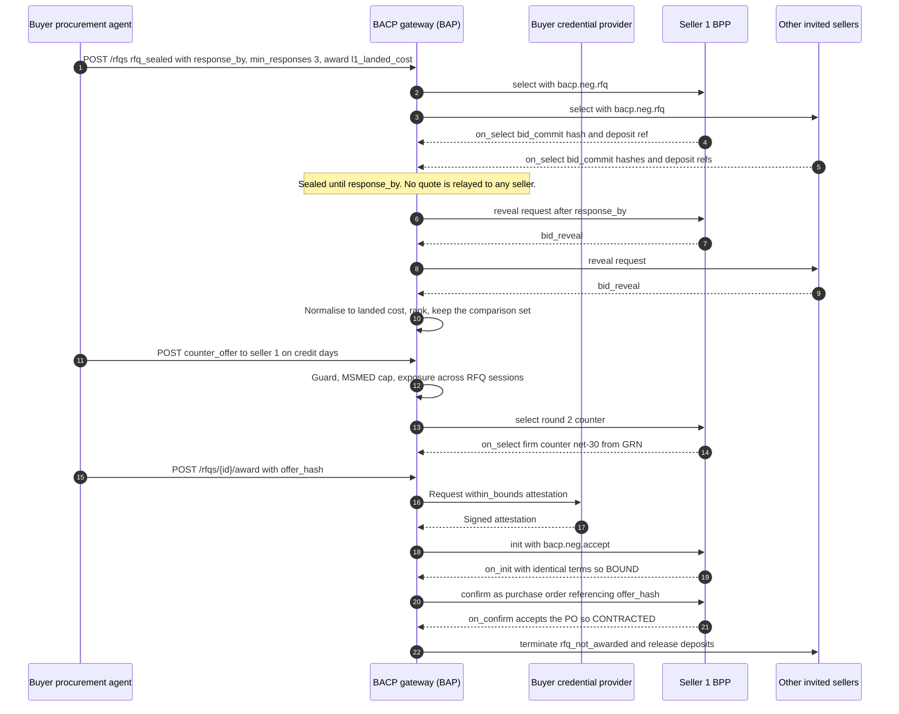

# RFQ and Auctions

!!! info "Version 2026-10-17"
    This page is part of BACP version `2026-10-17`. Rules marked **Proposed** depend on an open question and may change in a later dated release. This page extends the [negotiation module](index.md). Everything there (term sheets, signed messages, the guard, exposure, drift detection, contract timing) applies to RFQs and auctions too.

Two families of multi-party negotiation are covered here:

- **RFQs**: a buyer asks N sellers for structured quotations and awards one, then issues a purchase order. This is how B2B procurement, IndiaMART-style leads and GeM e-bids work.
- **Auctions**: bidders compete on a published price clock run by a neutral auctioneer. This covers GeM-style reverse auctions, mandi and eNAM forward auctions, Dutch clearance of perishables and sealed-bid tenders.

Both rest on two rules: **the rules are signed and published before the first response**, and **no participant sees another's quote or bid before the rules allow it**.

## RFQ

An RFQ is a signed `Rfq` object (`negotiation-session.json#/$defs/Rfq`). It replaces ONDC's free-text `BUYER_TERMS` with a structured draft term sheet. Each invited seller gets its **own bilateral negotiation session** under the parent `rfq_id`, so every message, guard check and transcript of the [negotiation module](index.md) applies per seller.

| Field | Rule |
|---|---|
| `rfq_id` | Parent identifier. Every child negotiation carries it as `rfq_parent_id`, which drives [exposure counting](index.md#per-principal-exposure). |
| `mode` | `rfq_sealed` or `rfq_iterated` |
| `term_sheet_draft` | The structured requirement (lines, quantity, delivery, payment terms, quality, deposit) |
| `issues_negotiable[]` | JSON Pointers sellers may quote on. A counter-offer on any other issue is refused with `NEG_ISSUE_NOT_NEGOTIABLE`. |
| `invitees[]` / `broadcast` | Named sellers, or a category and city broadcast. Suspended sellers MUST be excluded. |
| `response_by` | **REQUIRED.** The time after which quotations are compared |
| `min_responses` | **REQUIRED.** The minimum number of valid quotations before an award (for example 3 for an L1 purchase) |
| `award_rule` | `l1_landed_cost`, `qcbs` or `best_score`, with `scoring_rule_ref` where needed |
| `state` | `DRAFT → PUBLISHED → COLLECTING → CLOSED → REVEALED → SHORTLISTED → AWARDED`, or `CANCELLED` |
| `comparison[]` | Every valid quotation normalised to **landed cost**, with rank. Kept for audit. |
| `awarded` | The winning negotiation, offer hash and reason |

A request without `response_by` or `min_responses` MUST be refused with 400 `invalid_request`. If the buyer's negotiation mandate sets `process.rfq_min_window`, a `response_by` closer than that window is refused with `mandate_scope_mismatch`.

```json title="rfq.sealed.json"
--8<-- "source/examples/rfq.sealed.json"
```

### Sealed RFQ

In `rfq_sealed`, quotations are sealed with **commit–reveal**:

1. Before `response_by`, each seller sends `bid_commit` with `commit_hash = sha-256(JCS(bid) ‖ salt)` and a `bid_deposit_ref`.
2. Neither the gateway nor any other seller sees a quotation before `response_by`. While collecting, `GET /rfqs/{id}` MUST expose only the **number** of commitments and MUST omit `comparison`.
3. After `response_by`, the gateway requests reveals. Each seller sends `bid_reveal` with the bid and salt, and the gateway checks that the hash matches the commitment. A reveal before close is refused with `NEG_EARLY_REVEAL`.
4. A seller that **never reveals forfeits** its bid and its deposit (`bid_not_revealed`).
5. The gateway normalises every revealed quotation to landed cost (freight, payment terms, taxes) and ranks them.

A sealed RFQ MUST carry a deposit in its draft term sheet. A sealed RFQ without one is refused with `NEG_DEPOSIT_REQUIRED`. See [Deposits and EMD](#deposits-and-emd).

### Iterated RFQ

In `rfq_iterated`, the sealed round is followed by alternating rounds with a **shortlist** ("best and final"). Each shortlisted seller's session continues as a bilateral `alternating` negotiation under the same `rfq_id`. Firm counter-offers to several shortlisted sellers count together against the buyer's exposure, so the guard escalates once their sum would exceed the mandate.

### Award

- **No early award.** The buyer MUST NOT award before `response_by` unless every invitee has responded. An early award is refused with `NEG_EARLY_AWARD`. This counters the first-proposal bias of LLM negotiators.
- **Minimum responses.** An award with fewer valid quotations than `min_responses` is refused with `NEG_AWARD_RULE`.
- **Award rule.** Under `l1_landed_cost`, the award MUST go to the L1 landed-cost quotation. Any other choice is refused with `NEG_AWARD_RULE`.
- **Award is acceptance.** An award is an `accept` of the winning quotation's `offer_hash`, signed under the tag `bacp-negotiate`, guarded like any acceptance and carrying the `within_bounds` attestation. The quotation's [`acceptance_revocation`](index.md#acceptance-revocation) term applies to the award as to any acceptance; BACP fixes no value for RFQ modes.
- **Frozen comparison set.** The award rule is evaluated over the comparison set frozen when the RFQ closes; under `rfq_iterated` that is the close of the final shortlist round. Nothing that arrives later joins it, and it does not change when an award is revoked.
- **Revoked award.** An award can be revoked only under the [sunset text](index.md#acceptance-revocation-sunset) for `allowed_until_receipt`; in this version every `accept_revoke` of an award is refused (`accept_revoke_not_allowed`). If an award is revoked (`accept_revoke_honoured`), the RFQ moves to `CANCELLED` and is flagged `NEG_COLLUSION_SCREEN` for review. It is not awarded again: any later award on it is refused with `NEG_AWARD_RULE`. A buyer that still wants the goods publishes a new RFQ.
- **Buyer-prescribed `waived`.** A buyer that wants its awards to be final MAY require in its own RFQ that quotations carry `acceptance_revocation: waived` with a `waiver_basis` naming that RFQ (`doc_type: rfq`, the RFQ's id and the hash of the published RFQ). The buyer then gives up its own right to revoke the award, on terms it set itself. The profile rules of [Acceptance revocation](index.md#acceptance-revocation) still apply.
- **Losers.** Every other child negotiation receives `terminate` with reason `rfq_not_awarded`, and its deposit is released.
- **Audit trail.** The comparison set is kept with the award (for example, offers from at least three different manufacturers for an L1 purchase), together with who awarded it, under which mandate and why.

### Purchase order

After award, the RFQ follows the ONDC B2B (RET 2.0.2) sequence, as bound in [Beckn / ONDC Binding](../transports/beckn.md):

| Step | BACP | Beckn / ONDC carrier |
|---|---|---|
| RFQ | `Rfq` | `select` with a `bacp.neg.rfq` tag group; one `select` per seller under one `rfq_id` |
| Quotation | Firm offer (or `bid_commit` / `bid_reveal`) | `on_select`; `quote.price` MUST equal `all_in_total`; a proforma on `on_status` |
| Negotiation rounds | Counter-offers | Repeated `select` / `on_select` in the same `transaction_id` |
| Acceptance | `accept` | `init` carrying `bacp.neg.accept` |
| Bound terms | BPP-signed quote echoing the term sheet | `on_init` |
| **Purchase order** | PO referencing `offer_hash` | `confirm` with `BAP_TERMS.ACCEPT_BPP_TERMS` |
| PO acceptance | Order acknowledgement | `on_confirm` → `CONTRACTED` |

The PO MUST NOT alter accepted terms. Any drift between the accepted term sheet and `on_init`, `confirm` or `on_confirm` is handled by [drift detection](index.md#drift-detection). For credit sales, the contract opens a credit-ledger entry instead of a checkout session, and the GRN, invoice and payment follow [Credit and Split Tender](../payments/credit-and-split-tender.md). A typical B2B order is net-30 from GRN with an early-payment discount, and an MSE seller's credit is capped as described in [Credit terms and MSMED limits](index.md#credit-terms-and-msmed-limits).



## Auctions

Every auction starts with an **AuctionSpec** (`negotiation-session.json#/$defs/AuctionSpec`):

| Field | Meaning |
|---|---|
| `type` | `english`, `reverse_l1`, `dutch` or `sealed_first_price` |
| `auctioneer`, `auctioneer_neutrality` | Who runs the clock. `affiliated_with_any_seller` MUST be `false`. `operator_type` ∈ `network_auction_service`, `government_platform`, `exchange`, `regulated_market`. `clock_source` names the authoritative clock. |
| `lots[]` | Lot, item, quantity, unit, optional assay document and MRP |
| `reserve_price`, `reserve_disclosed`, `start_price`, `increment`, `decrement_schedule[]` | Price rules |
| `opens_at`, `closes_at`, `extension_rule{window, extend_by, max_extensions}` | Clock and anti-sniping |
| `visibility` | `sealed`, `price_only` or `open` |
| `tie_break` | `earliest_bid`, `lottery`, `msme_preference`, `make_in_india_preference` |
| `bid_deposit{amount, instrument, forfeit_on[]}` | Required for sealed auctions |
| `retraction_rule` | `no_retraction`, `before_close_outside_window`, `obvious_error_only` |
| `eligibility` | Bidder allow-list, technically qualified only, licence required; `exclude_suspended` is the constant `true` |
| `award_rule` | `highest_price`, `l1`, `first_accept`, `qcbs` |
| `fixed_terms`, `scoring_rule_ref` | Non-price issues fixed for every bidder, or scored by a published rule |
| `procurement_mode_reason` | Why this mode was chosen, for example the value threshold |

**Publication.** The creator submits an AuctionSpec draft. Any signature on the draft is the requester's own and is not relied on. The neutral auctioneer MUST sign the **published** spec and freeze its `spec_hash`, which is authoritative. The rules MUST NOT change after the first bid. The auctioneer's CounterSignature timestamps fix bid order and close.

Bidders see an `AuctionState` view: `spec_hash`, state (`SCHEDULED`, `OPEN`, `EXTENDED`, `CLOSED`, `REVEALED`, `AWARDED`, `NO_AWARD`, `CANCELLED`), the current price where visibility allows, the caller's own rank, a bid count and `closes_at`. It never shows other bidders' identities or sealed bids. A bid outside `OPEN` or `EXTENDED` is refused with `auction_not_open`.

**Anti-sniping is mandatory.** A bid received within `extension_rule.window` before `closes_at` extends the close by `extend_by`, up to `max_extensions`.

A price-only lot auction carries each bid as a single line of quantity 1 with unit `set`, priced at the lot total, with the lot quantity in the line name, so that lot totals never have to be split into fractional paise per unit.

```json title="auction.reverse-l1.json"
--8<-- "source/examples/auction.reverse-l1.json"
```

### Reverse L1 (GeM-style)

The reverse auction follows GeM practice: after technical evaluation, qualified sellers revise prices downward in a faceless online L1 negotiation.

- Visibility is `price_only`: bidders see the current L1 **price** and their own rank, never who bid it.
- A bid MUST be at or below `start_price` and MUST improve on the bidder's **own** previous bid by at least `increment`. It need not beat the current L1. A bid that does not improve is refused with 409 `bid_not_improving`.
- The default retraction rule is `no_retraction`.
- At close by the auctioneer's clock, the award goes to the L1 bid. Award is an `accept` of the winning bid's hash, with the buyer's `within_bounds` attestation.
- A seller-side guard checks each bid against the seller mandate's floor (`total_min`, or `auction_max_bid` read as a floor for sellers).
- GeM separates the ordering entity, the consignee and the paying authority, and the term sheet names all three. Payment terms on GeM are fixed and not negotiable (see [GeM profile](../trade-profiles.md#gem)).

**Procurement-mode thresholds.** A buying organisation configures its own value thresholds for direct purchase, L1 purchase and bid or reverse auction, and every RFQ or auction records `procurement_mode_reason`. Under GFR Rule 149 as amended by DoE OM F.1/3/2024-PPD (10-07-2024), the default thresholds are:

| Value | Mode |
|---|---|
| Up to ₹50,000 | Direct purchase from any GeM seller meeting quality, specification and delivery period |
| Above ₹50,000, up to ₹10 lakh | L1 purchase from the GeM seller with the lowest price among the sellers of at least three different manufacturers. The online bidding and reverse auction tools may also be used. |
| Above ₹10 lakh | Bids are mandatory, obtained through online bidding (e-bid) or the reverse auction tool. GeM gives a normal bid duration of 10 to 45 days. |

The values are from GFR 2017 Rule 149 as consolidated by the Department of Expenditure. Direct purchase has no ceiling for automobiles. Scientific ministries and research institutes have a ₹1 lakh direct-purchase limit (DoE OM F.20/42/2021-PPD, 18-07-2024). Rule 149 forbids splitting a demand to avoid L1 buying, bidding or reverse auction. The values MUST be configurable, not hard-coded.

### English (forward) auctions

Used for mandi and eNAM lots, FPO sales and disposal auctions.

- A bid MUST beat the current highest by at least `increment`, otherwise `bid_not_improving`.
- For packaged goods that must bear MRP, bids are capped at MRP (`NEG_MRP_EXCEEDED`).
- The default retraction rule is `before_close_outside_window`.
- **The seller's explicit acceptance is required.** For a farmer's or FPO's lot, the highest bid at close is not a sale until the seller accepts it. Only the seller (the auction creator) may award a forward auction. A rejected highest bid allows the same lot to be re-auctioned.
- The farmer's payout is the accepted bid times the weighed quantity, minus itemised charges (commission, market fee, loading), each tagged with the party that bears it (see [agri profile](../trade-profiles.md#enam-and-mandi)).

### Dutch auctions (perishables)

Used for perishables and end-of-day clearance.

- The `decrement_schedule[]` is published in the spec, and its ticks MUST be non-increasing. A spec or runtime tick that rises is refused with `NEG_DUTCH_PRICE_INCREASE`.
- A bidder accepts the **current tick** by sending an acceptance at that tick's price. An acceptance at any other price is refused with `NEG_STALE_OFFER`.
- **The first conforming acceptance in the auctioneer's receipt order wins, and the award is final.** It is never replaced.
- `tie_break` is the constant `earliest_bid`. Acceptances are ordered by the auctioneer's CounterSignature `received_at`, then by earlier `dispatched_at`, then by the lowest `msg_hash`.
- Later acceptances for the awarded tick MUST still be recorded and ordered by that rule. Each receives `auction_closed_no_award`.

### Sealed-bid auctions

A `sealed_first_price` auction, or any auction with `visibility: sealed`, uses the same commit–reveal as a [sealed RFQ](#sealed-rfq):

- `bid_commit` with `commit_hash` and `bid_deposit_ref` before close; `bid_reveal` after close. A reveal before close is `NEG_EARLY_REVEAL`.
- An unrevealed bid is excluded and its deposit forfeited.
- It is negotiated under mode `rfq_sealed`, so the bidder's mandate MUST allow `rfq_sealed`.
- A sealed auction without `bid_deposit` is refused with `NEG_DEPOSIT_REQUIRED`:

??? failure "Invalid: sealed auction with no deposit (`auction.sealed-no-deposit.invalid.json`)"
    ```json
    --8<-- "source/examples/auction.sealed-no-deposit.invalid.json"
    ```

## Deposits and EMD

Sealed RFQs and sealed auctions MUST require a bid deposit. The instrument (`bid_deposit.instrument`) is one of `emd` (earnest money deposit), `ebg` (electronic bank guarantee), `upi_otm_block` (a UPI one-time-mandate block) or `pa_escrow` (payment-aggregator escrow).

- A `bid_deposit_ref` counts only if the **holder** of the deposit confirms a live deposit, held for **that** bidder, of at least the published minimum. Otherwise the commitment is refused with 403 `NEG_DEPOSIT_INVALID` (reasons: not found, not held for this bidder, below minimum). A reference string alone proves nothing.
- A bidder that does not reveal forfeits its deposit. Losing bidders' deposits are released at award, when they receive `terminate` with `rfq_not_awarded` or `auction_closed_no_award`.
- A deposit is a `deposit` issue in the term sheet with `type: emd`, `refundable`, `deduction_policy` and `held_by` (`pa_escrow`, `bank_guarantee`, `gem_pool_account`, …). Collecting a deposit on behalf of others requires an authorised payment aggregator's escrow.

## Who may run and award

- **Neutral auctioneer.** The auctioneer is a network auction service, a government platform, an exchange or a regulated market. It MUST NOT be the seller's BPP or anyone affiliated with a seller, because of the conflict of interest and the shill risk. A spec with `affiliated_with_any_seller` not equal to `false` is refused: **seller-run auctions are refused**. Gateways join only the network-designated neutral auctioneer. Who operates that auctioneer on ONDC is open ([Q-25](../open-questions.md#q-25)).

??? failure "Invalid: seller-run auction (`auction.seller-run.invalid.json`)"
    ```json
    --8<-- "source/examples/auction.seller-run.invalid.json"
    ```

- **Award authority.** Only the auction's **creator** or the neutral **auctioneer** itself may award. Any other caller gets `NEG_AWARD_RULE`. An award MUST be signed under the tag `bacp-negotiate`.
- **Award timing and rule.** Except in Dutch auctions, an award is possible only after close by the auctioneer's clock (`NEG_EARLY_AWARD` otherwise), and only to the bid that the `award_rule` selects at close (`NEG_AWARD_RULE` otherwise).
- **Forward auctions.** Only the seller's explicit acceptance awards a forward auction.
- **Revoked award.** The award rule is evaluated over the bids standing at close, frozen then. In every auction type, if an award is revoked (`accept_revoke_honoured`, possible only under the [sunset text](index.md#acceptance-revocation-sunset)), the auction moves to `CANCELLED` and is flagged `NEG_COLLUSION_SCREEN` for review. It is not awarded again: an award to the next bid, or any later award on it, is refused with `NEG_AWARD_RULE`. A lot that is still for sale goes to a new auction.
- Seller-paced messages (ticks, a seller counter-offer after silence) travel as unsolicited `on_select` within the transaction, with buyer polling as a fallback. Whether ONDC validators accept this is open ([Q-26](../open-questions.md#q-26)).

## Retraction

The `retraction_rule` decides whether a bidder may retract a bid with `bid_retract`:

| Rule | Retraction allowed | Default for |
|---|---|---|
| `no_retraction` | Never | `reverse_l1`, sealed |
| `before_close_outside_window` | Before close and outside the anti-sniping window | `english` |
| `obvious_error_only` | Only with reason `obvious_error`, before close and outside the window | — |

Under every rule, a retraction inside the anti-sniping window, or after close, is refused with `NEG_RETRACTION_REFUSED`.

**Not an acceptance revocation.** `accept_revoke` never governs `bid_retract`. A bid's retraction follows the `retraction_rule` above whatever the bid's `acceptance_revocation` value, and an `accept_revoke` cannot retract a bid.

**Retraction isolation.** A retraction voids **only the retracting bidder's own bid**. Other bidders' bids stand. The previous best bid is not re-published as the standing price: the standing price stays hidden until the next bid. Repeated retractions by one bidder are flagged to the shill and collusion screens.

!!! warning "Proposed"
    Proposed: the Sale of Goods Act, 1930, s.64(2) says that an auction sale "is complete when the auctioneer announces its completion by the fall of the hammer or in other customary manner; and, until such announcement is made, any bidder may retract his bid". BACP does not treat this right as overriding `no_retraction` in e-auctions. Whether it applies is open ([Q-35](../open-questions.md#q-35)). The quoted text is from a bare-act reproduction and was not checked against the official India Code text as of 17-10-2026.

    Section 64 also bears on shill bidding: unless the sale is notified as subject to the seller's right to bid, the seller may not bid or employ anyone to bid (s.64(4)), and a sale in which the seller uses "pretended bidding to raise the price" is voidable by the buyer (s.64(6)).

## Shill and affiliate detection

A bid by the seller, or by anyone acting for the seller, inflates the price. The auctioneer judges bidder independence by three identities, not by the network participant alone:

1. the **principal** behind the bidder's negotiation mandate;
2. the **agent operator**, the registry subscriber operating the agent (the `did:web` host of its agent id);
3. the **key fingerprint** of the agent's signing key.

| Situation | Result |
|---|---|
| The bidder is the auction creator (the seller), a declared affiliate of the seller, or shares the seller's principal, operator or key | Refused with `NEG_SHILL_BID` |
| Two different bidders share a signing key | Flagged (`NEG_SHILL_BID`, screen) |
| Two different bidders share an agent operator | Flagged |
| Two bidders reach the network through the same BAP | **Not** a shill signal. A shared network BAP is normal. |
| One bidder retracts repeatedly | Flagged |

## Collusion screens

Under the Competition Act, 2002, s.3(3)(d), an agreement between enterprises "engaged in identical or similar trade" that "directly or indirectly results in bid rigging or collusive bidding" is presumed to have an appreciable adverse effect on competition. The proviso added in 2023 extends that presumption to an enterprise not in that trade if it "participates or intends to participate in the furtherance of such agreement". BACP prevents collusion structurally and screens for it statistically:

- **No seller-to-seller channel.** The protocol offers no way for one seller to obtain another's live or sealed quote or bid. Gateways MUST NOT cache or relay `on_select` term sheets across BPPs. Bidder-to-bidder messaging is not supported.
- **Pricing-AI disclosure.** Participants declare any third-party pricing or negotiation AI (`pricing_ai_vendor`). A shared vendor is a hub-and-spoke risk signal under the Competition Act, 2002, s.3(3) and its 2023 proviso.
- **Screens.** The auctioneer and the network run screens that **flag and never block** (`NEG_COLLUSION_SCREEN`, `requires_buyer_review`):
    - identical prices from different bidders;
    - distinct bidders within **0.5%** of each other;
    - **bid rotation**: across 3 or more auctions with a recurring ring of bidders, the winners take turns.
- Flags go to the buyer and, through the network operator, to the competition regulator as appropriate. They are evidence for review, not a verdict.

## Error codes

| Code | HTTP | Resolution | When |
|---|---|---|---|
| `NEG_EARLY_AWARD` | 403 | unrecoverable for that action | Award before `response_by` or before close |
| `NEG_EARLY_REVEAL` | 403 | unrecoverable for that action | Reveal before close |
| `NEG_SHILL_BID` | 403 (or a screen flag) | unrecoverable for that action | Bid by the seller or a non-independent party |
| `NEG_DUTCH_PRICE_INCREASE` | 403 | unrecoverable for that action | A Dutch tick rises |
| `NEG_RETRACTION_REFUSED` | 403 | unrecoverable for that action | Retraction not allowed by the rule, inside the window or after close |
| `NEG_AWARD_RULE` | 403 | unrecoverable for that action | Award to the wrong bid, by the wrong party, with too few responses, or on an RFQ or auction cancelled after a revoked award |
| `NEG_DEPOSIT_REQUIRED` | 400 | recoverable | Sealed RFQ or auction without a deposit |
| `NEG_DEPOSIT_INVALID` | 403 | recoverable | Deposit not confirmed by its holder |
| `NEG_COLLUSION_SCREEN` | 200 msg (flag) | requires_buyer_review | Screen flag, including an RFQ or auction cancelled after a revoked award |
| `bid_not_improving` | 409 | recoverable | Bid does not improve by the increment |
| `auction_not_open` | 409 | recoverable | Bid outside `OPEN` / `EXTENDED` |
| `auction_closed_no_award` | `terminate` reason / 200 msg | unrecoverable | Losing bidder, or a later Dutch acceptance |
| `rfq_not_awarded` | `terminate` reason | unrecoverable | Losing RFQ seller |
| `bid_not_revealed` | 200 msg | unrecoverable | Commitment never revealed; deposit forfeited |

Bilateral negotiation codes are in [Negotiation](index.md#error-codes), and the full registry is in [Errors](../errors.md).
