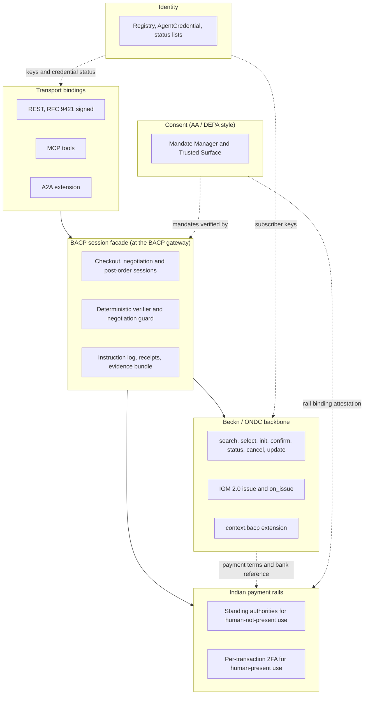
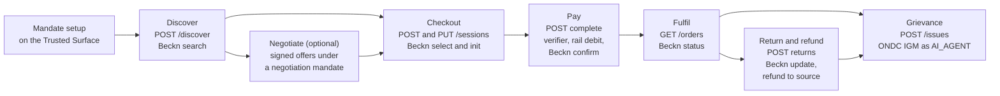

# Bharat Agentic Commerce Protocol (BACP) Specification

!!! info "Version 2026-10-17"
    This page is part of BACP version `2026-10-17`. Rules marked **Proposed** depend on an open question and may change in a later dated release. Each one links to the relevant entry in [Open Questions](../open-questions.md).

BACP is an open protocol that lets an AI agent run the full Indian commerce
lifecycle on behalf of a person or a business: discover, negotiate, check out,
pay, track fulfilment, return, get refunds and raise grievances. It does this
on rails that already exist and are already regulated: ONDC/Beckn for commerce,
UPI and the other Indian payment rails for money, Account Aggregator–style
consent artefacts for authority, and the Digital Personal Data Protection
(DPDP) Act for personal data.

This page is the normative entry point. It defines the conventions that apply
to every other page, the layering and actor model, the core artefacts, the
lifecycle, and the rules for versioning and extensibility.

## Conventions

### Requirements language

The key words **MUST**, **MUST NOT**, **REQUIRED**, **SHALL**, **SHALL NOT**,
**SHOULD**, **SHOULD NOT**, **RECOMMENDED**, **MAY** and **OPTIONAL** in this
specification are to be interpreted as described in
[RFC 2119](https://www.rfc-editor.org/rfc/rfc2119.html){ target="_blank" } and
[RFC 8174](https://www.rfc-editor.org/rfc/rfc8174.html){ target="_blank" }
when, and only when, they appear in all capitals, as shown here.

### Data conventions

| Convention | Rule |
|---|---|
| Amounts | Every amount is an `Amount` object: an integer `value` in **paise** (INR minor units) and `currency: "INR"`. ₹302 is `{"value": 30200, "currency": "INR"}`. Every settlement amount MUST be in INR. A foreign-currency figure MAY appear only as a disclosure view ([`fx.json`](https://bacp.dev/schemas/fx.json)). |
| Payable amounts | A payable amount (a closed mandate's `amount`, a payment receipt's `amount`, a tender's `amount`) MUST be an integer number of paise greater than zero. Values that may legitimately be zero, such as a remaining budget or a free-goods line, MAY be zero. |
| Date and time | Timestamps are [RFC 3339](https://www.rfc-editor.org/rfc/rfc3339.html){ target="_blank" } `date-time` strings, for example `2026-10-12T10:15:00+05:30`. Where a rule depends on a calendar period (a budget month, an AFA period), the period is computed in IST (UTC+05:30). |
| Durations | ISO 8601 durations, for example `P30D` or `PT5M`. |
| Signature timestamps | RFC 9421 `created` and `expires` parameters are integer seconds since the Unix epoch. |
| Canonical JSON | Signed and hashed JSON is canonicalised with JCS ([RFC 8785](https://www.rfc-editor.org/rfc/rfc8785.html){ target="_blank" }). |
| Hashes | Written as `alg:base64url`. `sha-256` is mandatory. `blake2b-512` is allowed only for Beckn digests. |
| Text shown to people | Multilingual maps keyed by BCP 47 tag, for example `{"hi-IN": "...", "en-IN": "..."}`. Hindi display text under `hi-IN` is written in Devanagari. Romanised Hindi (for example a voice transcript) is tagged `hi-Latn-IN`. |
| Schemas | JSON Schema draft 2020-12. Schemas are identified by their `$id` under `https://bacp.dev/schemas/`, and tools MUST resolve `$ref`s by `$id`, not by file path. |

## The problem BACP solves

India already has interoperable commerce (ONDC/Beckn), instant interoperable
payments with standing authorities (UPI Reserve Pay, UPI Circle, AutoPay),
a consent-artefact model (Account Aggregator and DEPA), and a data-protection
law (DPDP). None of them was designed for a software agent acting for a
person. Each lacks the same four things:

- **Who** the agent is. Today only the platform is identified on the network,
  never the agent or the legal entity that operates it.
- **Under whose authority, and within what limits.** Nothing expresses "buy
  groceries for me, up to ₹3,000 a month, never more than ₹1,500 an order, and
  ask me above ₹1,200".
- **Whether a human was present.** Payment and consumer rules differ sharply
  between a person approving a payment and an agent acting alone.
- **What the person agreed to share,** with whom, for what purpose.

BACP adds these four things as a thin, namespaced agent layer, together with a
hash-chained instruction log and rail-anchored receipts so that any dispute can
be reconstructed from the person's instruction to the bank reference number.
BACP does not fork ONDC/Beckn, UPI or any other rail.

## Design principles

1. **The model proposes, a deterministic engine decides.** An LLM interprets
   intent, searches, builds carts and drafts offers. It never verifies anything
   that matters. Every commitment (paying, accepting an offer, placing a bid,
   cancelling, returning) passes a deterministic, non-LLM check that fails
   closed. The agent is treated as untrusted: prompt injection cannot be
   prevented, so it is contained. See
   [the section below](#the-model-proposes-a-deterministic-engine-decides).
2. **The rail is authoritative.** Payment rails enforce their own limits. BACP
   limits MUST be at or below the rail's, and BACP re-checks them. BACP never
   relies on the rail to bound its own budgets.
3. **An agent is never an authentication factor.** The agent never sees or
   relays a UPI PIN, OTP or card credential, and never activates a mandate.
   Approval and authentication happen only on a non-agentic
   [Trusted Surface](../glossary.md#trusted-surface).
4. **Consent is explicit and never inferred.** Purchase consent and DPDP
   consent come from an affirmative action by the person, never from silence.
5. **Minimum disclosure.** The payment leg is basket-blind. The seller never
   sees the payment instrument or the buyer's negotiation bounds. The bank
   never sees the basket.
6. **Evidence by default.** Every step is signed and logged so that liability
   can be decided from evidence. BACP makes no claim about how the law
   allocates liability for agent error
   ([Q-01](../open-questions.md#q-01)).
7. **Bharat-first.** Multilingual text, voice and IVR channels, voice-consent
   evidence, GST lines and cash on delivery are first-class.

## Layering

BACP is an agent layer **over** Beckn/ONDC, not a replacement for it. Each
layer reuses an existing primitive.

Solid arrows are call paths. Dotted arrows are trust dependencies. Consent and
identity are cross-cutting: every call depends on them. The facade talks to the
payment rails through the payer PSP rather than through Beckn, because Beckn
carries only payment *terms*: money moves off-network.

| Layer | What BACP reuses | What BACP adds |
|---|---|---|
| **Transport bindings** | REST (OpenAPI 3.1), MCP tools with `structuredContent`, A2A `DataPart` and the `TASK_STATE_AUTH_REQUIRED` task state. One operation set, bound three ways, as UCP does. | RFC 9421 agent signatures with separate tags for browsing, paying, post-order writes and negotiation. Step-up mapped to A2A `TASK_STATE_AUTH_REQUIRED` and MCP `insufficient_scope`. See [REST](../transports/rest.md) and [MCP and A2A](../transports/mcp-a2a.md). |
| **Session facade** | UCP checkout verbs and statuses; ACP full-state responses, flat errors, `messages[].resolution` and idempotency; AP2's Trusted Surface and fail-closed constraint evaluation. | A synchronous session over asynchronous Beckn; the deterministic verifier; the instruction log; an in-doubt payment saga. See [Sessions and Checkout](../checkout/index.md). |
| **Beckn/ONDC backbone** | Beckn `{context, message}`, ACK plus `on_*` callbacks, Ed25519/BLAKE2b network signing, registry lookup, ONDC payment and settlement fields, IGM. | The [`context.bacp`](https://bacp.dev/schemas/beckn-context-bacp.json) extension, mandatory idempotency and a replay cache, and an IGM `actors[]` entry of type `AI_AGENT` (Proposed: [Q-11](../open-questions.md#q-11)). Agent semantics stay in a namespace that network participants can ignore. See [Beckn / ONDC Binding](../transports/beckn.md). |
| **Payment rails** | Live Indian rails: UPI Reserve Pay, UPI Circle, UPI AutoPay, card e-mandates, eNACH, PPIs, COD and others, with their own regulatory limits. | Payment authority bound to a **live** rail primitive with a PSP-signed attestation; a basket-blind payment leg; rail-anchored receipts. See [Payments](../payments/index.md). |
| **Consent** | AA/DEPA consent-artefact semantics: immutable, purpose-coded, use-counted, revocable. AP2-style open and closed mandates. | Periodic budgets, allow-lists, step-up thresholds, post-order action scopes, a separate negotiation mandate, revocation within 60 seconds, DPDP consent receipts. See [Mandates and Consent](../mandates.md). |
| **Identity** | ONDC registry onboarding and key lookup, W3C verifiable credentials and status lists, AP2 `cnf` key binding. | The [`AgentCredential`](https://bacp.dev/schemas/agent-credential.json): the agent, its operator's legal entity, its BAP binding, AI disclosure and human handoff. See [Identity and Request Signing](../identity-and-signing.md). |

### The layering decision

BACP makes four choices about how it sits on existing infrastructure:

1. **An agent layer over Beckn/ONDC.** Beckn already provides a signed
   asynchronous grammar, registry PKI, post-order writes (cancel, return),
   grievance handling (IGM), reconciliation and settlement (RSF), and a
   production network. BACP carries agent semantics in `context.bacp` and
   stays wire-compatible with UCP checkout verbs so that global agents can
   reuse their integration. BACP is neither a UCP profile only (UCP has no
   network discovery, post-order writes, Indian rails or DPDP) nor an ONDC
   domain specification only (that would lose global-agent interoperability
   and the AP2 mandate format).
2. **Mandates in AP2 style with AA/DEPA consent semantics.** A mandate has the
   structure of an AP2 open or closed Checkout Mandate or Payment Mandate, and the life
   of an Account Aggregator consent artefact: immutable once signed, tied to a
   purpose code, use-counted, and revocable at any time.
3. **Payment bound to live Indian rails.** An open (human-not-present) payment
   mandate MUST bind to a standing authority that a live rail already enforces,
   such as a UPI Reserve Pay block or a UPI Circle delegation. A closed
   (human-present) payment is authorised by a fresh per-transaction factor on
   the Trusted Surface. BACP does not wait for a future rail: as of 17-10-2026,
   NPCI has not published an agent-payment specification for UPI, so the handler
   `in.upi.uap` is reserved.
4. **RFC 9421 agent signatures.** Every agent request is signed with
   [RFC 9421](https://www.rfc-editor.org/rfc/rfc9421.html){ target="_blank" }
   HTTP Message Signatures under the key bound in the AgentCredential, with
   a tag that limits what the request may do. The network leg keeps the
   network's own signing.

## Actor model

| Actor | Role in BACP | Trust |
|---|---|---|
| **Principal** | The person or business on whose behalf the agent acts (the DPDP Data Principal and, for payments, the payer). Sets up, pauses and revokes mandates; answers step-ups; receives notices. | Trusted to authorise. Consent is always an explicit, affirmative action on the Trusted Surface, never inferred. |
| **Agent** | The LLM runtime (voice or text) that interprets intent, discovers, builds carts, negotiates and closes open mandates with its `cnf` key. | **Untrusted.** It never verifies anything that matters, never holds a PIN or OTP, never signs consent and is never an authentication factor. |
| **Agent operator** | The legal entity that runs the agent and holds its AgentCredential. Keeps the operator signing key out of the agent's reach, runs the instruction log, appoints a grievance officer, keeps an AI inventory, and provides AI disclosure and a human handoff. | Accountable and identified through registry onboarding. |
| **BACP gateway** | The BACP endpoint that agents call. It is co-located with, or runs on behalf of, a registered **Buyer App (BAP)**, so the BAP subscriber is the network-visible party. It verifies agent signatures and credentials, runs the deterministic mandate verifier and negotiation guard, translates calls into signed Beckn actions, holds the replay cache, idempotency store and reservation ledger, and is the interfacing network participant for IGM. | Trusted to enforce policy deterministically, but audited by conformance tests and evidence rather than trusted on its word. |
| **Seller / BPP** | The seller and its Seller App (BPP). Provides catalogue, signed quotes, fulfilment, cancel and return handling, GST invoices, and responds to IGM issues. A BACP-aware BPP verifies `context.bacp` and, in negotiation, the buyer's `within_bounds` attestation. | Honest but curious. Its content is **untrusted input** to the agent (dark patterns, prompt injection). |
| **Mandate Manager** | Turns an approval on the Trusted Surface into signed, immutable mandates and consent receipts. Keeps status, usage and revocation, publishes a status list and notifies counterparties within 60 seconds. Acts as, or for, a DPDP Consent Manager. | **Data-blind**: stores mandates and logs, never order or payment payloads. |
| **Trusted Surface** | The non-agentic surface, typically the payer's UPI app, where the principal reads notices in their language, approves mandates and step-ups, and enters a PIN or biometric. | Non-agentic by requirement. Trusted for consent capture and authentication. |
| **PSP / rail** | The payer PSP and the rail behind it (for UPI, NPCI and the issuer bank). Creates the standing authority (block, delegation, mandate), issues the `rail_binding` attestation, executes debits and refunds, and signs receipts with the rail reference (RRN, UTR or equivalent). | Authoritative for money movement and limits. Sees only payee, amount, mandate reference and checkout hash, never the basket. |
| **Registry** | The ONDC registry or another accredited registry. Publishes subscriber keys for BAPs, BPPs, Mandate Managers and PSPs; issues AgentCredentials and their status lists; records conformance attestations and payment-aggregator authorisation. | Root of trust for keys. Which body anchors agent identity is open ([Q-02](../open-questions.md#q-02)). |

Other parties appear in specific flows: the Beckn gateway (BG), which
multicasts `search` and is routing-only; grievance redressal officers and ODR
providers; payment aggregators; logistics providers; and, for trade profiles,
roles such as consignee, paying authority, broker, financier and a neutral
auctioneer (see [Trade Profiles](../trade-profiles.md)).

!!! note "Co-location"
    In BACP `2026-10-17` the Mandate Manager is operated by, or co-located with, the
    payer PSP that also provides the Trusted Surface, so that consent capture
    and PIN entry happen on one non-agentic surface. The roles stay logically
    separate so that an independent DPDP Consent Manager can take over. An
    MM that acts as a registered Consent Manager does not also act as
    credential provider; that role runs as a separate component
    ([Q-16](../open-questions.md#q-16)).

## Core artefacts

| Artefact | Purpose | Schema |
|---|---|---|
| **AgentCredential** | Identifies the agent, its operator and its BAP; binds the agent's signing key (`cnf`); lists the signature tags it may use; carries the AI disclosure and human-handoff link. An SD-JWT VC, `vct: in.bacp.agent.1`. | [`agent-credential.json`](https://bacp.dev/schemas/agent-credential.json) |
| **Mandate** | The principal's signed authority, AP2-compatible: open or closed, Checkout or Payment, with budgets, allow-lists, step-up thresholds, action and data scopes, and a rail or auth binding. | [`mandate.json`](https://bacp.dev/schemas/mandate.json) |
| **Negotiation mandate** | A separate mandate (`vct: in.bacp.mandate.negotiation.1`) holding negotiation bounds, including a reservation price that is never disclosed. | [`mandate-negotiation.json`](https://bacp.dev/schemas/mandate-negotiation.json) |
| **ConsentReceipt** | The DPDP record of what personal data goes to which recipient, for what purpose, in which language, with the withdrawal and grievance routes. One per recipient per mandate. | [`consent-receipt.json`](https://bacp.dev/schemas/consent-receipt.json) |
| **Receipt** | A PSP-signed payment or refund receipt anchored to the rail reference (RRN, UTR or other rail evidence). Budgets decrement only from these. | [`receipt.json`](https://bacp.dev/schemas/receipt.json) |
| **InstructionLog entry** | A signed, hash-chained record of prompt → intent → cart → mandate → payment reference, held by the operator. | [`instruction-log-entry.json`](https://bacp.dev/schemas/instruction-log-entry.json) |
| **`context.bacp`** | The extension carried in the Beckn/ONDC `context` of every BACP-originated network message. | [`beckn-context-bacp.json`](https://bacp.dev/schemas/beckn-context-bacp.json) |
| **TermSheet** | The multi-issue terms under negotiation: price, quantity, delivery, payment, returns, warranty and more. | [`termsheet.json`](https://bacp.dev/schemas/termsheet.json) |
| **Offer and negotiation messages** | Signed, expiring offers, counter-offers, bids, ACCEPT, REJECT, WITHDRAW and related messages. | [`offer.json`](https://bacp.dev/schemas/offer.json) |
| **NegotiationSession** | The state of a negotiation, RFQ or auction, and the negotiation capability advert. | [`negotiation-session.json`](https://bacp.dev/schemas/negotiation-session.json) |
| **Handler descriptor** | Data describing one Indian payment handler: binding class, presence rules, limits, AFA, refund route, settlement evidence. | [`handler-descriptor.json`](https://bacp.dev/schemas/handler-descriptor.json) |
| **PaymentPlan** | A split-tender or multi-tranche payment plan. | [`payment-plan.json`](https://bacp.dev/schemas/payment-plan.json) |
| **Credit ledger entry** | A hash-chained B2B credit (khata) posting. | [`credit-ledger-entry.json`](https://bacp.dev/schemas/credit-ledger-entry.json) |
| **LoanOffer** | A regulated credit offer with its key fact statement reference and cooling-off period. | [`loan-offer.json`](https://bacp.dev/schemas/loan-offer.json) |
| **FX view** | A disclosure view of a foreign-currency amount; settlement stays in INR. | [`fx.json`](https://bacp.dev/schemas/fx.json) |
| **Common types** | `Amount`, `Hash`, `Jws`, `Jwk`, `Signature`, `Presence`, `LangText`, `HandlerRef` and others. | [`common.json`](https://bacp.dev/schemas/common.json) |

The **evidence bundle**, which packages mandates, the BPP-signed quote,
receipts and the instruction-log chain for a dispute, is defined in the REST
binding (`EvidenceBundle` in the OpenAPI document listed under
[Reference](../reference.md)) and described in
[Evidence and Instruction Log](../evidence.md).

## Lifecycle

A BACP transaction moves through seven stages. Mandate setup happens once,
before the first stage, on the Trusted Surface. Negotiation is optional: a
fixed-price catalogue purchase goes straight from discovery to checkout.

| Stage | Agent call | Signature tag | Network or rail action | Defined in |
|---|---|---|---|---|
| Mandate setup | `POST /mandates` | `bacp-browse` | None on the network. The Mandate Manager and PSP create the mandate and the rail authority after the principal approves on the Trusted Surface. | [Mandates and Consent](../mandates.md) |
| Discover | `POST /discover` | `bacp-browse` | Beckn `search` → `on_search` through the Beckn gateway, with registry lookup | [Discovery and Profiles](../discovery.md) |
| Negotiate | `/negotiations`, `/negotiations/{id}/offers`, `/negotiations/{id}/accept`, `/rfqs`, `/auctions` | `bacp-browse` for non-binding messages; `bacp-negotiate` for firm offers, ACCEPT, auction creation, bids and awards | `select` / `on_select` rounds carrying negotiation tags | [Negotiation](../negotiation/index.md) |
| Checkout | `POST /sessions`, `PUT /sessions/{id}` | `bacp-browse` | `select` → `on_select` (quote), then `init` → `on_init` (signed quote, payment terms) | [Sessions and Checkout](../checkout/index.md) |
| Pay | `POST /sessions/{id}/complete` | `bacp-pay` | Basket-blind debit through the payer PSP, then `confirm` → `on_confirm` with the rail reference | [Payments](../payments/index.md) |
| Fulfil | `GET /orders/{id}` and webhooks | `bacp-browse` | `status` and unsolicited `on_status` (`track` is proposed) | [Orders and Post-order](../checkout/post-order.md) |
| Return and refund | `POST /orders/{id}/returns`, `POST /orders/{id}/cancel` | `bacp-post-order` | `update` (return) or `cancel`, then a refund to the original source | [Orders and Post-order](../checkout/post-order.md) |
| Grievance | `POST /issues`, `POST /issues/{id}/actions` | `bacp-post-order` | IGM 2.0 `issue` / `on_issue` with an `AI_AGENT` actor (Proposed) and an evidence bundle | [Evidence and Instruction Log](../evidence.md) |

Revocation can happen at any point. A revoked mandate stops new commitments
within 60 seconds. Protective actions on orders already placed under it
(cancel, return, grievance) remain allowed with the principal present
(`presence: HP`).

[Getting Started](../getting-started.md) walks through one complete
transaction.

## The model proposes, a deterministic engine decides

BACP separates proposing from deciding.

- The agent, and any LLM behind it, MAY propose anything: a search, a cart, a
  counter-offer, a return.
- A **deterministic, non-LLM engine** inside the gateway trust zone decides
  whether a proposal becomes a commitment. For checkout this is the mandate
  verifier, which runs authoritatively on every `complete` and as an advisory
  pre-check on every `PUT /sessions/{id}`. For negotiation it is the
  negotiation guard, which runs on every outgoing firm counter-offer, ACCEPT,
  bid and award, and on every incoming offer.
- The engine MUST fail closed: any failure, unknown constraint or
  unevaluable input rejects the commitment. The first failing check wins.
- The engine's outcome is limited to *pass*, *reject* or *escalate to the
  principal*. When the engine escalates, the decision moves to the principal on
  the Trusted Surface, never back to the LLM. In negotiation the LLM sees only
  the verdicts `acceptable`, `not_acceptable` or `needs_escalation`, never the
  principal's bounds.
- Free text from counterparties (product descriptions, seller chat) is
  untrusted input. It is returned to the agent only as data and can never widen
  a mandate.
- Budgets, usage counts and rail caps are evaluated against an atomic
  reservation ledger, so concurrent requests cannot together exceed a budget.

The detailed evaluation order is defined in
[Mandates and Consent](../mandates.md) and
[Negotiation](../negotiation/index.md).

## Protocol versioning

BACP versions are calendar dates in the form `YYYY-MM-DD`. A dated version is
a snapshot of the whole protocol: the specification pages, the JSON Schemas,
the OpenAPI document, the handler registry and the conformance manifest,
published together.

- The current dated release is `2026-10-17`. The working version on `main`
  is `draft`, which has no date and may change without notice.
- A gateway publishes the versions it supports in its
  [profile](../discovery.md#profile-document) (`bacp.version` and
  `bacp.supported_versions`). An agent MUST use a version that the gateway
  lists.
- Schema `$id`s under `https://bacp.dev/schemas/` resolve to the latest
  release. Pinned copies live under `https://bacp.dev/YYYY-MM-DD/schemas/`.

The release process, URL scheme and breaking-change policy are defined on the
[Versioning](https://bacp.dev/versioning/) page.

## Extensibility

BACP is designed to be extended without breaking existing participants, with
one deliberate exception: authority is never extended silently.

1. **Unknown fields are ignored.** A receiver MUST ignore fields it does not
   understand in requests, responses, webhooks and network messages, unless the
   schema for that object forbids additional properties. A network participant
   that does not speak BACP ignores `context.bacp`.
2. **Unknown mandate constraints fail closed.** A verifier that meets a
   constraint key it does not understand, in any mandate, MUST reject the
   mandate (`constraint_unknown`). An unknown constraint might be the very
   limit the principal relied on.
3. **New constraints go in new mandates.** Because existing AP2-compatible
   verifiers fail closed on unknown constraints, a new family of bounds is
   carried in a separate mandate type, as negotiation bounds are, rather than
   added to Checkout or Payment Mandates.
4. **Closed objects stay closed.** Objects whose schema forbids additional
   properties (for example the mandate `constraints` object, `context.bacp` and
   the term-sheet issue groups) MUST NOT carry extra fields. Extra negotiable
   issues go only under namespaced `extensions`, and the negotiation guard
   fails closed on any extension issue that is not agreed.
5. **Error codes are registered.** A new error code MUST be registered with its
   HTTP status and resolution before use. A client that meets an unregistered
   code MUST act on the HTTP status class and MUST NOT retry a 4xx with a new
   `Idempotency-Key`. See [Errors](../errors.md).
6. **Unknown handlers fail closed.** A payment handler reference that does not
   resolve in the [handler registry](../payments/handler-registry.md) MUST be
   treated as not eligible. Resolving a handler does not make it eligible:
   reserved and deprecated handlers MUST NOT back a payment.
7. **Namespaces.** Indian rails and instruments use `in.<family>.<variant>`
   handler ids. BACP-native constructs use `bacp.<construct>`. Capabilities use
   `in.bacp.*`.

## Page map

| Page | Contents |
|---|---|
| [Getting Started](../getting-started.md) | One end-to-end transaction, step by step |
| [Glossary](../glossary.md) | Definitions of every term |
| [Discovery and Profiles](../discovery.md) | `/.well-known/bacp`, capability and version negotiation, registry lookup |
| [Identity and Request Signing](../identity-and-signing.md) | AgentCredential, RFC 9421 signatures, replay protection, idempotency, key rotation |
| [Mandates and Consent](../mandates.md) | Mandate types, constraints, deterministic verification, consent receipts, revocation |
| [Sessions and Checkout](../checkout/index.md) | The checkout session, its state machine and the payment saga |
| [Orders and Post-order](../checkout/post-order.md) | Order reads, cancel, return, refund |
| [Negotiation Overview](../negotiation/index.md) | Negotiation modes, term sheets, offers, the guard |
| [RFQ and Auctions](../negotiation/rfq-and-auctions.md) | RFQs, sealed bids, reverse, English and Dutch auctions |
| [Payments Overview](../payments/index.md) | Payment binding, presence, step-up, receipts |
| [Handler Registry](../payments/handler-registry.md) | Payment handlers, binding classes, alias resolution, intersection |
| [Rail Bindings](../payments/rails.md) | UPI Reserve Pay, Circle, AutoPay and other rail rules |
| [Credit and Split Tender](../payments/credit-and-split-tender.md) | Split tender, credit ledgers, loans, COD |
| [Evidence and Instruction Log](../evidence.md) | Instruction log, receipts, evidence bundle, grievances |
| [Trade Profiles](../trade-profiles.md) | Roles and profiles for Indian trade models |
| [Errors](../errors.md) | Error model and code registry |
| [Security and Privacy](../security-and-privacy.md) | Threat model, controls, data minimisation |
| [Regulatory Mapping](../regulatory-mapping.md) | Regulatory requirements and how BACP meets them |
| [Conformance](../conformance.md) | Conformance levels and testing |
| [REST](../transports/rest.md) | REST binding |
| [Beckn / ONDC Binding](../transports/beckn.md) | Mapping onto Beckn and ONDC |
| [MCP and A2A](../transports/mcp-a2a.md) | MCP tool and A2A bindings |
| [Reference](../reference.md) | Schemas, OpenAPI and registry downloads |
| [Open Questions](../open-questions.md) | Questions pending an owner decision |
