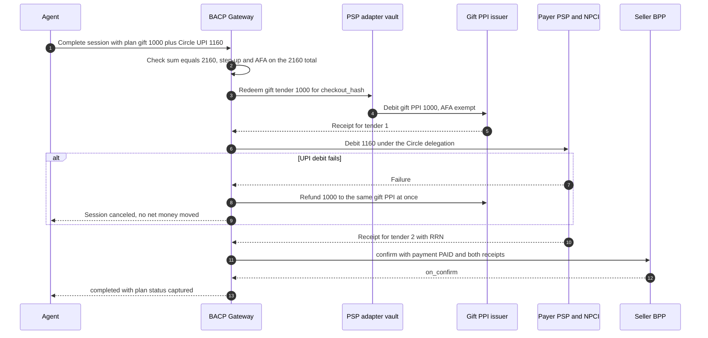

# Credit and Split Tender

!!! warning "Draft"
    This page is part of the `draft` BACP specification. Rules marked **Proposed** depend on an open question and can change.

This page covers the ways an order is paid other than one tender in full at checkout:

- [split tender](#split-tender-payment-plans): several tenders now, or tranches over time;
- [credit at checkout](#credit-at-checkout-bnpl-and-loan-offers): BNPL, cardless EMI, card EMI and point-of-purchase loans, with lender-signed loan offers;
- the [khata credit ledger](#the-khata-credit-ledger) for seller credit between known parties;
- [MSME late-payment interest](#msme-late-payment-interest), [trade credit, TReDS and GeM](#trade-credit-treds-and-gem);
- the [FX disclosure](#fx-disclosure-for-cross-border-payments) for cross-border payments.

The general payment model, handler classes and refund rules are in the [Payments Overview](index.md).

!!! warning "Proposed"
    Payment plans, credit ledgers and trade documents are defined in this draft as **service-level interfaces without a normative REST binding**. Their conformance is tested at library level. `CompleteRequest.payment_plan` is reserved. The REST, MCP and A2A bindings are open: [Q-44](../open-questions.md#q-44).

## Split tender: payment plans

A **payment plan** ([schema](https://bacp.dev/schemas/payment-plan.json)) says how one accepted all-in total is paid. There are two kinds of split:

- **Split in space (tenders):** for example a gift card for ₹1,000 plus UPI for ₹1,160 on a ₹2,160 order.
- **Split in time (tranches):** for example a booking token by UPI now, a loan disbursal by the lender later, and the balance at delivery. Each tender points to a TermSheet `payment.schedule[]` tranche through `tranche_id`.

| Field | Content |
|---|---|
| `plan_id` | `plan_` followed by 8 to 40 characters |
| `checkout_hash` | The hash of the BPP-signed quote. The same value for every tender. It is not the negotiation `offer_hash`, and nothing in BACP may assert that the two are equal. |
| `all_in_total` | The accepted all-in total, in paise |
| `tenders[]` | One to four tenders: `tender_id`, `handler`, `amount`, `sequence` (capture order), and optionally `tranche_id`, `presence`, `closed_payment_mandate_ref`, `auth_binding_type`, `rail_ref`, `funding`, `receipt_id`; `status` is `planned`, `held`, `captured`, `failed`, `released`, `refunded` or `partially_refunded` |
| `refund_allocation` | `lifo` (default), `pro_rata` or `tender_specific` |
| `atomicity` | `saga` |
| `afa_evaluated_on` | `plan_total` |

### Rules

1. **One checkout, many payment mandates.** A plan has one closed checkout mandate (one `checkout_hash`), and **one closed payment mandate and one receipt per tender**. Each tender is debited at most once.
2. **Positive amounts.** Every tender amount MUST be an integer number of paise greater than zero. A zero or negative tender MUST be refused with `amount_not_positive`, even when the sum matches.
3. **Exact sum.** The tender amounts MUST add up to `all_in_total` exactly. The gateway checks this and refuses a mismatch with `plan_sum_mismatch`. A plan has at most four tenders.
4. **Capture order and atomicity.** Capture runs as a saga. Stored-value tenders (gift PPI, store credit, loyalty, e-RUPI) go first, held where the issuer supports holds, then rail tenders. If a later tender fails, the earlier ones are released or refunded to source at once; a PPI refund is immediate. A plan whose `sequence` breaks this order gets `plan_order_invalid`.
5. **Thresholds on the total.** Step-up thresholds, the ₹15,000 AFA threshold, contactless and Tap & Pay exemptions, and split-order detection are evaluated on the **plan total**. A plan that keeps each tender under a threshold while the total is above it gets `requires_escalation` with reason `split_tender_afa_on_total`.
6. **Presence per tender.** Each tender's handler MUST be eligible at that tender's presence (see [handler classes](index.md#handler-classes)). For example a gift PPI may be captured HNP, but an HP card-token tender in the same plan needs a Trusted Surface approval, and that approval shows and covers the whole plan.
7. **Code custody.** The agent never sees gift-card or voucher codes. They are held in the Trusted Surface or the PSP-adapter vault, and the gateway's PSP adapter redeems them.

### Refunds of a split tender

- `lifo` (default): refunds reverse the capture order, each tender back to its own source under its handler's refund route, capped at what that tender captured.
- `tender_specific`: used when lines were bound to a tender, for example a purpose-bound e-RUPI item.
- A refund above a tender's capture gets `refund_exceeds_capture`.

Whether LIFO allocation satisfies the refund-to-source rule of PA Master Direction para 10(f) is open ([Q-40](../open-questions.md#q-40)).

### Token plus loan

A tranche plan for a high-value purchase (a vehicle, a property booking) combines a token, a loan and a balance:

- The token tranche is limited by RERA (a booking token of at most 10% without a registered agreement) and by the cash limit of Income-tax Act s.269ST (cash of ₹2,00,000 or more is refused, `NEG_CASH_LIMIT`).
- The loan tranche is an `in.credit.*` or `in.fin.ocen` tender with all the [credit-at-checkout](#credit-at-checkout-bnpl-and-loan-offers) duties: the KFS shown, HP acceptance, disbursal to the end beneficiary's account, and a cooling-off period of at least one day.

### Example

A gift card plus a UPI Circle tender. The agent is paying a weaver it has not paid before, so a Reserve Pay block (which belongs to one seller) cannot be used, and the UPI tender runs under a Circle delegation.

```json
{
  "plan_id": "plan_GIFTUPI0001",
  "checkout_hash": "sha-256:MdzPb6o2QprB1t01MqITDlt_3VlU_4O8efFu8026Jpo",
  "all_in_total": {"value": 216000, "currency": "INR"},
  "tenders": [
    {
      "tender_id": "tdr_gift001",
      "handler": "in.ppi.gift",
      "amount": {"value": 100000, "currency": "INR"},
      "sequence": 1,
      "presence": "HNP",
      "funding": "prepaid",
      "closed_payment_mandate_ref": "mdt_PAYGIFT0000001",
      "auth_binding_type": "parent_rail_binding",
      "status": "captured",
      "receipt_id": "rcpt_GIFT000000001"
    },
    {
      "tender_id": "tdr_upi001",
      "handler": "in.upi.circle",
      "amount": {"value": 116000, "currency": "INR"},
      "sequence": 2,
      "presence": "HNP",
      "funding": "debit",
      "closed_payment_mandate_ref": "mdt_PAYUPI00000001",
      "auth_binding_type": "parent_rail_binding",
      "rail_ref": "CIRCLE-DLG-40917",
      "status": "captured",
      "receipt_id": "rcpt_UPI0000000001"
    }
  ],
  "refund_allocation": "lifo",
  "atomicity": "saga",
  "afa_evaluated_on": "plan_total"
}
```



## Credit at checkout: BNPL and loan offers

Handlers: `in.credit.bnpl` (alias `in.bnpl`), `in.credit.cardless_emi`, `in.fin.ocen` (pilot), `in.fin.dealer_line`, and `in.card.emi`. All are class C, with `funding: loan` or `credit`, so `credit_disclosure_required` is `true`.

They are governed by the RBI **Digital Lending Directions 2025** (RBI/2025-26/36, DOR.STR.REC.19/21.07.001/2025-26, 8 May 2025), which apply to banks, co-operative banks, NBFCs and AIFIs and repeal the 2022 and 2023 digital-lending guidelines. The Key Fact Statement (KFS) follows DOR.STR.REC.13/13.03.00/2024-25 (15 April 2024). Credit-card EMI is governed instead by the Credit Card MD para 6(b)(iii) and is outside the Digital Lending Directions; debit-card EMI is inside them (para 29(i)). PPI-based BNPL is not permitted for non-banks.

### Loan offers

Credit offers are carried as an **offer list** ([schema](https://bacp.dev/schemas/loan-offer.json)):

| Field | Rule | Source |
|---|---|---|
| `requested_amount` | The amount the buyer needs financed | — |
| `offers[]` | **Every** matching offer | DL Directions para 6(iv), from 1 November 2025 |
| `unmatched_lenders[]` | Each lender that did not match, by name, with a reason | para 6(iv) |
| `ranking_metric` | A URI to a publicly pre-disclosed, neutral ranking rule (for example APR ascending). Ranking by such a metric is not treated as promotion; sponsored ranking is not allowed. | para 6(iv) |

Each `LoanOffer` MUST carry:

| Field | Content | Source |
|---|---|---|
| `offer_id`, `lender`, `lender_regulated_entity` | The lender and its RBI registration | para 6(iii) |
| `loan_amount`, `tenor_months`, `apr_pct`, `emi_amount`, `interest_amount`, `penal_charges` | The cost of credit; `processing_fee` is optional | para 6(iii), 8(i) |
| `kfs_ref` | A URI to the KFS, shown before acceptance | para 8(i) |
| `cooling_off_days` | At least 1 | para 10 |
| `repayment{payee, mandate_type}` | The payee is always the lender; `mandate_type` is `in.nach.debit`, `in.upi.autopay` or `manual` | para 9(ii), 9(iii) |
| `no_cost` | `true` only if the interest is genuinely nil | Credit Card MD para 6(b)(iii) |
| `preselected` | Always `false`: no offer is pre-selected | para 6(iv) |
| `rank` | Position under `ranking_metric` | para 6(iv) |

**Lender signature.** Each offer is signed by the lender. Because the offer schema is closed, the lender's signature is carried beside the offer, not inside it. The gateway MUST verify it, and MUST reject an offer whose APR, cooling-off period or repayment payee has been altered.

An example offer:

```json
{
  "offer_id": "lof_7Q2K91",
  "lender": "Example Finance Ltd",
  "lender_regulated_entity": "N-14.03512",
  "loan_amount": {"value": 3000000, "currency": "INR"},
  "tenor_months": 6,
  "apr_pct": 18.5,
  "emi_amount": {"value": 526400, "currency": "INR"},
  "interest_amount": {"value": 158400, "currency": "INR"},
  "processing_fee": {"value": 49900, "currency": "INR"},
  "penal_charges": "2% per month on the overdue EMI, as stated in the KFS",
  "kfs_ref": "https://lender.example.in/kfs/lof_7Q2K91",
  "cooling_off_days": 3,
  "repayment": {"payee": "Example Finance Ltd collection account", "mandate_type": "in.upi.autopay"},
  "no_cost": false,
  "preselected": false,
  "rank": 1
}
```

### Rules for credit at checkout

1. **Consent to credit.** A credit-funded handler MUST be refused with `credit_funding_not_allowed` unless the governing checkout or negotiation mandate sets `credit_funding_allowed: true`. The agent MUST tell the user that the payment is credit.
2. **Human acceptance.** Accepting a KFS or loan agreement MUST be a human act on the Trusted Surface: a step-up with `kind: confirm` and reason `credit_acceptance`, completed by e-sign or the lender's acceptance flow. An agent that tries to accept gets `credit_acceptance_requires_hp`. Explicit consent is also required by E-Commerce Rule 4(9).
3. **Full disclosure.** Before acceptance the user sees every field above, and every matched offer with the unmatched lenders named.
4. **Cooling-off.** During the cooling-off period (set by the lender's board, at least one day) the borrower MUST be able to exit without penalty by repaying the principal and the proportionate APR. A one-time processing fee may be kept if it was disclosed in the KFS (DL Directions para 10). The post-disbursal state carries the end of the cooling-off period and an exit action.
5. **Fund flow.** The DL Directions require disbursal to the borrower's bank account (para 9(i)). Their exceptions do not include a general merchant exception; the relevant one is disbursal "for specific end use, provided the loan is disbursed directly into the bank account of the end-beneficiary". A checkout loan that pays the seller MUST fit that exception: the lender documents the end use and pays the end beneficiary directly. Whether this holds when the merchant is the beneficiary is open ([Q-32](../open-questions.md#q-32)).
6. **Repayment to the lender only.** Repayments and refunds MUST go to the lender. No agent platform or lending service provider may pool them (para 9(ii), 9(iii)). A repayment or refund addressed to anyone else gets `repayment_payee_not_lender`. A merchant refund on a financed purchase goes to the lender and reduces the loan; the exact mechanics are not verified.
7. **No automatic limit increase** without the borrower's explicit request (para 7(ii)).
8. **Data.** Need-based, explicit, auditable consent; no access to contacts, call logs or media (para 12).
9. **Neutrality.** An agent that ranks or selects credit offers is acting as, or for, a lending service provider and inherits the para 6 neutrality duties.
10. **Card EMI.** Before converting a card purchase to EMI the agent shows principal, interest and any upfront discount, and never calls an interest-bearing EMI "no cost". A TermSheet that claims `no_cost` with non-zero interest is refused (`NEG_EMI_NO_COST_FALSE`).
11. **OCEN and dealer lines.** `in.fin.ocen` offers carry the lender, APR or all-in cost, tenure, repayment mandate type and KFS link, and acceptance is human-present. `in.fin.dealer_line` drawdowns run under a maker-checker approval and are repaid by NACH. No RBI direction specific to dealer finance was found.

Disputes go to the lender's grievance officer and, after 30 days, to the RBI Ombudsman (DL Directions para 11(iv)).

## The khata credit ledger

`bacp.credit_ledger` is a bilateral, hash-chained, signed ledger for credit between known parties: a kirana's khata, net-N trade credit, distributor credit, and GeM receivables. It is class O, so an HNP agent may book a sale on it within the agreed limit. **No money moves on a ledger entry.** Money moves on another handler, and the ledger records that handler's receipt.

Schemas: [`credit-ledger-entry.json`](https://bacp.dev/schemas/credit-ledger-entry.json), with `$defs/CreditLedger` for the ledger header.

### Opening a ledger

The `CreditLedger` header is signed by **both** parties at opening (at least two signatures). It records:

- `creditor` and `debtor`;
- `kind`: `khata`, `trade_credit`, `distributor_credit` or `gem_receivable`;
- `credit_limit` and `default_credit_days`;
- `interest_rule`: `none`, `msmed_statutory`, `contractual` or `gem_penal_1pct_pm`. The header selects exactly one rule;
- `ack_window`: how long the counterparty has to acknowledge an entry (ISO 8601 duration);
- `head_hash` and `opened_at`.

### Entries

Entry types are `opening_balance`, `sale`, `payment`, `credit_note`, `debit_note`, `scheme_credit`, `interest_msmed`, `interest_contractual`, `gem_penal_interest`, `adjustment`, `write_off` and `limit_change`. `effect` is `increase_receivable`, `decrease_receivable` or `none`, from the creditor's side.

- **Positive amounts.** Every value-bearing posting MUST have an amount greater than zero. Direction is carried by the entry type and `effect`, never by the sign.
- **Who posts.** Only the ledger's creditor or debtor may post. The poster signs the entry.
- **Hash chain.** Entries are chained by `prev_hash` and `entry_hash`. `entry_hash` and the entry signatures cover only the **immutable posting**. `status`, `acknowledgements` and `dispute_ref` are lifecycle fields kept outside the hash, so acknowledging an entry never rewrites history.
- **Lifecycle events are chained too.** Every status change (posted, acknowledged, disputed, settled) is recorded as its own hash-chained event. An entry's current `status` and `dispute_ref` MUST equal what its chained events say, and every acknowledgement MUST verify under the counterparty's registry key. A silent change, for example from `disputed` back to `acknowledged`, therefore breaks chain verification.
- A `sale` requires `due_date` and `credit_terms`. A `payment` or `credit_note` requires `settles[]`, the sale entries it closes. A `payment` requires `settlement_evidence`.
- Each entry carries `ledger_after`: balance, credit limit, overdue amount and ageing buckets (0–30, 31–45, 46–60, 61–90 and over 90 days). A balance confirmation can be exported from the ledger.

### Acknowledgement: the creditor cannot self-confirm

- An entry is acknowledged by the **counterparty of the poster**, never by the poster. When the seller books a sale, only the buyer can acknowledge it. An acknowledgement by anyone else gets `ack_not_by_counterparty`.
- The acknowledgement MUST be signed with the counterparty's key, whatever the channel: a signature, a Trusted Surface tap, an SMS link, a voice confirmation, or an assisted operator. Every channel ends in the counterparty's signature over the entry hash, and the channel is recorded as `method`.
- A `payment` entry is acknowledged automatically from the rail receipt it cites (`auto_from_rail_receipt`), because the PSP's signature is the evidence.
- An entry still unacknowledged when `ack_window` expires becomes **`disputed`**, with a `dispute_ref`. A disputed entry does not count toward the balance or ageing, cannot be acknowledged (`entry_disputed`), and can be settled or credit-noted only after the dispute is resolved.

Entry `status` values: `pending_ack`, `acknowledged`, `disputed`, `settled`, `partially_settled`, `overdue`, `written_off`.

### Booking and settling

- **Sale.** An HNP agent may book a `sale` only within `credit_limit − balance` **and** within the negotiation mandate's `payment.credit_ledger.max_outstanding`. Otherwise it gets `credit_limit_exceeded`. Whether credit-ledger deals also count against the checkout mandate's budgets is open ([Q-46](../open-questions.md#q-46)); the working position counts them against both.
- **Payment.** A `payment` entry MUST cite a PSP-signed receipt from another handler: `settlement_evidence.receipt_id` with its RRN or UTR. The gateway verifies the receipt signature against the PSP's registry key, and checks that the amount, result and RRN or UTR match. A screenshot or any other evidence MUST be refused, and the sale stays unpaid. A receipt settles ledger entries at most once.
- **Credit note.** An unpaid sale is reduced by a `credit_note` entry (`refund_state: credit_note_issued` where a refund is involved). A credit note cannot exceed the sale's open amount. A paid sale is refunded to the instrument that settled it.

An example `payment` entry, settling a sale by NEFT:

```json
--8<-- "source/examples/credit-ledger-entry.payment.json"
```

### Interlocked credit

Where a broker or commission agent (an arhtiya) advances money to a seller and deducts it at sale, the advance is recorded as a separate ledger with the broker as creditor. The deduction at sale MUST appear as a visible commission or deduction line, never netted silently.

### Regulatory status

Interest-free seller credit (khata, net-N) is treated as trade credit, not digital lending. Once a third-party lender funds it, the handler becomes `in.fin.*` or `in.credit.*` and the Digital Lending Directions apply. This position is open ([Q-27](../open-questions.md#q-27)).

## MSME late-payment interest

For a sale by a supplier registered (Udyam) as a micro or small enterprise in manufacturing or services, the Micro, Small and Medium Enterprises Development Act 2006 applies:

| Rule | Content | Source |
|---|---|---|
| Due date | The buyer pays by the agreed date, which may be no more than 45 days from acceptance or deemed acceptance. Without a written agreement, payment is due within 15 days. | MSMED Act s.15 |
| Interest | On late payment, compound interest with monthly rests at three times the RBI bank rate | MSMED Act s.16 |
| Tax | From AY 2024-25, a sum owed to a micro or small enterprise beyond the s.15 limit is deductible only when actually paid. Under the Income-tax Act 2025, in force from 1 April 2026, this is s.37(2)(g). | Income-tax Act 1961 s.43B(h); Ministry of Finance reply of 21 July 2026 *(secondary report)* |

The ledger implements this as follows:

- `msmed.statutory_due_date` = the earlier of the agreed date and acceptance + 45 days, or acceptance + 15 days when `written_agreement` is false. For micro and small suppliers the schema caps `credit_terms.credit_days` at 45. A firm offer of longer credit to such a supplier is refused (`NEG_MSMED_CREDIT_CAP`).
- **Acceptance date.** A buyer-signed GRN is required for an acceptance-dated sale. The acceptance date is the earlier of the GRN date and delivery + 15 days. The GRN date MUST NOT precede the invoice or delivery date or lie in the future, and it is never a free parameter of the creditor. The 15-day deemed-acceptance rule is not verified ([Q-21](../open-questions.md#q-21)).
- **Alerts.** BACP raises an alert 5 days before the statutory due date and flags the debtor's tax consequence (`msmed.tax_flag`).
- **Interest without double charging.**
    - Overdue statutory interest is posted as `interest_msmed` entries with `interest_basis: 3x_rbi_bank_rate_compound_monthly` and the `bank_rate_pct` used.
    - Each `interest_msmed` entry carries the cumulative `interest_accrued` for its sale and posts only the **increment** over interest already accrued for that sale. Re-running the accrual never charges the same interest twice.
    - The ledger header selects one `interest_rule`. A ledger MUST NOT accrue both statutory and contractual interest on the same overdue amount for the same period.
    - Interest stops accruing on the amount settled by a rail-evidenced payment.
- **Traders.** Whether Udyam-registered traders fall under s.15 is open ([Q-21](../open-questions.md#q-21)). For a trader, BACP raises a warning only and does not accrue statutory interest.

## Trade credit, TReDS and GeM

### TReDS

Handler: `in.fin.treds` (class N, non-paying). The Trade Receivables Discounting System is regulated by RBI under its TReDS guidelines; licensed platforms include RXIL, M1xchange, Invoicemart and C2treds.

1. The MSME seller uploads an invoice the buyer has accepted, creating a **factoring unit**.
2. Financiers bid, and the seller accepts a bid.
3. The financier funds the seller **without recourse** to the seller.
4. The buyer pays the financier on the due date, by a NACH debit.

Binding rules:

- Each factoring unit MUST be bound to the GST e-invoice IRN and the buyer's acceptance. An invoice whose IRN has already been financed MUST be refused.
- After discounting, the ledger's `settlement_evidence.new_payee` is the financier, and the buyer's due-date NACH debit pays the financier.
- Companies with turnover above ₹250 crore, and all CPSEs, had to onboard on TReDS by 31 March 2025 (MSME Ministry notification S.O. 4845(E), 7 November 2024; *secondary*). BACP records the buyer's TReDS onboarding status and SHOULD offer TReDS as a settlement option on MSME invoices for such buyers.
- Funding is same day (T0) for bids accepted before a cut-off, otherwise T+1, with the buyer's NACH debit on the due date *(vendor; the cut-off time is given inconsistently)*.
- Buyer-side and seller-side agents act only within the corporate's platform entitlements and with human signatory approval.

### GeM receivables

A `gem_receivable` ledger tracks a Government e-Marketplace order:

- The consignee issues the CRAC (Consignee Receipt and Acceptance Certificate) within 10 days of the PRC (Provisional Receipt Certificate); otherwise GeM auto-generates a CRAC for the full quantity.
- The buyer pays within **10 calendar days of the CRAC**.
- Late payment carries penal interest of **1% a month**, prorated on a 30-day month. This interest is **retained by GeM** and is not paid to the seller. BACP MUST disclose that, and records it as a `gem_penal_interest` entry with `effect: none`.
- For non-PFMS buyers the GeM Pool Account block reference is recorded at order time; an order without one is shown as unfunded.

Sources: Department of Expenditure OM of 3 July 2020 (procurements from 1 October 2020); GeM GTC clause 12. Individual buyers sometimes override these terms with 45, 60 or 90-day terms.

## FX disclosure for cross-border payments

All BACP settlement amounts are INR. For a cross-border payment, an **`fx` view** ([schema](https://bacp.dev/schemas/fx.json)) MAY appear on the TermSheet, the receipt and the disclosures, to show the foreign-currency amount, the rate and the markup:

| Field | Rule |
|---|---|
| `currency` | ISO 4217 code, never `INR` |
| `foreign_amount` | Integer minor units of `currency`, at least 1 |
| `rate` | INR per one unit of `currency`, greater than zero |
| `markup_bps` | Markup in basis points, zero or more |
| `inr_total` | An INR amount in paise: `round(foreign_amount × rate × (1 + markup_bps / 10000))` |
| `rate_source`, `quoted_at` | Optional |

The gateway MUST reject an `fx` view that is inconsistent with its `inr_total`. Every settlement amount remains INR.

```json
{
  "currency": "USD",
  "foreign_amount": 250000,
  "rate": 84,
  "markup_bps": 100,
  "inr_total": {"value": 21210000, "currency": "INR"},
  "rate_source": "acquirer",
  "quoted_at": "2026-10-13T11:30:00+05:30"
}
```

Related cross-border rules:

- **Card AFA.** A non-recurring, cross-border, card-not-present payment needs AFA when the overseas acquirer asks for it (RBI Authentication Directions 2025 para 10, from 1 October 2026). See [Cards](rails.md#rbi-authentication-directions-2025-for-cards).
- **Determining cross-border.** A payment that the merchant declares cross-border is treated as cross-border. A declaration that it is *not* cross-border cannot override merchant, acquirer or FX data that says it is.
- **PA cross-border** collections and payments are capped at ₹25,00,000 per transaction (RBI PA Master Direction 2025 para 11(d)).
- **Export realisation.** Under the FEM (Export and Import of Goods and Services) Regulations 2026, as amended by FEMA 23(R)/(1)/2026-RB of 22 September 2026 (effective 1 October 2026), export proceeds are realised within 9 months (goods from shipment, services from invoice), or 12 months for INR-invoiced exports. Proceeds unrealised more than a year past the due date restrict future exports to full advance or an irrevocable LC (Reg 13). `bacp.trade.export_realisation` tracks the due date, with an alert 30 days before it.
- Whether a cross-border transfer of personal data meets the DPDP Act's restrictions is not checked by the FX view.
