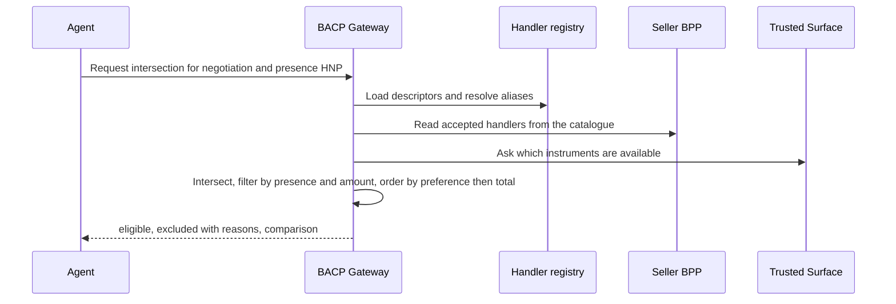

# Payments Overview

!!! warning "Draft"
    This page is part of the `draft` BACP specification. Rules marked **Proposed** depend on an open question and can change.

BACP does not move money itself. Money moves on Indian payment rails (UPI, cards, net banking, NACH, PPIs, BBPS, e-RUPI and others), operated by NPCI, the card networks, NBBL, banks and payment aggregators under RBI regulation. Beckn/ONDC carries only the payment *terms* of an order. The BACP gateway talks to the rail through the payer's PSP and records the result as a signed, rail-anchored receipt.

This page defines the payment model that every rail binding shares:

- [payment handlers](#handlers-instruments-and-tokens), their [classes](#handler-classes) and how [mandates bind to them](#binding-mandates-to-handlers);
- the [handler intersection](#handler-intersection-and-preference) between buyer and seller;
- [receipts](#receipts), [refunds](#refunds) and [failed-payment handling](#failed-payments-tat-and-auto-reversal);
- the reserved [NPCI UAP slot](#npci-uap-the-reserved-slot) and [handler naming](#handler-ids-and-legacy-aliases).

The other payment pages cover the details:

| Page | Content |
|---|---|
| [Handler Registry](handler-registry.md) | The descriptor format, governance, alias resolution and the full table of 57 handlers |
| [Rail Bindings](rails.md) | One subsection per rail family, with every limit and the regulation it comes from |
| [Credit and Split Tender](credit-and-split-tender.md) | Payment plans, BNPL and loan offers, the khata credit ledger, MSME interest, TReDS and FX disclosure |

Mandates themselves are defined in [Mandates and Consent](../mandates.md), and the checkout session that drives a payment in [Sessions and Checkout](../checkout/index.md).

## Handlers, instruments and tokens

A **payment handler** is one way of paying that a rail or instrument offers, such as `in.upi.autopay` (UPI AutoPay) or `in.card.mandate` (a card e-mandate). Each handler has a descriptor in the [handler registry](handler-registry.md) that states, as data:

- who operates and regulates it;
- whether a human must be present for each payment, or a standing authority may be used;
- the limits, the AFA (additional factor of authentication) model and the pre-debit-notice rule;
- where refunds go, how disputes are raised and what settlement evidence the rail returns;
- which fields may cross the payment leg, and which must never be collected.

An **instrument** is the payer's account, card, wallet, voucher or credit line that a handler debits. An **opaque token** is the reference by which BACP names an instrument or a standing authority without holding the credential behind it: a UPI Circle delegation id, an SBMD block id, a UMN, a UMRN, a card-on-file token reference, or a voucher reference held in a vault.

**Credential rules.** These apply to every participant, and to the agent in particular.

- An agent, a BACP gateway and a buyer app MUST NOT collect, store, log or relay a UPI PIN, an OTP, a card PAN, CVV or expiry date, net-banking credentials, an Aadhaar number or biometric data. Every handler descriptor lists these under `data_minimisation.never_collect`.
- An agent is never an authentication factor. A PIN, OTP, passkey, biometric or 3-D Secure step is completed by the human on their own device or on the payer PSP's Trusted Surface.
- For cards, only the issuer and the card network may store card-on-file data (RBI CoFT circular RBI/2021-22/96). Other parties MAY retain only the last four digits and the issuer name.
- Gift-card and voucher codes are held in the Trusted Surface or a PSP-adapter vault. The agent never sees them, and the gateway's PSP adapter redeems them.
- Net banking is implemented only as a redirect to the bank's own page.

**Basket-blind payment leg.** The request that reaches the payer PSP and the rail carries only `{payee, amount, mandate_ref, checkout_hash}`. Line items, product names and other basket data MUST NOT be sent on the payment leg.

## Handler classes

Every descriptor carries `binding.class`. The class decides whether a handler may run with no human present (HNP) under a standing authority, or needs a human present (HP) for each payment.

| Class | Meaning | Presence | Examples |
|---|---|---|---|
| **O** (open-eligible) | A standing authority whose limits the rail, the issuer or both parties enforce. It MAY back an open (HNP) payment mandate. | HP or HNP | `in.upi.reservepay`, `in.upi.circle`, `in.upi.autopay`, `in.upi.otm`, `in.card.mandate`, `in.nach.debit`, `in.ppi.gift`, `in.erupi`, `bacp.credit_ledger` |
| **C** (closed, HP only) | Needs a human-completed 2FA or approval bound to this one transaction. It backs only a closed, HP payment mandate. | HP | `in.upi.intent`, `in.card.token`, `in.netbanking`, `in.a2a.neft`, `in.credit.bnpl` |
| **A** (assisted or device-bound) | HP on the payer's own device or at an assisted touchpoint. Never usable by a remote agent. | HP, assisted | `in.upi.lite`, `in.card.present`, `in.pos.tap`, `in.aeps.assisted` |
| **D** (deferred) | The order may be placed HNP, but payment happens later with a human (cash or UPI at the door). | Order HNP, payment HP | `in.cod`, `in.cod.upi` |
| **N** (non-paying) | Financing, verification or tracking. Never satisfies a payment mandate. | — | `in.fin.treds`, `in.fin.lc`, `in.gov.gem`, `in.pa.settlement` |

The full assignment of all 57 handlers is in the [registry table](handler-registry.md#registry-table).

**Why only class O is open-eligible.** The RBI Authentication Directions 2025 (RBI/2025-26/79) require every digital payment to be authenticated with at least two factors, one of them dynamic for card-not-present payments. The exemptions in Annexure-1 include recurring e-mandate debits after the first one, small-value contactless and offline payments, gift PPIs and PPI-MTS, and UPI Tap & Pay. So an unattended agent debit is lawful only when it runs under a standing authority that the rail or issuer recognises and enforces, such as an AFA-registered e-mandate, a UPI Circle delegation or an SBMD block. Class O names exactly those handlers. Every other payment needs a fresh, human-performed 2FA, which makes it class C or A.

The descriptor schema enforces two consistency rules:

- `binding.open_eligible: true` implies `presence.hnp: rail_enforced`;
- `presence.device_bound: true` implies `binding.open_eligible: false`.

## Binding mandates to handlers

A payment mandate is either **open** (a standing HNP authority the agent may draw on) or **closed** (authority for exactly one payment). See [Mandates and Consent](../mandates.md).

| Mandate | Carries | Rule |
|---|---|---|
| Open payment mandate | `rail_binding{type, rail_ref, attestation, pre_debit_notice}` | `type` MUST resolve to a class O handler whose descriptor has `open_eligible: true` and `status: live`, or `status: pilot` only when the gateway's conformance attestation lists that pilot. `rail_ref` is the delegation id, SBMD block id, UMN, UMRN or equivalent. `attestation` is a PSP-signed statement of `{rail_ref, limits, expiry, payee}`, hashed into the mandate. |
| Closed payment mandate (HNP) | `auth_binding{type: parent_rail_binding}` | The debit executes under the parent open mandate's rail binding. |
| Closed payment mandate (HP) | `auth_binding{type}` with `type` in the handler's `binding.closed_auth` | E.g. `upi.pin`, `card.3ds`, `netbanking.login_otp`, `maker_checker`, `kfs_esign`. Created on the Trusted Surface. |

The rules below apply after the handler reference has been resolved to its canonical id ([alias resolution](handler-registry.md#alias-resolution)).

1. **Open eligibility.** An open payment mandate whose `rail_binding.type` resolves to a class C, A, D or N handler MUST fail schema validation and MUST be refused. A `reserved` or `deprecated` descriptor MUST NOT back a payment, and a `pilot` descriptor only when attested.
2. **Rail limits are authoritative.** The mandate's constraints (per-transaction amount, budgets, validity) MUST be at or below the descriptor's rail limits. The Mandate Manager rejects a mandate whose constraints exceed its rail binding.
3. **Class C.** A class C handler backs only a closed, HP payment mandate whose `auth_binding.type` is in `binding.closed_auth`. An HNP request gets `presence_handler_mismatch`.
4. **Class A.** A class A handler needs presence HP, an assisted channel and an assisted-session binding: operator id, terminal id, and an order hash shown to the payer before capture. A remote agent is refused.
5. **Class D.** A COD order needs an open checkout mandate with `cod_allowed: true` and a `cod_max_open_orders` cap. No payment mandate is created at order time. See [COD](rails.md#cash-on-delivery).
6. **Class N.** A class N handler never satisfies a payment mandate. Credit-funded handlers need `credit_funding_allowed: true` on the governing mandate (otherwise `credit_funding_not_allowed`) and an HP loan acceptance. See [Credit and Split Tender](credit-and-split-tender.md).
7. **Credit on UPI.** `in.upi.credit_line` and `in.upi.rupay_cc` are class C. They MAY run HNP only through a class O primitive on the credit account (AutoPay, Reserve Pay or OTM), and the rail binding then carries `funding: credit` and a consent reference.
8. **AFA thresholds.** A debit above ₹15,000 (₹1,00,000 for insurance premiums, mutual-fund subscriptions and credit-card bills) under UPI AutoPay, a card e-mandate or a PPI e-mandate needs AFA (RBI E-mandate Framework 2026). The gateway returns `requires_escalation` with `step_up.kind = rail_auth`. Thresholds are evaluated on the **total** of a payment plan, never per tender.
9. **Other rail caps.** Exceeding any other rail cap (per-transaction, period, block balance, first-24-hour, channel caps) gives 403 `rail_limit_exceeded` with `resolution: requires_buyer_review`, `step_up_kind: rail_auth` and every reason listed.
10. **Budgets do not rely on the rail.** A gateway MUST NOT rely on rail-enforced limits to bound BACP budgets, because the rail authority may be larger than the mandate's budget. Budgets are enforced atomically by the gateway (see [Mandates and Consent](../mandates.md)).

**Pre-debit notice.** The descriptor's `afa.pre_debit_notice` gives the rule for each handler:

| Value | Meaning | Handlers |
|---|---|---|
| `required_24h` | Notice at least 24 hours before the debit, with opt-out (RBI E-mandate Framework 2026) | `in.upi.autopay`, `in.card.mandate`, `in.ppi.wallet` (e-mandate), `in.bbps.upms` |
| `bacp_policy_24h` | BACP's own 24-hour notice with opt-out, because the framework does not state that it covers NACH | `in.nach.debit` |
| `exempt` | No pre-debit notice; a post-debit notice MUST be sent | `in.ppi.netc_topup`, `in.ppi.ncmc_topup` |
| `unknown` | Not settled | `in.upi.reservepay`, `in.upi.otm` |

Until [Q-03](../open-questions.md#q-03) is answered, `unknown` MUST be treated as `required_24h` for the second and every later unattended debit on a Reserve Pay or OTM binding. The first debit is covered by the block-creation authorisation. A deployment MAY switch this off for a rail only by an explicit, logged policy decision, and conformance runs MUST keep it on.

A 24-hour notice cannot fit inside a short quote TTL, so a notice-gated checkout works as follows:

1. The gateway issues the notice when the session first becomes `ready_for_complete`, and relays it as webhook `pre_debit.notice` and message `pre_debit_notice`.
2. A `complete` before the notice matures moves no money and returns 200 with message `pre_debit_notice`.
3. After maturity the agent re-quotes. The matured notice is reused only if the new amount is at or below the notified amount. Otherwise a new notice is required.
4. An opt-out on the Trusted Surface cancels the session with `pre_debit_opt_out` and no rail traffic.

## Handler intersection and preference

Before a payment, the gateway computes the set of handlers that every party accepts, deterministically:

```text
eligible = registry handlers with status live (or pilot, when attested)
         ∩ the buyer app's profile payment_handlers
         ∩ the seller's accepted handlers
         ∩ the handlers of the selected TermSheet payment option and tranche
         ∩ the handlers allowed by the negotiation, checkout and payment mandates
         ∩ presence filter
         ∩ amount filter (descriptor limits, UPI P2M category caps, remaining block or balance)
         ∩ instruments the Trusted Surface reports as available (including card CNP enablement)
```

The presence filter is:

| Presence | Classes allowed |
|---|---|
| HNP | O, plus D for placing an order |
| HP | O, C, D |
| HP on an assisted channel | O, C, D, A |

The eligible set is then ordered by:

1. the user's own designated preference. The order MUST NOT be steered by incentives to the platform, network or PSP;
2. the lowest all-in total, including method-specific fees and discounts (a COD fee, a convenience fee);
3. the lowest authentication friction at this presence.

Every excluded handler is reported with a reason, for example `not_in_registry`, `pilot_not_attested`, `not_accepted_by_seller`, `not_in_mandate`, `presence_handler_mismatch`, `above_limit`, `instrument_unavailable`, `card_not_enabled_for_cnp`, `reservepay_block_wrong_payee`, `cod_open_orders_cap` or `credit_funding_not_allowed`. The response also carries a `comparison[]` of every option and its total, and the comparison is written to the instruction log so that the user can see why a method was chosen.

- An empty intersection returns 200 with message `handlers_incompatible` (`requires_buyer_input`). The same code is a 403 when it blocks the caller's own ACCEPT.
- A Reserve Pay block is payable only to one seller. The intersection MUST exclude `in.upi.reservepay` unless a block payable to this seller exists.
- If a card is excluded because card-not-present use is disabled on it, the agent MUST NOT silently try another card.

The REST binding of the intersection is `POST /payment-handlers/intersect`. In this draft it requires a `negotiation_id`, because the inputs come from a negotiated TermSheet. Whether plain sessions are supported is [Q-45](../open-questions.md#q-45).



## Receipts

Every money movement is evidenced by a receipt signed by the party that acted, normally the payer PSP ([schema](https://bacp.dev/schemas/receipt.json)).

- `receipt_type` is `payment` or `refund` (or `mandate`, `checkout`). `result` is `success`, `failure` or `in_doubt`.
- `rail.type` is a handler reference. Producers SHOULD emit the canonical id. `rail.rail_ref` and `rail.status` are required.
- **UPI family** (`in.upi.*`, `in.cod.upi`, `in.pos.tap`, `in.pos.dynamic_qr` and their aliases): a successful receipt MUST carry a 12-digit `rrn`, and MUST carry `utr` whenever the descriptor's `settlement.evidence_refs` lists `utr`. `in.upi.lite` and `in.upi.intl` list RRN only.
- **Other handlers**: a successful receipt MUST carry at least one of `rrn`, `utr` or `rail.evidence`. The keys of `rail.evidence` MUST come from the descriptor's `settlement.evidence_refs`, for example `arn` and `auth_code` for cards, `umrn` for NACH, `voucher_id` for e-RUPI, `loan_id` for credit, `ledger_entry_id` for store credit and the credit ledger, `bconnect_txn_id` for BBPS, `cbdc_txn_id`, `uetr` and `pa_order_id`.
- `rail.evidence` MUST NOT contain anything in the descriptor's `never_collect` list.
- Cash COD moves no money through a rail, so it has no payment receipt. The order records the collection against the AWB, with no escrow reference.
- The remaining mandate budget (`budget_after`) is computed by the gateway after it applies a signed receipt, and is returned unsigned on the session. It MUST NOT appear inside a signed receipt.
- Webhooks never embed a signed receipt. They carry a `ReceiptRef` with `receipt_hash`, and the agent fetches the full receipt and checks the hash. See [Evidence and Instruction Log](../evidence.md).
- A cross-border payment MAY carry an `fx` disclosure view. Settlement amounts stay in INR. See [FX disclosure](credit-and-split-tender.md#fx-disclosure-for-cross-border-payments).

A refund receipt MUST identify the original payment (`original_rrn`, `original_utr`, or an `original_*` key in `rail.evidence` such as `original_arn`) and MUST carry a `refund_state`:

| `refund_state` | Meaning |
|---|---|
| `refunded_to_source` | Default: the refund reached the original instrument |
| `released_block` | A UPI OTM block was released before capture |
| `adjusted_against_dues` | A card refund made before the bill was paid, adjusted against the dues (Credit Card MD para 10(g)) |
| `pending_cardholder_consent` | A card refund waiting for the cardholder's consent (see below) |
| `reversed_to_bank_account` | No consent within 7 days, so the issuer reversed the amount to the cardholder's bank account |
| `credit_note_issued` | An unpaid credit-ledger sale was reduced by a credit note; no money moved |

## Refunds

**Default: to the original method.** A refund goes back to the instrument that paid (RBI PA Master Direction 2025 para 10(f)), routed through the PA escrow. A refund goes to store credit or to another mode owned by the payer only on the payer's explicit instruction; otherwise the gateway refuses it with `refund_not_to_source`. Refunds do not restore a mandate budget.

**Never into a PPI where the PPI rules forbid it.** Refunds of card, UPI or net-banking payments MUST NOT be credited to an RBI-regulated PPI (wallet, PPI card, gift PPI), even if the user asks (PPI Master Direction 2021 para 14.3(2) has no consent exception). The gateway refuses with `refund_to_ppi_forbidden`. In the other direction, a refund of a PPI-funded payment MUST go back to the same PPI immediately, even if this takes it above the PPI's limits (para 14.3(1)).

**Card refunds above the consent threshold.** Where the card bill has already been paid and a refund would leave a credit balance above the lower of 1% of the credit limit or ₹5,000, the issuer must seek the cardholder's consent within 7 days; without consent the issuer reverses the amount to the cardholder's bank account (Credit Card and Debit Card Directions 2022 para 10(h)). The refund receipt goes through `pending_cardholder_consent` and then either `refunded_to_source` or `reversed_to_bank_account`, and BACP MUST NOT promise an "instant refund to card" in that case. A refund made before the bill is paid is adjusted against the dues (`adjusted_against_dues`) and does not pass through `pending_cardholder_consent`.

The refund route of each handler is the descriptor's `refund.route`:

| Paid with | Route | Notes |
|---|---|---|
| UPI (intent, Circle, AutoPay, Reserve Pay, credit line) | `source` | To the source VPA or account with `original_rrn`. A credit-line payment goes back to the credit line. Whether a refund restores a Reserve Pay block is not verified. |
| UPI OTM | `release_block_or_source` | Before capture, release the block. After capture, a normal UPI refund. |
| Cards (token, e-mandate, agentic, RuPay credit card on UPI) | `source_with_card_credit_consent` | To the card, with the consent rule above |
| Card EMI, BNPL, cardless EMI, OCEN | `lender` | To the lender, reducing the loan. The cooling-off exit is separate. |
| PPI wallet, PPI card, gift PPI, transit PPI | `same_ppi` | Back to the same PPI immediately |
| Net banking | `source` | To the source account |
| IMPS, NEFT, RTGS, NACH debit | `new_credit_push` | A new credit to the payer's bound account, with a UTR |
| Cash COD | `user_elected_account` | Cash cannot be refunded to source: to the UPI or bank account the user chooses, or store credit only if the user elects it |
| COD paid by UPI at the door | `source` | UPI refund to the source VPA |
| Store credit, loyalty, UPI Lite | `same_balance` | Back to the same balance |
| e-RUPI, programmable e₹, NETC and NCMC top-ups | `issuer_or_sponsor` | Unredeemed or expired value reverts to the issuer or sponsor |
| `bacp.credit_ledger` | `ledger_credit_note` | Unpaid: a `credit_note` entry. Paid: a refund to the instrument that settled it. |
| Split tender | per tender | Last in, first out by default. See [split tender](credit-and-split-tender.md#refunds-of-a-split-tender). |

A return refund is issued exactly once, on the first of the return reaching `Liquidated` or `Return_Delivered`. Refund disputes go to the descriptor's `dispute.channels`: UDIR for UPI, the card issuer's 30-day billing dispute, the PPI issuer (48 hours preferred, 30 days at most), and the Bharat Connect complaint system for BBPS. An IGM issue about a refund carries the RRN or UTR. See [Orders and Post-order](../checkout/post-order.md).

## Failed payments: TAT and auto-reversal

RBI's harmonised turnaround-time circular (RBI/2019-20/67) requires automatic reversal of failed transactions within a fixed time, and ₹100 per day of compensation beyond it, paid without a claim:

| Failure | TAT |
|---|---|
| UPI P2M (merchant) payment debited but not credited | T+5 |
| UPI P2P | T+1 |
| IMPS beneficiary not credited | T+1 auto-reversal |
| NACH debit after mandate revocation | T+1 |
| Card-present POS | T+5 |
| Card-to-card transfer | T+1 |
| PPI on-us | T+1 (off-us follows the underlying rail) |
| Aadhaar Pay debited without merchant confirmation; micro-ATM cash not dispensed | T+5 |

The card-not-present (e-commerce) row of the circular could not be read and is not verified. The circular has no net-banking row. NEFT and RTGS follow their own return rules: NEFT credits within 2 hours of batch settlement or returns, RTGS credits within 30 minutes or returns within 1 hour, with penal interest at repo + 2% for delay ([Rail Bindings](rails.md#imps-neft-and-rtgs)).

Inside the checkout session, a payment moves through `initiated`, `debited` and `confirmed`. The failure paths are:

- **`in_doubt`.** The PSP timed out. The gateway reconciles by idempotency key and PSP status, and MUST NOT attempt a new debit until the outcome is known. The budget reservation stays in place until reconciliation.
- **Debited but not confirmed.** If the debit succeeded and the seller's `on_confirm` is still missing after the `confirm` is re-sent, the session MUST stay `complete_in_progress` with `payment.status = reversal_pending`, `reversal_deadline` = debit time + 5 days, and message `debited_not_confirmed` (`recoverable`). The gateway MUST start a refund to source with `original_rrn` at once. Issuing the refund receipt does not by itself end the session. When the PSP reports the refund credit as settled, `payment.status` becomes `reversed` and the session becomes `canceled`. The message SHOULD state the rail TAT and the ₹100/day compensation entitlement. What signal confirms refund settlement is open ([Q-49](../open-questions.md#q-49)).
- **Failed debit.** No money moved. The session is canceled, the budget reservation is released, and the message is `payment_failed`.

## NPCI UAP: the reserved slot

NPCI's Unified Agent Protocol (UAP) for agentic UPI payments has been reported in the press (Business Standard, July 2026; Reuters, September 2026), but as of this draft **no public specification, circular or NPCI press release for UAP exists**. NPCI's GFF 2026 press release does not mention it. What is live today is UPI Circle delegation to IoT or software secondaries (with AI chatbots in a closed-user-group pilot), UPI Reserve Pay and UPI AutoPay, and BACP binds to those.

BACP reserves a slot so that UAP can be added without breaking clients:

- Canonical id `in.upi.uap`, with status `reserved` and class O, but `open_eligible: false`.
- The glob aliases `upi.uap.*` and `in.upi.uap.*` resolve to it. The exact alias `upi.uap.pin` resolves to `in.upi.intent`, not to UAP ([alias resolution](handler-registry.md#alias-resolution)).
- The `AgentCredential` reserves a `uap_agent_id` field for an NPCI agent registry id ([Identity and Request Signing](../identity-and-signing.md)).
- A reference that resolves to `in.upi.uap` is schema-valid as a rail binding, but MUST NOT back a payment while the status is `reserved`.

When NPCI publishes UAP, the descriptor will be filled in from the published text and its status changed through the [registry process](handler-registry.md#proposing-a-new-handler). Obtaining the member-only NPCI circulars is tracked as [Q-07](../open-questions.md#q-07), and the identity anchor as [Q-02](../open-questions.md#q-02).

## Handler ids and legacy aliases

!!! warning "Proposed"
    The naming scheme below is the working position. Who governs handler names, and how long legacy aliases stay accepted, is open: [Q-28](../open-questions.md#q-28).

- `in.<family>.<variant>` names an Indian rail or instrument, e.g. `in.upi.reservepay`, `in.card.mandate`, `in.nach.debit`.
- `bacp.<construct>` names a BACP-native construct, e.g. `bacp.credit_ledger`, `bacp.trade.export_realisation`.
- Earlier names (`upi.reservepay.block`, `upi.circle.delegate`, `upi.autopay`, `rupay.token`, `erupi`, `cod`, and the `bacp.pay.*`, `bacp.fin.*`, `bacp.gov.*` forms) are kept as **aliases** for one deprecation window.
- Producers MUST emit canonical ids in new artefacts. Consumers MUST accept any handler reference and MUST compare handlers only after resolution.

The resolution rules and the full alias list are in the [Handler Registry](handler-registry.md#alias-resolution).

## Errors

The payment-specific codes are listed in [Errors](../errors.md). The ones this page refers to are:

| Code | HTTP when surfaced | Resolution |
|---|---|---|
| `presence_handler_mismatch` | 403 | requires_buyer_review |
| `reservepay_block_wrong_payee` | 403 | requires_buyer_input |
| `rail_limit_exceeded` | 403 | requires_buyer_review |
| `handlers_incompatible` | 200 message (intersect) or 403 (ACCEPT) | requires_buyer_input |
| `card_not_enabled_for_cnp` | 200 message | requires_buyer_input |
| `credit_funding_not_allowed` | 403 or 200 message (intersect) | requires_buyer_input |
| `cod_not_allowed`, `cod_open_orders_cap` | 403 | requires_buyer_input |
| `collector_not_authorised` | 403 | unrecoverable |
| `refund_to_ppi_forbidden` | 403 | unrecoverable |
| `refund_not_to_source` | 403 | requires_buyer_input |
| `pre_debit_notice_too_late` | 403 | recoverable |
| `payment_in_doubt`, `debited_not_confirmed` | 200 message | recoverable |

**Collector check.** Before any money moves, `complete` MUST verify that the party in `collected_by` is an RBI-authorised payment aggregator or a bank, using the registry's `pa_authorisation` attribute. Otherwise the gateway returns 403 `collector_not_authorised` with no rail traffic. The PA-to-merchant settlement timeline is whatever the PA–merchant agreement says; the RBI PA Master Direction 2025 sets no T+1 or other T+N (para 16(a)).
