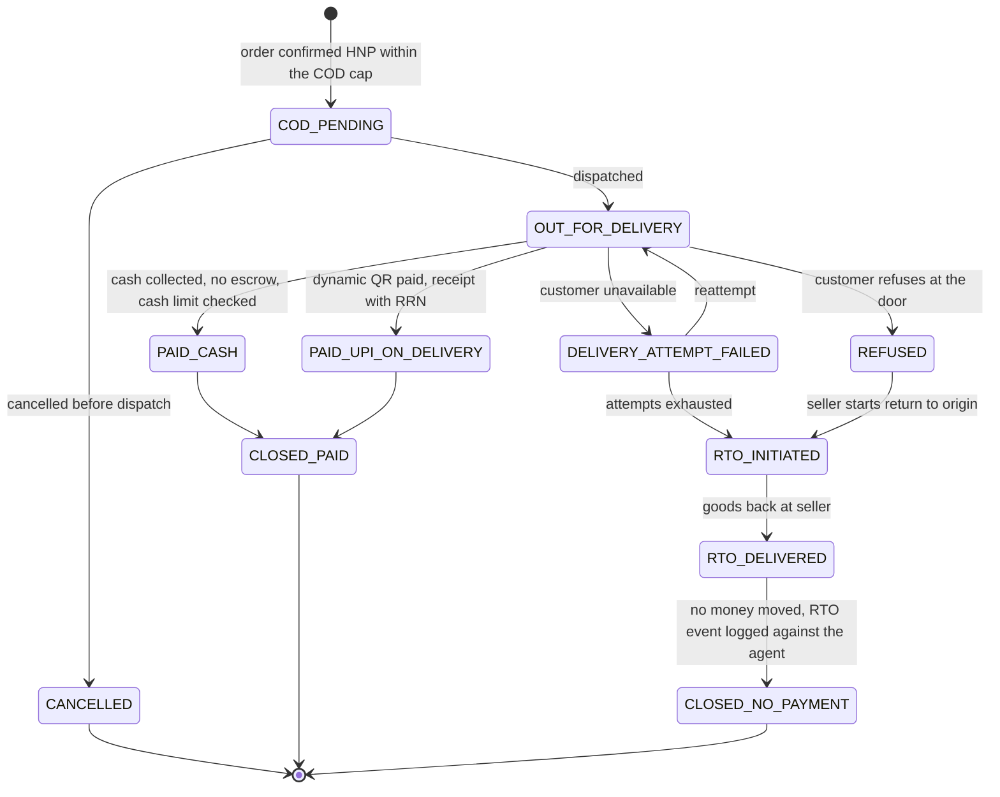

# Rail Bindings

!!! warning "Draft"
    This page is part of the `draft` BACP specification. Rules marked **Proposed** depend on an open question and can change.

This page binds the [payment model](index.md) to each Indian rail family. For every family it gives the handlers, the limits with the regulation or operator text they come from, the authentication model, how a mandate binds, and the refund and dispute path. The descriptors in the [Handler Registry](handler-registry.md) carry the same values as data, together with a verification grade for each limit.

**How to read the limits.**

- A limit taken from an RBI direction or an NPCI publication that was read is stated plainly.
- A limit known only from a vendor's documentation or from the press is marked *(vendor)* or *(press)*. One that sources disagree on is marked *(conflict)*.
- Amounts are shown in rupees here. On the wire every amount is integer paise (₹15,000 = `1500000`).
- Limits are configurable in the registry. Where sources conflict, the gateway enforces the stricter value unless a deployment documents otherwise.

**The rule every rail is judged against.** Under the RBI Authentication Directions 2025 (RBI/2025-26/79, issued 25 September 2025, compliance from 1 April 2026), every digital payment needs at least two distinct factors, at least one of them dynamic for every payment other than a card-present one (para 6), and the issuer compensates the customer in full for a loss from a non-compliant transaction. So an agent-initiated debit either runs under an exempted or AFA-registered standing authority, or needs a fresh 2FA performed by the user. The agent is never a factor.

## UPI

UPI is operated by NPCI under the Payment and Settlement Systems Act 2007 and RBI oversight. Its rules come through NPCI operating circulars, several of them member-only; the UPI Procedural Guidelines were not available for this draft ([Q-07](../open-questions.md#q-07)). The UPI PIN never leaves the payer's UPI app. On every UPI handler the payment leg is basket-blind, receipts carry the RRN (and the UTR where the descriptor lists it), and disputes go to UDIR in the payer app, with MyUPI automated chargeback.

Failed UPI merchant payments are auto-reversed within T+5, with ₹100 per day of compensation after that; a failed P2P transfer is reversed by T+1 (RBI/2019-20/67, Annex rows 4b and 4a).

### Intent, QR and collect

Handlers: `in.upi.intent`, `in.upi.qr`, `in.upi.collect`. Class C (human present for every payment).

| Item | Rule | Source |
|---|---|---|
| Flows | **Intent:** a `upi://pay` deep link opens the payer's UPI app, where the payer enters the PIN. **QR:** static (fixed VPA, payer types the amount) or dynamic (amount and transaction reference embedded); Bharat QR is also read. **Collect:** the merchant's PSP pushes a request to the payer's VPA and the payer approves with the PIN. | NPCI UPI product page |
| P2M limit | ₹1,00,000 per transaction (banks may set lower). ₹5,00,000 per transaction for verified merchants in notified categories (capital markets, insurance, travel, credit-card bills, GeM and others) from 15 September 2025, with a 24-hour aggregate that differs by category (reported as ₹10,00,000 for most and ₹6,00,000 for credit-card bills). | ₹1 lakh: NPCI UPI Procedural Guidelines *(member-only, not read)*. Category caps: NPCI circular of 28 August 2025 *(press; NPCI text not read)* |
| Collect | P2P collect ended on 1 October 2025; merchant (P2M) collect continues. | NPCI circular of 29 July 2025 *(press)* |
| Payee name | From 30 June 2025, UPI apps display only the bank-registered name of the ultimate beneficiary. | NPCI *(press)* |
| AFA | Device binding (the bank-linked mobile number) plus UPI PIN, or device-native biometric where enabled (launched at GFF 2025). | NPCI UPI product page; NPCI GFF 2026 press release |

Binding rules:

- An HP one-off UPI payment authorised by PIN is identified as handler `in.upi.intent` with `auth_binding.type: upi.pin`.
- BACP MUST NOT emit a UPI collect request to a non-merchant VPA. `in.upi.collect` is P2M only.
- Agent-originated in-person or doorstep UPI payments MUST use a dynamic QR (or intent) carrying the exact amount and a transaction reference equal to, or mapped to, the BACP order id. A static QR MUST be rejected for an agent cart, because it breaks the binding between order and payment.
- The gateway MUST enforce the P2M per-transaction cap by merchant category (₹1 lakh by default, ₹5 lakh for notified categories) and refuse locally above it.

### UPI Circle delegate

Handler: `in.upi.circle` (alias `upi.circle.delegate`). Class O. Status **pilot**.

UPI Circle lets a primary user delegate UPI payments to a secondary user, or to a device or software, including AI chatbots. For IoT and software secondaries, NPCI publishes these limits:

| Limit | Value | Source |
|---|---|---|
| Per transaction, per device | ₹5,000 | NPCI UPI Circle page |
| Per month, per device | ₹15,000 | NPCI UPI Circle page |
| First 24 hours after linking | ₹2,000 | NPCI UPI Circle page |
| Devices or software per primary user | 5 | NPCI UPI Circle page |

- **Linking.** OTP, then QR or intent, then consent and limit setting in the primary user's UPI app, then PIN or biometric. AFA happens at linking; payments within the limits need no per-transaction PIN.
- **Status.** NPCI states that "AI/Software driven IoT Payments are under pilot with limited users as a part of Closed User Group". The handler is therefore `pilot`, and a gateway MAY use it only when its conformance attestation lists it.
- **Full delegation** to a human secondary went live on BHIM on 25 November 2025: up to ₹15,000 a month, with expiry from 1 month to 5 years, usable "after a short cooling period" (NBSL press release). The length of the cooling period and any per-transaction cap for human secondaries are not in any NPCI text read ([Q-08](../open-questions.md#q-08)).
- **Payee scope.** A Circle delegation is not tied to one merchant, so it is one of the two recommended rails for multi-seller agent shopping (with network agentic card tokens).

Binding rules:

- An open payment mandate bound to Circle MUST have `amount_per_txn` at or below ₹5,000 and a monthly budget at or below ₹15,000.
- The first-24-hour cap and the device's remaining monthly limit are pre-checked before `complete`. A debit that would exceed them returns 403 `rail_limit_exceeded`, not a step-up.
- Because Circle's limits are loose relative to most mandates, the gateway's own atomic budget enforcement is what bounds spending.

### Reserve Pay (single-block-multiple-debit)

Handler: `in.upi.reservepay` (alias `upi.reservepay.block`). Class O.

| Item | Rule | Source |
|---|---|---|
| Basis | RBI decided to allow single-block-multiple-debit (SBMD) in UPI on 7 December 2022. | RBI Statement on Developmental and Regulatory Policies, 2022-12-07 |
| Launch | NPCI launched UPI Reserve Pay on credit accounts on 8 October 2025: the payer blocks part of a credit card or pre-sanctioned credit-line limit for repeat purchases, with blocked and used amounts visible across apps. | NPCI GFF 2025 press release |
| Account types | *(conflict)* The GFF 2025 release covers credit cards and credit lines; NPCI's product page says "your account" without restriction; Pine Labs lists savings accounts. | NPCI; *(vendor)* |
| Block | At most ₹10,000 per block, reserved for at most 90 days; the merchant may debit several times up to the blocked amount. | NPCI UPI Reserve Pay product page |
| Notice | The payer is notified each time money is deducted. The product page mentions no pre-debit notice. | NPCI UPI Reserve Pay product page |
| Revocation | The payer can modify the reserved amount or cancel the reserve at any time before expiry; unused money is released on expiry or cancellation. | NPCI UPI Reserve Pay product page |
| AFA | UPI PIN at block creation. | NPCI UPI Reserve Pay product page |

Which issuers and account types support Reserve Pay is open ([Q-04](../open-questions.md#q-04)).

**One block per seller.** An SBMD block's payee is one seller's collection VPA, or the seller's PA sub-merchant VPA. A buyer app cannot hold one block for many sellers.

- An open payment mandate bound to Reserve Pay MUST name the block's payee. A debit against a block whose payee is another seller MUST be refused with `reservepay_block_wrong_payee` (the rail-level twin is `payee_mismatch`).
- Multi-seller agent shopping therefore needs one of: one open payment mandate per seller block, all under one open checkout mandate whose budgets cap the total; an any-merchant primitive (`in.upi.circle`, `in.card.agentic`); or a human-present payment.
- The handler intersection excludes `in.upi.reservepay` unless a block payable to this seller exists.

**Notice on repeat debits.** Whether the E-mandate Framework's 24-hour pre-debit notice applies to SBMD debits is open ([Q-03](../open-questions.md#q-03)). Until it is answered, the second and every later unattended debit on a Reserve Pay block MUST follow the 24-hour notice-gated checkout described in the [overview](index.md#binding-mandates-to-handlers). The first debit is covered by the block authorisation.

**Refunds** go to the source with `original_rrn`. Whether a refund restores the block is not verified.

### AutoPay (UPI e-mandate)

Handler: `in.upi.autopay` (alias `upi.autopay`). Class O.

UPI AutoPay is governed by the RBI **Digital Payments – E-mandate Framework, 2026** (RBI/DPSS/2026-27/396, CO.DPSS.POLC.No.S56/02.14.003/2026-27, 21 April 2026, effective immediately). The two identifiers are the RBI reference number and the department circular number of the same document. It consolidates and repeals the earlier e-mandate circulars, and applies to e-mandates on cards, PPIs and UPI.

| Item | Rule | Source |
|---|---|---|
| AFA | At registration, modification and revocation of the mandate, and for the first debit | E-mandate Framework 2026 paras 4(a), 4(e), 5(a) |
| No-AFA debit cap | ₹15,000 per debit | E-mandate Framework 2026 para 8 |
| Special categories | ₹1,00,000 per debit for insurance premiums, mutual-fund subscriptions and credit-card bills | E-mandate Framework 2026 para 8 |
| Pre-debit notice | At least 24 hours before each debit, with an opt-out of the debit or the mandate (itself validated by AFA) | E-mandate Framework 2026 paras 6(a), 6(c) |
| Cost | Free to the customer | E-mandate Framework 2026 para 10(a) |
| Earlier caps (repealed) | ₹2,000 (cards, August 2019; UPI, January 2020), ₹5,000 (December 2020), ₹15,000 (June 2022), ₹1,00,000 for the three categories (12 December 2023) | RBI circulars listed in para 11 of the 2026 Framework, now repealed |
| Management | The issuer must let the customer modify the validity or withdraw the mandate at any time. Mandates can be paused or revoked in the UPI app, and MyUPI shows mandates across apps. | E-mandate Framework 2026 para 4(b); NPCI |

Binding rules:

- `rail_binding.rail_ref` is the UMN. `pre_debit_notice` is `required_24h`.
- An open payment mandate bound to AutoPay MUST have `amount_per_txn` at or below ₹15,000 unless the purpose is one of the three special categories.
- A debit above the no-AFA cap returns `requires_escalation` with `step_up.kind = rail_auth` and reason `above_afa_limit`. The user completes AFA on the Trusted Surface.
- Every debit follows the notice-gated checkout: no money moves before the notice matures, a re-quoted amount above the notified amount needs a new notice, and an opt-out cancels the session with `pre_debit_opt_out`.
- AutoPay on a credit line or RuPay credit card is a payment-plan leg with `funding: credit`, and the governing mandate MUST have `credit_funding_allowed: true` (the user's prior consent).

### One-time mandate (OTM)

Handler: `in.upi.otm`. Class O.

An OTM blocks funds once, for one merchant, amount and validity. The merchant captures once, up to the blocked amount, and the rest is released; or the block is released if the order is cancelled. It suits "buy this when the final price is known, at most ₹X", such as capture after delivery or after a negotiation.

| Item | Rule | Source |
|---|---|---|
| Basis | RBI's SBMD/blocking decision of 7 December 2022. The NPCI OTM circular was not read. | RBI; NPCI text not verified |
| Block | Up to ₹1,00,000 per mandate for general merchant categories | *(vendor: Pine Labs)* |
| Validity | Up to 60 days from authorisation (Pine Labs, PayU) versus a 14-day execution window (Juspay); Razorpay documents other authorisation-expiry values by merchant category | *(conflict; vendors only)* |
| AFA | UPI PIN at block creation; no further AFA at capture. OTM's status under the 2026 framework is not verified. | *(vendor)* |
| Revocation | The payer cannot revoke the block in the TPAP and must ask the merchant, per the vendor. | *(vendor)* |

Binding rules:

- The mandate records merchant, maximum amount and expiry. A capture above the blocked amount MUST fail.
- The agent MUST release the block when the order is cancelled. Before capture a refund is a block release (`refund_state: released_block`); after capture it is a normal UPI refund.
- Validity is configurable and the shortest applicable window wins ([Q-31](../open-questions.md#q-31)).
- Repeat-debit notice follows the same fail-safe as Reserve Pay ([Q-03](../open-questions.md#q-03)).

### UPI Lite

Handler: `in.upi.lite` (alias `upi.lite`). Class A, device-bound.

| Item | Rule | Source |
|---|---|---|
| Limits | ₹1,000 per transaction and ₹5,000 in total at any point in time, with no PIN per transaction; the balance is loaded with a PIN | RBI/2024-25/93, 4 December 2024, para 2 (announced 9 October 2024) |
| Lite X | Offline NFC payments without a PIN. RBI states the uplift for "UPI Lite"; whether NPCI applies ₹1,000 and ₹5,000 to Lite X is not verified (an older NPCI Lite X FAQ gave ₹500 and ₹2,000; it could not be read for this draft). | NPCI Lite X brand guidelines *(no limits stated)* |
| AFA | Exempt as a small-value offline payment | RBI Authentication Directions 2025, Annexure-1 item 5 |

A remote agent MUST NOT use UPI Lite. The handler is `device_bound: true`, so it can never be open-eligible, and a request from a remote agent gets `presence_handler_mismatch`. Only an assisted, on-device agent at a point of sale may use it. Lite receipts carry the RRN only.

### UPI 123PAY

Handler: `in.upi.123pay` (alias `upi.123pay`). Class C.

UPI 123PAY serves feature phones through IVR, missed call, app and sound-based payments, with the UPI PIN on every transaction.

| Limit | Value | Source |
|---|---|---|
| Per transaction | ₹10,000, raised from ₹5,000 ("Necessary instructions will be issued to NPCI shortly") | RBI Statement on Developmental and Regulatory Policies, 9 October 2024 |
| Implementation | NPCI circular dated 25 October 2024, compliance by 1 January 2025 | *(press; NPCI text not read)* |

The cap is configurable, with a default of ₹10,000, and the gateway MUST refuse an instruction above it, returning 403 `rail_limit_exceeded`. Confirming the cap from the NPCI circular is tracked as [Q-05](../open-questions.md#q-05).

### Credit on UPI

| Handler | Rule | Source |
|---|---|---|
| `in.upi.credit_line` | A pre-sanctioned credit line from a scheduled commercial bank (small finance banks added in 2025) may be used on UPI with the individual's prior consent. The bank sets the limit, period and rate. | RBI/2023-24/58, 4 September 2023, updated 12 February 2025; NPCI UPI-OC-171 and OC-171A *(press)* |
| `in.upi.rupay_cc` | RuPay credit cards may be linked to UPI. The refund rule of Credit Card MD para 10(h) applies. | RBI policy statement of 8 June 2022 *(press)* |

Both are class C. They run HNP only through a class O primitive on the credit account (AutoPay, Reserve Pay or OTM), with `funding: credit` on the payment-plan leg and the user's prior consent recorded as `credit_funding_allowed` on the mandate (`rail_binding` has no funding or consent field). Before using any credit-funded handler, the agent MUST tell the user that the payment is credit and MUST hold the user's prior consent (`credit_funding_allowed` on the mandate).

### UPI international

Handler: `in.upi.intl` (alias `bacp.pay.xb.upi_global`). Class C. UPI payments abroad through NPCI International corridors, and inbound foreign remittances to UPI-linked accounts. Human present only: no cross-border UPI mandate primitive exists. The payer's UPI app must have international use enabled. Settlement is in INR at the displayed rate, and the rate and markup are disclosed with an [FX view](credit-and-split-tender.md#fx-disclosure-for-cross-border-payments). Refund and dispute rules follow the corridor and are not verified.

## Cards

Handlers: `in.card.token`, `in.card.mandate`, `in.card.agentic` (pilot), `in.card.emi`, `in.card.present`; `in.pos.tap` and `in.pos.dynamic_qr` at a point of sale. Card issuance and conduct are governed by the RBI Credit Card and Debit Card – Issuance and Conduct Directions 2022 (RBI/2022-23/92). The networks are RuPay (NPCI), Visa, Mastercard, American Express and Diners. Receipts carry `arn`, `auth_code` and the RRN.

### Card-on-file tokens (CoFT)

Handler: `in.card.token` (alias `rupay.token`). Class C.

| Item | Rule | Source |
|---|---|---|
| Storage | Only issuers and card networks may store card-on-file data. Others keep only the last four digits and the issuer name. | RBI CoFT circular RBI/2021-22/96, 7 September 2021 |
| Token scope | A token is unique to the combination of card, token requestor and merchant. For an e-commerce marketplace, the "merchant" is the marketplace entity. | CoFT Annex, condition 1 and footnote 4 |
| Provisioning | Explicit customer consent with issuer AFA, which may be combined with the first payment's AFA. | CoFT para 3 (consent and issuer AFA); Annex condition 2 (combined AFA) |
| Reissue | A renewed or replaced card needs fresh consent before it is linked to merchants again. | CoFT condition 5 |
| Requestor duties | A token requestor with a direct cardholder relationship lists the merchants tokenised through it and allows de-registration. | CoFT condition 3 |
| Devices | Phones, tablets, laptops, desktops, wearables and IoT devices may be tokenised. That tokenisation is free and optional for the cardholder comes from RBI's tokenisation FAQ, not re-read. | RBI circular of 25 August 2021, cited in the CoFT circular para 1 |
| Default channels | New and reissued cards are enabled only for domestic contact use. Card-not-present, international and contactless use must be enabled by the cardholder. | RBI/2019-20/142, 15 January 2020 |
| AFA | Two factors, one dynamic, completed by the cardholder for every card-not-present payment, typically through 3-D Secure. The Directions mandate no specific factor. | RBI Authentication Directions 2025 paras 5, 6 |

Binding rules:

- A token MUST NOT be presented at a merchant other than the one it is bound to. Because a CoFT token is merchant-bound, a merchant-agnostic agent cannot reuse one token across sellers. On a marketplace the token is bound to the marketplace entity.
- If the issuer declines because card-not-present use is disabled, the gateway returns message `card_not_enabled_for_cnp` (`requires_buyer_input`). The agent MUST NOT retry with another card without the user's approval.
- When the user holds the same issuer's cards on several networks, the agent MUST use the card and network the user designated (RBI network-choice circular of 6 March 2024).
- Whether a BACP operator is itself a CoFT token requestor, with the duties above, is open ([Q-54](../open-questions.md#q-54)).

### Card e-mandates

Handler: `in.card.mandate`. Class O. This is the only card primitive for unattended debits that is not a network pilot.

| Item | Rule | Source |
|---|---|---|
| AFA | At registration and on the first debit | E-mandate Framework 2026 paras 4(a), 5(a) |
| Up to ₹15,000 per debit | Later debits need no AFA, so they MAY run HNP within the mandate | E-mandate Framework 2026 para 8 |
| Above ₹15,000 | AFA for every debit | E-mandate Framework 2026 para 8 |
| Special categories | ₹1,00,000 instead of ₹15,000 for insurance premiums, mutual-fund subscriptions and credit-card bills | E-mandate Framework 2026 para 8 |
| Pre-debit notice | At least 24 hours, with opt-out | E-mandate Framework 2026 para 6 |
| Variable amounts | Allowed within a maximum the customer specifies | E-mandate Framework 2026 para 4(c) |

Binding rules:

- An unattended card debit MUST run only under an AFA-registered e-mandate (`in.card.mandate`) or a network agentic token whose intent limits cover it. Otherwise the cardholder completes 3-D Secure, OTP or a passkey.
- A debit above the no-AFA cap returns `requires_escalation` with `step_up.kind = rail_auth` and reason `afa_threshold_card_emandate`.
- Sub-threshold debits on one mandate are aggregated per calendar month (IST), so that one charge split into several smaller debits does not escape AFA.
- A debit above the registered maximum gets `rail_limit_exceeded`. A debit on a cancelled standing instruction gets `mandate_cancelled`. A notice issued less than 24 hours before the debit gets `pre_debit_notice_too_late`.

### RBI Authentication Directions 2025 for cards

- The Directions (RBI/2025-26/79, 25 September 2025) apply from 1 April 2026. Card-not-present payments need two factors, one dynamic. No specific factor is mandated: the Directions give password, SMS OTP, passphrase, PIN, card hardware, software token and biometrics (device-native or Aadhaar) as examples (para 5). Passkeys are not named, but a passkey can supply a dynamic factor.
- **Cross-border.** The Directions apply only to domestic payments. By 1 October 2026, issuers must have a mechanism to validate a non-recurring, cross-border, card-not-present payment when the overseas merchant or acquirer asks for authentication, and a risk-based mechanism for all cross-border CNP payments (para 10). When the acquirer requests AFA on such a payment, the gateway MUST return `requires_escalation` with `step_up.kind = rail_auth` and reason `afa_crossborder_cnp`, and MUST NOT debit until AFA completes. Recurring cross-border payments are outside this trigger.
- **Exemptions** (Annexure-1) include small-value contactless payments and recurring e-mandate debits after the first.

### Network agentic tokens

Handler: `in.card.agentic`. Class O. Status **pilot**.

| Network | Status | Source |
|---|---|---|
| Mastercard Agent Pay | First authenticated agentic transaction in India demonstrated in February 2026 (issuers Axis Bank and RBL; several PAs and merchants). Agents are registered and verified before transacting; a purchase-intent object with limits and validity windows is kept as dispute evidence. A demonstration, not general availability. | Mastercard press release, February 2026 |
| Visa Intelligent Commerce | "Live agentic commerce payment experiences" showcased at GFF 2026 with Indian banks and PAs, built on tokenisation and Visa Payment Passkey. Whether agent-specific tokens are live in India is not verified. | Visa; press |
| RuPay, Amex, Diners | No agentic card-token product found. | — |

RBI has issued no rule specific to agentic tokens. They must still satisfy CoFT (consent and AFA at provisioning) and the AFA Directions per transaction unless they run under an e-mandate. An `in.card.agentic` payment MUST carry the network intent object (basket hash, amount limit, validity window, agent identity) and keep it as dispute evidence. General availability is open ([Q-39](../open-questions.md#q-39)).

### Card EMI and card-present

- **`in.card.emi`** (class C). Credit-card EMI is governed by Credit Card MD para 6(b)(iii): before conversion the issuer shows principal, interest and any upfront discount, separately on the bill. Debit-card EMI is a loan under the Digital Lending Directions 2025 (para 29(i); RBI has since withdrawn these Directions in its consolidation into entity-wise directions, see [Credit and Split Tender](credit-and-split-tender.md)). An agent MUST show these three amounts before converting a purchase to EMI and MUST NOT describe an interest-bearing EMI as "no cost". See [Credit and Split Tender](credit-and-split-tender.md).
- **`in.card.present`** and **`in.pos.tap`** (class A, assisted only). Contactless card payments up to ₹5,000 need no AFA (RBI DPSS.CO.PD No.752/02.14.003/2020-21, effective 1 January 2021). UPI Tap & Pay on NFC point-of-sale terminals is PIN-less up to ₹5,000 (NPCI GFF 2026 press release; exemption in Annexure-1 item 7 of the Authentication Directions). The receipt MUST record whether the payment ran under a PIN-less exemption, and an assisted agent MUST NOT split a cart to stay under an exemption threshold.
- **`in.pos.dynamic_qr`** (class A). A store or kiosk agent generates a dynamic UPI QR with the exact cart amount and order reference, and the human pays on their own phone.

### Card refunds and disputes

Refunds go to the original card (PA MD para 10(f)), with the Credit Card MD para 10(g)/10(h) rules described in [Refunds](index.md#refunds). When a cardholder protests a bill, the issuer must give an explanation and, where applicable, documentary evidence within 30 days of the complaint (Credit Card MD para 10(b)), and no charges may be levied on a transaction disputed as fraud until the dispute is resolved (para 10(d)). Network chargeback windows are not verified. A failed card payment, card-present (POS) or card-not-present (e-commerce), is auto-reversed within T+5, with ₹100 per day after that (RBI/2019-20/67, Annex rows 2b and 2c).

## Net banking

Handler: `in.netbanking`. Class C.

| Item | Rule | Source |
|---|---|---|
| Regulation | No net-banking-specific payment direction; the RBI Authentication Directions 2025 and the PA Master Direction 2025 apply. | RBI |
| Flow | The merchant or PA redirects to the bank's login page; the customer logs in and authorises with OTP or another factor. | — |
| Limits | Set by each bank | *(not verified)* |
| AFA | Bank login plus a dynamic factor for every payment | RBI Authentication Directions 2025 |
| Refund | To the source account | PA MD para 10(f) |
| TAT | RBI/2019-20/67 has no net-banking row. | RBI |
| Dispute | Bank grievance, then the RBI Integrated Ombudsman. No chargeback scheme. | RBI |

Net banking is human-present only. It MUST be implemented as a redirect to the bank's page. Agents MUST NOT collect, store or relay bank login credentials or OTPs, and the handler exposes no credential fields. A request without a human authorisation event gets `presence_handler_mismatch`. Screen-scraping or credential-proxy net banking is incompatible with the AFA Directions and the DPDP Act.

## PPI wallets

Handlers: `in.ppi.wallet` (class O, only with a PPI e-mandate), `in.ppi.card` (class C). Governed by the RBI Master Direction on Prepaid Payment Instruments (RBI/DPSS/2021-22/82, 27 August 2021, updated to 30 September 2026). A draft PPI Master Direction 2026 (comments closed 22 May 2026) would replace it; its final status is not verified.

| Item | Rule | Source |
|---|---|---|
| Small PPI | Balance ≤ ₹10,000; loading ≤ ₹10,000 a month and ≤ ₹1,20,000 a year; debits ≤ ₹10,000 a month; no cash-out or funds transfer; convert to full KYC within 24 months | PPI MD para 9.1 |
| Full-KYC PPI | Balance ≤ ₹2,00,000; transfers to pre-registered beneficiaries ≤ ₹2,00,000 a month per beneficiary, others ≤ ₹10,000 a month | PPI MD para 9.2 |
| Credit loading | Non-bank PPIs may not be loaded from credit lines | RBI clarification of 20 June 2022 *(press; RBI letter not public)* |
| AFA | 2FA for every wallet debit; PPI cards follow debit-card AFA | PPI MD para 15.3(3) |
| Recurring | E-mandates on PPIs follow the E-mandate Framework 2026 (₹15,000 no-AFA cap, 24-hour notice) | E-mandate Framework 2026 para 2; PPI MD para 15.3(7) |
| Interoperability | Only full-KYC PPIs may link to UPI | PPI MD para 11.6.3 |
| Validity | At least one year from the last load, with an expiry warning within 45 days | PPI MD para 13 |
| Refund | Refunds of PPI-funded payments go back to the same PPI immediately, even above its limits. Refunds of payments made with any other instrument must not be credited to a PPI. | PPI MD para 14.3 |
| Failed TAT | On-us T+1, ₹100 per day; off-us follows the underlying rail | RBI/2019-20/67 |
| Complaints | Resolved preferably within 48 hours, at most 30 days | PPI MD para 16.2(5) |
| Unauthorised debits | Non-bank PPIs, third-party breach: zero liability if reported within 3 days; the lower of the transaction value or ₹10,000 per transaction for days 4 to 7; beyond 7 days per the issuer's policy. Zero liability whenever the issuer is at fault. Bank PPIs follow the bank customer-liability circular. | PPI MD paras 17.1, 17.5 |

Binding rules:

- A wallet runs HNP only under an AFA-registered PPI e-mandate. Otherwise every debit needs 2FA, and an HNP request gets `presence_handler_mismatch`.
- The gateway MUST enforce the small-PPI and full-KYC caps and MUST NOT accept a credit line as a funding source for a PPI load.
- A pre-funded wallet balance is a natural hard cap on agent spending.
- PPI complaints raised through BACP are forwarded to the issuer and tracked against the 30-day limit. Unauthorised-debit reports are time-stamped, because liability depends on reporting within 3 or 7 days (PPI MD para 17.4: the issuer's alert system records the time and date of delivery and of the customer's response; liability bands in para 17.5).

## Gift cards, store credit and loyalty

| Handler | Class | Rule | Source |
|---|---|---|---|
| `in.ppi.gift` | O | Gift PPI: ≤ ₹10,000 per instrument, not reloadable, no cash-out; validity at least one year. **AFA-exempt**, so an agent may spend it HNP up to the balance. Reload and cash-out MUST be refused. | PPI MD para 10.1, 15.3(5) |
| `in.store_credit` | O | A closed-system gift card or store credit usable only at the issuer is not an RBI payment system. Consumer-protection law and the E-Commerce Rules apply. Usable HNP at that merchant. | PPI MD para 2.1 |
| `in.loyalty` | O | Loyalty or reward points. No RBI regime was found. Usable HNP only where the programme allows redemption by API; the agent MUST disclose the conversion value. | Programme terms *(not verified)* |

- Gift and voucher codes are held in the Trusted Surface or the PSP-adapter vault and redeemed by the gateway's PSP adapter. The agent never sees them. Whether a PSP adapter may redeem gift-PPI codes on the user's behalf is open ([Q-30](../open-questions.md#q-30)).
- In a [split tender](credit-and-split-tender.md#split-tender-payment-plans), stored-value tenders are captured first.
- **Cashback is not a handler.** It is an offer adjustment in the TermSheet. The agent evaluates the net price after the cashback conditions and MUST NOT count conditional cashback as a discount.

## Cash on delivery

Handlers: `in.cod` (banknotes; aliases `cod`, `bacp.pay.cod.record`) and `in.cod.upi` (UPI at the door). Class D.

| Item | Rule | Source |
|---|---|---|
| Definition | COD is a merchant transaction in which banknotes are tendered at delivery. | RBI PA Master Direction 2025 para 4(a) |
| No escrow | "The escrow account shall not be operated for Cash-on-Delivery transactions." | PA MD para 18(b) |
| Cash limit | Cash receipts of ₹2,00,000 or more per transaction, day or event are barred. | Income-tax Act 1961 s.269ST |
| UPI at the door | A dynamic UPI QR shown by the courier is a UPI P2M payment, not COD under the PA MD. | PA MD; NPCI |
| ONDC | Item flag `@ondc/org/available_on_cod`; logistics `@ondc/org/collection_amount`. | ONDC |

**Placing the order.** An agent MAY place a COD order HNP only if the open checkout mandate has `cod_allowed: true` and fewer than `cod_max_open_orders` COD orders are open. Otherwise the gateway returns `cod_not_allowed` or `cod_open_orders_cap`. The cap is read from the checkout mandate or the negotiation mandate, the stricter one winning. No payment mandate is created at order time. A COD order placed without a principal counts against the placing agent's id.

**Fees.** A COD fee, and any return-to-origin (RTO) fee, MUST appear in the TermSheet payment options from the first round and in the price breakup before commitment. Whether an RTO fee may be charged to a consumer is open ([Q-37](../open-questions.md#q-37)).

**Paying at the door.**

- Banknotes (`in.cod`) are recorded against the AWB with **no escrow reference**. Cash moves through no rail, so there is no payment receipt.
- A cash tender of ₹2,00,000 or more is refused (`NEG_CASH_LIMIT`).
- UPI at the door switches the tender to `in.cod.upi`, which needs a dynamic QR carrying the order reference and the payer's PIN. That tender gets a UPI receipt with the RRN and may be marked paid. Only `in.cod.upi` may be marked paid from a UPI reference.

**Refused deliveries.** COD has no escrow, so BACP does not hold the buyer's money. A COD order the user refuses at the door is logged against the agent as an RTO event, and repeated RTOs reduce the agent's allowed `cod_max_open_orders`. This bounds the abuse vector of an agent creating unwanted COD orders.

**Refunds.** Cash cannot be refunded to source. A refund goes to the UPI or bank account the user chooses, with a credit note, or to store credit only if the user elects it. A `in.cod.upi` refund goes to the source VPA (T+5 for failures).

The gateway maps ONDC fulfilment states onto these states. The ONDC RTO state codes are not verified.

## NACH and eNACH

Handlers: `in.nach.debit` (class O; aliases `in.enach`, `bacp.pay.nach.debit`, `bacp.mandate.enach.register`) and `in.nach.credit` (class C; bulk payouts with maker-checker). NACH is operated by NPCI under RBI oversight. The NACH procedural guidelines are member-only.

| Item | Rule | Source |
|---|---|---|
| e-mandate via net banking or debit card | ₹10,00,000 maximum, raised from ₹1,00,000 from 1 August 2020, "to be reviewed after 1 year" | NPCI/2020-21/NACH/Circular No.010, 15 July 2020, para 2 |
| e-mandate via Aadhaar eSign | ₹1,00,000 maximum, "till further notice" | NPCI NACH Circular No. 010, para 2 |
| Security mandate | ₹50,00,000, loan (LON) category only | NPCI NACH Circular No. 010, para 2 |
| ₹1 crore cap | NPCI NACH Circular No. 003 of FY2023-24 ("E-Mandate simplification and harmonization of the limit of all variants of mandates") is reported by vendors to set ₹1 crore for all mandate variants from 1 August 2023 (₹3 crore for TReDS). The NPCI text was not read. | *(vendor; not verified)* |
| Physical mandates | ₹1 crore, from an older NPCI FAQ | *(not verified as current)* |
| AFA | At registration only: net-banking login, debit card with PIN or OTP, or Aadhaar OTP eSign. Later debits are presented by the creditor's sponsor bank without customer authentication. | NPCI |
| Cancellation | Customers can cancel a mandate directly with their bank. | NPCI NACH OC 008 FY24-25 (title read on the NPCI NACH page; text not read) |
| Post-revocation debit | The customer's bank is responsible and must resolve it within T+1, with ₹100 per day after that | RBI/2019-20/67, Annex row 7b |
| Forms | Revised physical mandate form and XML; old formats valid until 30 September 2026 | NPCI/2026-27/NACH/001, 28 April 2026 *(press)* |

Binding rules:

- `rail_binding.rail_ref` is the UMRN, bound one-to-one to the BACP mandate hash (maximum amount, frequency, purpose, creditor utility code, validity).
- A NACH mandate MUST be registered only by human AFA. On the payer side an agent only proposes mandates; registration is human-present.
- The gateway MUST refuse an eSign mandate above ₹1,00,000 and a net-banking or debit-card e-mandate above the configured cap (default ₹10,00,000), with `nach_mandate_above_cap`. Whether ₹1 crore is current is open ([Q-29](../open-questions.md#q-29)).
- **Pre-debit notice.** The E-mandate Framework 2026 applies to recurring transactions "using cards / PPI / UPI" (para 2), and no RBI pre-debit notice rule for NACH was found. BACP therefore applies its own notice (`bacp_policy_24h`): every agent-presented NACH debit MUST be preceded by a logged notice at least 24 hours earlier, and an opt-out cancels it.
- After a cancellation event, including a customer's direct cancellation with the bank, a NACH debit MUST NOT be presented (`mandate_cancelled`). A forced debit triggers a T+1 refund workflow.
- Refunds are a new NACH or NEFT credit from the creditor, not a NACH reversal.

NACH is suited to high-value recurring debits from a single creditor (EMIs, SIPs, subscriptions, B2B supplies), not to ad-hoc multi-merchant shopping.

## IMPS, NEFT and RTGS

Handlers: `in.a2a.imps`, `in.a2a.neft`, `in.a2a.rtgs`. Class C.

| | IMPS | NEFT | RTGS |
|---|---|---|---|
| Operator | NPCI | RBI | RBI |
| Limit | ₹5,00,000 per transaction (all channels except SMS/IVR), raised from ₹2,00,000 by NPCI OC-103 of 11 October 2021 *(not re-read; the current NPCI IMPS page states no limit)*; daily cap set by the bank | No RBI minimum or maximum; walk-in cash remittances ≤ ₹50,000 | Minimum ₹2,00,000, no maximum |
| Availability | 24x7 | 24x7x365 from 16 December 2019, in 48 half-hourly batches | 24x7x365 from 00:30 on 14 December 2020 |
| Failure | Beneficiary not credited: auto-reversal by T+1, ₹100 per day | Credit within 2 hours of batch settlement, or return within 2 hours of batch completion; otherwise penal interest at LAF repo + 2%, without a claim | Credit within 30 minutes of receipt, or return within 1 hour (or by end of the RTGS day, if earlier); repo + 2% for delay |
| Source | NPCI IMPS page; RBI/2019-20/67 | RBI NEFT FAQ | RBI RTGS FAQ; RBI press release 2020-2021/748 |

**Payee binding.** Before any credit to a new payee, BACP MUST perform a beneficiary name look-up and store a `PayeeBinding` record: account, IFSC, returned name, timestamp and look-up reference. RTGS and NEFT members must offer Beneficiary Account Name Look-up, free of charge, from 1 April 2025 (RBI/2024-25/99, 30 December 2024). The user sees only the bank-returned name, never a merchant-supplied display name, and the agent cannot edit it. A payment to an account whose looked-up name does not match the invoiced seller is held for human confirmation.

**Rail selection.** The gateway MUST refuse RTGS below ₹2,00,000 and IMPS above ₹5,00,000 (configurable), and defaults to NEFT otherwise.

**Authentication.** Retail transfers need the remitter bank's 2FA every time, so they are human-present. For a business, the agent MAY act as **maker**, preparing a validated payment instruction, while a human **checker** approves it under the corporate's bank entitlement. The payment stays in state `pending_approval` until the checker event is logged, and the agent MUST NOT release it. Whether corporate host-to-host flows are exempt from the 2025 AFA rule is not verified.

**Evidence and refunds.** Every settled transfer records its UTR. There is no payer-initiated refund: the payee pushes a new credit. An unconfirmed IMPS credit enters reversal tracking (T+1, ₹100 per day). The refund-settlement signal for IMPS is open ([Q-49](../open-questions.md#q-49)).

## BBPS (Bharat Connect)

Handlers: `in.bbps.bill` (alias `bbps`), `in.bbps.b2b_invoice`, `in.bbps.upms`. The Bharat Bill Payment System is governed by the RBI BBPS Directions 2024 (29 February 2024, effective 1 April 2024) and operated as Bharat Connect by NPCI Bharat BillPay Limited (NBBL).

| Item | Rule | Source |
|---|---|---|
| Limits | None at network level; the payment instrument's limits apply | NBBL *(not re-read)* |
| Settlement | 8 cycles a day to billers | NBBL *(not re-read)* |
| Complaints | NBBL must run a centralised, end-to-end complaint management system; TATs per NBBL procedural guidelines *(not verified)* | RBI BBPS Directions 2024 (RBI/DPSS/2023-24/111) para 8(i) |
| B2B | Bharat Connect for Business: over 2 million invoice-based transactions in Q3 FY26 | NBBL press release, February 2026 *(not re-read)* |
| Recurring | UPMS presents bills and auto-pays them; its mandate types are not verified | NBBL |

Binding rules:

- A bill payment runs bill fetch, validation and payment through a customer operating unit, and MUST store the Biller ID, the bill reference and the Bharat Connect transaction reference (`bconnect_txn_id`). Bill fetch is a consented read that an agent may do on its own; a one-off payment is human-present.
- `in.bbps.b2b_invoice` payments MUST carry the seller's GST IRN and the buyer's GSTIN, and MUST be refused if the amount differs from the fetched invoice. They run under a maker-checker approval policy.
- `in.bbps.upms` (class O) binds a UPMS registration to an underlying instrument mandate (a UPI AutoPay UMN, a card standing instruction or a NACH UMRN) and inherits that instrument's limits and notice rule. For example, a ₹15,001 bill debit under UPI AutoPay needs AFA.

## e-RUPI

Handler: `in.erupi` (alias `erupi`). Class O.

e-RUPI is a purpose-bound prepaid voucher on UPI rails, launched in August 2021 with a cap of ₹10,000 per voucher, redeemable once (RBI, 10 February 2022).

| Item | Rule | Source |
|---|---|---|
| Government vouchers | ₹1,00,000 per voucher, redeemable several times until exhausted. RBI "proposed" this and said instructions to NPCI would follow; the NPCI instruction was not read. | RBI Statement on Developmental and Regulatory Policies, 10 February 2022 (Press Release 2021-2022/1694), item 6 |
| Wider issuance | RBI proposed issuance by non-bank PPI issuers and on behalf of individuals, and changes to reloading, authentication and issuance limits, with "separate instructions" to follow. Whether those instructions were issued is not verified. | RBI press release 2023-2024/365, 8 June 2023, item 6 |
| Authentication | The beneficiary presents the voucher code (QR or SMS) and confirms with a verification code. | NPCI |
| Refund | Unredeemed value returns to the issuer or sponsor on expiry. Merchant refunds after redemption are not verified. | NPCI |

Binding rules:

- The voucher is the mandate: purpose, eligible merchant or merchant category, remaining balance and expiry are mirrored into the BACP mandate. The handler MUST enforce them before redemption, and MUST support partial multi-use redemption for multi-use vouchers.
- Issuer-type caps (government, corporate, individual; bank or non-bank) are configuration, pending confirmation of the 2023 changes.
- Voucher codes are never shown to the agent.
- e-RUPI is open-eligible only where redemption without the beneficiary present is supported ([Q-38](../open-questions.md#q-38)).

## e₹ (CBDC)

Handlers: `in.cbdc.retail` (alias `erupee`; class C, pilot), `in.cbdc.programmed` (class O, pilot), `in.cbdc.wholesale` (class N, reserved).

| Item | Rule | Source |
|---|---|---|
| Retail e₹ | Pilot since 1 December 2022: bank-distributed tokens, wallet-to-wallet P2P and P2M, UPI-QR interoperability. Still a pilot in October 2026. | RBI CBDC FAQ; press |
| Programmability | Rules on expiry, geography, merchant category and merchant VPA; used for DBT, subvention, lending and allowances | RBI CBDC FAQ |
| Offline e₹ | Unveiled at GFF in October 2025 | *(press)* |
| Wholesale e₹ | Launched 1 November 2022 for G-sec settlement; deposit-tokenisation pilot from 8 October 2025 | *(press)* |
| Limits | Wallet holding and transaction caps are set per pilot bank | *(not verified)* |

Binding rules:

- When settling in e₹, BACP MUST compile the mandate constraints (expiry, geography, merchant category, merchant VPA, amount) into a programmability rule set, and MUST refuse settlement where the token's rules conflict with the mandate.
- Offline e₹ payments MUST be marked `offline=true` with a deferred-sync state, and MUST NOT be initiated autonomously by an agent.
- Refunds are a push back from the merchant. Programmed tokens that expire revert to the sponsor (mechanics not verified).
- `in.cbdc.wholesale` is reserved and institutional only. It never backs a payment.

## AePS and Aadhaar Pay

Handler: `in.aeps.assisted`. Class A, assisted only.

| Item | Rule | Source |
|---|---|---|
| Operator duties | Acquiring banks run customer due diligence on every AePS touchpoint operator (ATO) before onboarding and apply risk controls | RBI AePS ATO Due Diligence Directions 2025 (RBI/2025-26/63, 27 June 2025, effective 1 January 2026) para 2.1 |
| Inactive operators | An ATO that has performed no transaction for a customer for 3 continuous months must be re-KYCed by the acquiring bank before transacting again | RBI/2025-26/63 para 2.2 |
| Cash withdrawal | Up to ₹10,000 in a single transaction | NPCI/2021-22/AEPS/002 (18 August 2021), citing AePS Circular 3 of 25 January 2016 (not read) |
| Authentication | Aadhaar number plus the account holder's biometric, in person at a business correspondent or micro-ATM | NPCI; RBI Authentication Directions 2025 |
| TAT | AePS or Aadhaar Pay debited without merchant confirmation: credit adjustment within T+5, ₹100 per day after that | RBI/2019-20/67, Annex row 5a |

Binding rules:

- AePS and Aadhaar Pay MUST be human-present at an assisted touchpoint. The binding is an `AssistedSession`: ATO id, terminal id, the RRN, and an order hash.
- The order summary and amount MUST be shown, and spoken in the user's language, before biometric capture. The AI agent MUST NOT trigger the capture and is never the authenticator.
- BACP MUST reject a session from an ATO flagged inactive for 3 months or more without re-KYC, where the acquirer exposes that flag.
- BACP never collects the Aadhaar number or the biometric.

## FASTag, NCMC and transit

Handlers: `in.ppi.netc_topup`, `in.ppi.ncmc_topup` (class O) and `in.ppi.transit` (class C).

| Item | Rule | Source |
|---|---|---|
| FASTag | NETC FASTags are bank-issued PPIs; KYC at issue. NETC transactions are exempt from AFA. | NPCI NETC *(not re-read)*; RBI Authentication Directions 2025, Annexure-1 item 4 |
| Auto top-up notice | E-mandates that auto-replenish FASTag and NCMC balances need no pre-transaction notification. A post-transaction notification is still required. | E-mandate Framework 2026 paras 6(d), 7 |
| FASTag Annual Pass | ₹3,000 for one year or 200 trips at NH and NE fee plazas from 15 August 2025, bought only through the Rajmargyatra app or the NHAI site | *(press; NPCI and NHAI text not read)* |
| NCMC offline wallet | ₹500 per offline transaction and ₹2,000 in total per instrument at any time (the 2024 uplift to ₹1,000 and ₹5,000 is for UPI Lite only) | RBI/2023-24/57, 24 August 2023, para 2; RBI/2024-25/93 para 1 |
| PPI-MTS (transit PPI) | Outstanding balance ≤ ₹3,000, no KYC, no AFA, reloadable, perpetual validity; no cash-out, refund or transfer | PPI MD para 10.2 |

Binding rules:

- A FASTag, NCMC or transit top-up by an agent MUST run under an AFA-registered top-up mandate with threshold and amount fields. BACP MUST NOT require or send a pre-debit notice where the issuer claims the exemption, but MUST send a post-debit notice.
- Transit and NCMC offline caps are configurable, defaulting to the values above. A ₹3,001 PPI-MTS load and a ₹501 NCMC offline debit are refused.
- The toll or transit spend itself is tag- or card-present and involves no agent. Buying the FASTag Annual Pass is a human-present payment on the official channels.

## Other B2B and cross-border rails

These handlers mostly track or verify rather than pay. They are listed here for completeness; the financing ones are in [Credit and Split Tender](credit-and-split-tender.md).

| Handler | Class | Rule | Source |
|---|---|---|---|
| `in.xb.pacb` | C | PA cross-border collection or payment, capped at ₹25,00,000 per transaction; carries the export invoice or EDF reference. Outbound card payments need cross-border AFA. | RBI PA MD 2025 para 11(d) |
| `in.pa.settlement` | N | Read-only PA settlement status. The settlement timeline comes from the PA–merchant agreement. | RBI PA MD 2025 para 16(a) |
| `in.cheque.positive_pay` | C | Record and track cheques. Banks must enable Positive Pay for cheques of ₹50,000 and above and may make it mandatory from ₹5,00,000. BACP requires a Positive Pay reference before marking a cheque payment of ₹5,00,000 or more as issued. | RBI/2020-21/41, 25 September 2020 |
| `in.gov.gem` | N | GeM order and payment tracking: payment within 10 days of CRAC, 1% a month delay interest retained by GeM. See [trade credit](credit-and-split-tender.md#gem-receivables). | DoE OM of 3 July 2020; GeM GTC clause 12 |
| `in.fin.lc`, `in.fin.ebg` | N | Verify and track letters of credit and e-bank guarantees (NeSL e-BG platform) before treating them as payment security. | ICC UCP 600; NeSL |
