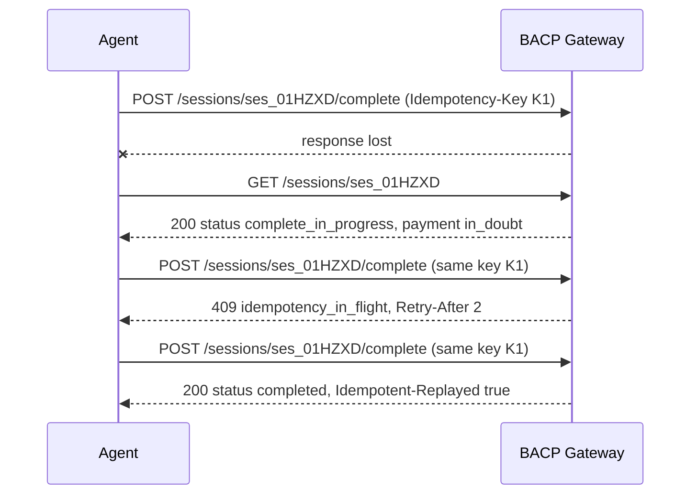

# REST

!!! info "Version 2026-10-17"
    This page is part of BACP version `2026-10-17`. Rules marked **Proposed** depend on an open question and may change in a later dated release.

The REST binding is the reference binding of BACP. A BACP gateway, run by or for a registered buyer app (BAP),
exposes it to AI agents. Each call is translated into signed Beckn/ONDC actions (see
[Beckn / ONDC Binding](beckn.md)) or into calls to the payer PSP and Mandate Manager, and the gateway returns the
authoritative full state of the resource. The same operations are bound to MCP tools and to an A2A extension (see
[MCP and A2A](mcp-a2a.md)).

The normative contract is the OpenAPI 3.1 document:
[https://bacp.dev/latest/services/bacp.openapi.yaml](https://bacp.dev/latest/services/bacp.openapi.yaml). Where
this page and the OpenAPI document differ, this page is authoritative.

## Base URL and media type {#base-url}

- The base URL is chosen by the gateway, for example `https://gw.bap.example.in/bacp`. Every path on this page,
  including `/.well-known/bacp`, is relative to it. Agents discover a gateway's base URL, transports, capabilities,
  payment handlers and keys from its profile (see [Discovery and Profiles](../discovery.md)).
- Requests and responses are `application/json` encoded in UTF-8.
- Amounts are integer paise (`{"value": 30200, "currency": "INR"}` is ₹302.00). Times are RFC 3339 date-times;
  examples use the IST offset `+05:30`.
- Readers MUST ignore unknown fields, except a request member of a capability that the receiver defines but does not list, which it refuses with `400 capability_unsupported` ([Extensibility](../overview/index.md#extensibility) rule 1). Unknown **mandate constraints** MUST fail closed.
- Business outcomes return 200, 201 or 202 with full state and `messages[]`; failures return 4xx or 5xx with the flat
  `Error` object (see [Errors](../errors.md)).

## Request headers {#headers}

| Header | Direction | Required | Meaning |
|---|---|---|---|
| `Signature-Input`, `Signature` | request | every call except the public reads | RFC 9421 HTTP Message Signature by the agent's `cnf` key (see [Signatures](#signatures)) |
| `Content-Digest` | request | every signed call | RFC 9530 digest of the raw body (of the empty body on a `GET`), covered by the signature |
| `BACP-Agent` | request | every signed agent call | The AgentCredential (SD-JWT VC) with only the disclosures the gateway needs |
| `BACP-Version` | request | every agent call when the profile lists more than one version; optional otherwise | The BACP version of the request ([Version negotiation](../discovery.md#request-version)). Covered by the signature whenever present |
| `Idempotency-Key` | request | every POST and PUT | 22–64 printable ASCII characters with at least 122 random bits (see [Idempotency](#idempotency)) |
| `Content-Type` | request | every call with a body | `application/json` |
| `Idempotent-Replayed` | response | on a replay | `true` when the response is the stored response of an earlier request with the same key |
| `Retry-After` | response | with 409 `idempotency_in_flight` and 429 `quota_exceeded` | Seconds to wait before retrying with the **same** key |

`BACP-Agent-Credential`, a fallback name for `BACP-Agent`, was accepted only before the first dated release. From BACP
`2026-10-17` it MUST NOT be accepted; agents send `BACP-Agent`.

## Signatures {#signatures}

Every agent request MUST be signed with RFC 9421 HTTP Message Signatures. The full rules, key resolution and the
AgentCredential are in [Identity and Request Signing](../identity-and-signing.md). In summary:

- The signature MUST cover `@method`, `@authority`, `@path`, `content-digest` and `bacp-agent`, plus
  `idempotency-key` on every non-GET request, and `bacp-version` whenever the request carries `BACP-Version`. A request under tag `bacp-ts` or `bacp-handoff` carries no
  `BACP-Agent` header and does not cover `bacp-agent`. It MUST also cover `@query` whenever the target URI has a query, and
  SHOULD cover `content-type`. A signature that lacks a required component is rejected with 401 `signature_invalid`.
- Signature parameters MUST include `created`, `expires`, `nonce`, `keyid` and `tag`. `expires − created` MUST NOT
  exceed 300 s; up to 5 s of clock skew is allowed.
- The gateway verifies the signature on the raw bytes **before** parsing JSON, after the
  [body-size check](#limits). It keeps a `(keyid, nonce)` replay cache until `expires`.
- The signing key is the AgentCredential's `cnf` key for agents, the registry key for a Mandate Manager or PSP
  calling `/trusted-surface/events` or `/trusted-surface/step-ups/{step_up_id}` (only the step-up's Mandate Manager or
  payer PSP, as defined in [Step-up signers](../human-participants.md#ts-signers); any other gets 404), and the registry key of a human support operator accepting or releasing
  a handoff (no `BACP-Agent` header, and `bacp-agent` is not covered).

### Signature tags {#signature-tags}

The `tag` parameter states what the signature authorises. The tag MUST be the one required by the endpoint, and it
MUST be listed in the AgentCredential's `purposes`; otherwise the gateway returns 401 `signature_invalid`. The table
lists every agent endpoint. **An agent endpoint that is not listed gets `401 signature_invalid`: there is no default tag.**
Every operation of the OpenAPI document carries its tag as `x-bacp-signature-tag`, and `scripts/validate.py` fails an
operation without it.

| Tag | Authorises | Endpoints |
|---|---|---|
| `bacp-browse` | Reads, discovery, building a cart, mandate requests, non-firm negotiation messages, ledger reads | `POST /discover`, `GET /discover/{transaction_id}/sources/{source_digest}`, `POST /sessions`, `GET` and `PUT /sessions/{session_id}`, `POST /sessions/{session_id}/cancel`, `POST /sessions/{session_id}/handoff` (`action: request`, and `action: release` before acceptance), `POST /checkout-sessions`, `GET` and `PUT /checkout-sessions/{id}`, `POST /checkout-sessions/{id}/cancel`, `POST /mandates`, `GET /mandates/{mandate_id}`, `POST /mandates/{mandate_id}/relinquish`, `GET /orders/{order_id}`, `GET /orders/{order_id}/returns/{return_id}`, `GET /orders/{order_id}/documents`, `GET /issues/{issue_id}`, `GET /evidence/{transaction_id}`, `GET /evidence/{transaction_id}/summary`, `GET /step-ups/{step_up_id}`, `POST /negotiations`, `GET /negotiations/{negotiation_id}`, `GET /negotiations/{negotiation_id}/offers`, non-firm messages other than `withdraw` and `accept_revoke` on `POST /negotiations/{negotiation_id}/offers`, `POST /rfqs`, `GET /rfqs/{rfq_id}`, `GET /auctions/{auction_id}`, `POST /payment-handlers/intersect`, `GET /ledgers/{ledger_id}`, `GET /ledgers/{ledger_id}/entries` |
| `bacp-pay` | Moving money | `POST /sessions/{session_id}/complete` and `POST /checkout-sessions/{id}/complete`, including a `payment_plan` ([Wire binding of plans](../payments/credit-and-split-tender.md#plan-wire)) |
| `bacp-post-order` | Protective writes on an existing order, trade acts and ledger postings | `POST /orders/{order_id}/cancel`, `POST /orders/{order_id}/returns`, `POST /issues`, `POST /issues/{issue_id}/actions`, `POST /trade-acts`, `POST /ledgers/{ledger_id}/entries` |
| `bacp-negotiate` | Binding negotiation acts: firm offers and counters, ACCEPT, bids, awards, and the acts that undo them (WITHDRAW, ACCEPT_REVOKE) | `POST /negotiations/{negotiation_id}/offers` when the message is firm or is a `withdraw` or `accept_revoke`, `POST /negotiations/{negotiation_id}/accept`, `POST /rfqs/{rfq_id}/award`, `POST /auctions`, `POST /auctions/{auction_id}/bids`, `POST /auctions/{auction_id}/award` |
| `bacp-ts` | Trusted Surface events and render fetches, signed by the step-up's Mandate Manager or payer PSP, never by an agent | `POST /trusted-surface/events`, `GET /trusted-surface/step-ups/{step_up_id}` |
| `bacp-handoff` | A human support operator accepting or releasing a handoff, signed by a registry key of role support operator, never by an agent | `POST /sessions/{session_id}/handoff` with `action: accept` or `release` |
| `bacp-mm-event` | A gateway reporting a mandate event to the Mandate Manager, signed by the registry key of the gateway's BAP, never by an agent | The webhook `mandate.event`, delivered to the mandate's `audit_uri` ([Mandate events](../mandates.md#mandate-events)); it is not an operation of this API |

`GET /.well-known/bacp`, `GET /payment-handlers` and `GET /payment-handlers/{handler_id}` are public and need no
signature.

## Idempotency {#idempotency}

| # | Rule |
|---|---|
| 1 | `Idempotency-Key` is REQUIRED on every POST and PUT. A missing or malformed key returns 400 `idempotency_key_required`. Keys are scoped to (agent, canonical operation, path parameters): the operation, not the URL string, and the values of its path parameters. For every operation that exists today this is the same scope as (agent, method, path), and an MCP tool or an A2A DataPart that maps to the operation shares its keys, as does the `/checkout-sessions` twin of a `/sessions` operation. |
| 2 | Body equality is semantic: `null` is not the same as an absent field. |
| 3 | Same key and same body: the gateway returns the stored response with `Idempotent-Replayed: true`. |
| 4 | Same key and a different body: 422 `idempotency_conflict`. |
| 5 | Same key while the first request is still in flight: 409 `idempotency_in_flight` with `Retry-After`. |
| 6 | Keys are kept at least 24 hours; 48 hours is RECOMMENDED. 5xx responses are never stored. |
| 7 | If the idempotency store fails, writes fail closed with 503 `idempotency_store_unavailable`. |
| 8 | After a lost response, a timeout or a 5xx, the agent MUST call `GET` on the resource first, and MAY retry only with the **same** key. A new key is a new purchase intent and is evaluated against the mandate afresh. |
| 9 | A write refused with `403 presence_not_proven` is retried with `hp_proof` under a **new** key: the body differs, so the same key gets `422 idempotency_conflict`, whose message names a new key. |
| 10 | Across a projection twin (an operation and its `/checkout-sessions` form), the stored request is compared in its canonical BACP form, and a replay returns the stored outcome in the shape of the path that was called. |

`complete` is protected twice: by the idempotency key and by the rule that a closed payment mandate is consumed at
most once and a `checkout_hash` is debited at most once (see [Sessions and Checkout](../checkout/index.md)).

## Limits {#limits}

- A request body larger than **256 KiB** is refused with 413 `request_too_large`, checked on raw bytes before
  signature verification. A gateway MAY set a lower limit. Proposed: it publishes the limit in its profile as
  `limits.max_body_bytes`.
- Per agent, a gateway keeps at most **10,000** live idempotency keys and **64** requests in flight by default.
  Beyond that it returns 429 `quota_exceeded` with `Retry-After`.
- A missing seller callback ends the gateway's wait with 504 `bpp_timeout`; the resource stays retrievable by GET.

Every operation with a request body documents 413 and 429. See [Security and Privacy](../security-and-privacy.md#resource-limits).

## Order ids {#order-ids}

A seller's order id is unique only within that seller, so the gateway keys orders by `(bpp_id, order_id)`. If an
agent holds the same order id from two sellers, an order-scoped request without `bpp_id` returns 400
`invalid_request` with `param: "$.bpp_id"`. The agent passes `bpp_id` in the body of cancel, return and issue
requests, or as the `?bpp_id=` query parameter on `GET /orders/{order_id}` and
`GET /orders/{order_id}/returns/{return_id}`. A request with a query string MUST cover `@query` in its signature.

## Pagination {#pagination}

Only `GET /ledgers/{ledger_id}/entries` is paginated, by keyset: `after_seq` (return entries whose `seq` is greater), `limit`
(1 to 50, default 50; a larger value is `400 invalid_request` at `$.limit`) and `status`. The response carries
`next_after_seq` until the last page and the ledger's `head_seq` and `head_hash`. The other list responses
(`GET /payment-handlers`, `GET /negotiations/{negotiation_id}/offers`) return the complete list. `GET /payment-handlers`
accepts the filters `presence`, `class`, `kind`, `segment` and `status`.

## Webhooks {#webhooks}

The gateway pushes state changes to the agent's webhook URL, given as `webhook_url` in `POST /mandates` (so that
`mandate.status_changed` can reach the agent before any session exists) and in `POST /sessions`.

| Event | When |
|---|---|
| `mandate.status_changed` | The mandate became ACTIVE, PAUSED, REVOKED, EXPIRED or EXHAUSTED, or the set of pause reasons (`pause_reasons[]`, beside the single `reason`) of a PAUSED mandate changed. Delivered within 60 s of the Trusted Surface event, with the affected sessions. |
| `session.updated` | Full session snapshot, for example step-up required or approved, or a payment resolved after being in doubt. |
| `payment.receipt` | A payment or refund receipt was applied (as a `ReceiptRef`). |
| `order.updated` | Full order snapshot after an unsolicited `on_status`, `on_cancel` or `on_update`. |
| `return.updated` | A return or refund changed state. |
| `issue.updated` | An IGM respondent action arrived (PROCESSING, INFO_REQUESTED, RESOLUTION_PROPOSED, RESOLUTION_CASCADED, RESOLVED). |
| `pre_debit.notice` | A pre-debit notice was issued. The agent MUST relay it to the buyer and MUST NOT dismiss it. |
| `step_up.updated` | A step-up that the agent credential's request created reached a final state (`approved`, `declined`, `expired`, `voided` or `superseded`). `data` is the `StepUpStatus`, with `ts_event_hash` once approved ([Presence proof](../human-participants.md#hp-proof)). It carries no render and no text for the principal. |

Each delivery is a `WebhookEvent`: `event_id`, `type`, `created_at` and `data`.

A `MandateEvent` is not one of these deliveries: the gateway sends it to the mandate's `audit_uri`, the endpoint of the
Mandate Manager, under the tag `bacp-mm-event` ([Mandate events](../mandates.md#mandate-events)). The agent never receives
it, and the Mandate Manager refuses one whose signer's BAP is not the mandate's `agent.bap_id`.

**Signing and delivery.**

- Every delivery MUST be signed by the gateway with an RFC 9421 signature under the gateway's registry key, covering
  at least `@method`, `@authority`, `@path`, `content-digest` and the Standard Webhooks headers `webhook-id` (equal to
  `event_id`) and `webhook-timestamp`. Proposed: the signature `tag` is `bacp-webhook`, and the gateway lists its tags
  in its profile ([Q-58](../open-questions.md#q-58)). Until that is settled, a receiver MUST NOT reject a webhook
  only because its signature has no `tag` or an unknown one.
- The receiver MUST verify the signature against the gateway's published key and SHOULD de-duplicate on
  `webhook-id`. A 2xx response acknowledges the event; otherwise the gateway retries with backoff.
- Webhooks are full-state snapshots, but **field-scoped**: a body MUST NOT embed a signed receipt. Receipts travel as
  a `ReceiptRef` (`receipt_id`, `receipt_hash`, `receipt_type`, `result`, and where present `amount`,
  `refund_state`, `rail{type, rrn, status, original_rrn}`). The agent fetches the full signed receipt by GET on the
  owning session, order or return and MUST check that its hash equals `receipt_hash`.
- A webhook MUST NOT carry personal data outside the receiving agent's `data_scopes`, nor any negotiation bound. See
  [Security and Privacy](../security-and-privacy.md#webhooks).

## Operations {#operations}

Every operation in the OpenAPI document. *Tag* is the OpenAPI tag; *Signature tag* is the RFC 9421 `tag` the
endpoint requires. This table is generated from `source/services/bacp.openapi.yaml`.

| Method | Path | Tag | Signature tag | Idempotency-Key | Summary |
|---|---|---|---|---|---|
| GET | `/.well-known/bacp` | profile | `none (public)` | — | Gateway profile (UCP /.well-known pattern) |
| POST | `/discover` | discovery | `bacp-browse` | required | Network discovery (Beckn search / 2.0 discover via gateway and registry) |
| GET | `/discover/{transaction_id}/sources/{source_digest}` | discovery | `bacp-browse` | — | Fetch the BPP-signed on_search callback behind a discovery result, as {body, authorization}. Served only to the agent whose search produced the transaction. |
| POST | `/sessions` | session | `bacp-browse` | required | Create checkout session (UCP create_checkout, Beckn select) |
| GET | `/sessions/{session_id}` | session | `bacp-browse` | — | Get session (UCP get_checkout). Use for lost-response recovery before any retry. |
| PUT | `/sessions/{session_id}` | session | `bacp-browse` | required | Update session, full replace (UCP update_checkout). Items trigger select, fulfilment/billing triggers init. |
| POST | `/sessions/{session_id}/complete` | session | `bacp-pay` | required | Complete (UCP complete_checkout). Verifies closed mandates, debits the rail, sends Beckn confirm. |
| POST | `/sessions/{session_id}/cancel` | session | `bacp-browse` | required | Cancel a session before an order exists (UCP cancel_checkout). No Beckn call is needed. |
| POST | `/sessions/{session_id}/handoff` | session | `bacp-browse` (request; release before acceptance); `bacp-handoff` (accept, release) | required | Hand the session to a human (bacp.human_handoff). Requested by the agent; accepted only by a registered human support operator. |
| POST | `/mandates` | mandate | `bacp-browse` | required | Request a mandate. Returns PENDING plus a Trusted Surface link. The agent never signs or activates it. |
| GET | `/mandates/{mandate_id}` | mandate | `bacp-browse` | — | Get mandate with live status and usage (AA ConsentUse analogue) |
| POST | `/mandates/{mandate_id}/relinquish` | mandate | `bacp-browse` | required | Agent gives up its authority (agent-side revoke). Users revoke or pause on the Trusted Surface only. |
| POST | `/trusted-surface/events` | trusted-surface | `bacp-ts (registry key)` | required | Signed event from a Mandate Manager or payer PSP (mandate activated, paused, resumed, revoked, step-up result, rail event) |
| GET | `/trusted-surface/step-ups/{step_up_id}` | trusted-surface | `bacp-ts (registry key)` | — | Fetch the gateway-signed ts_render of a step-up. Only the step-up's Mandate Manager or payer PSP may call it. |
| GET | `/evidence/{transaction_id}/summary` | evidence | `bacp-browse` | — | A human-readable summary of the evidence bundle in one language (profile in.bacp.evidence.summary.1). Informative, never evidence. |
| GET | `/step-ups/{step_up_id}` | step-up | `bacp-browse` | — | Read the state of a step-up and, once approved, the hash of the signed approval event (bacp.step_up_status). |
| GET | `/orders/{order_id}` | order | `bacp-browse` | — | Get order (Beckn status, UCP get_order). Adjustments are the append-only read model. |
| POST | `/orders/{order_id}/cancel` | order | `bacp-post-order` | required | Mandate-scoped cancel (Beckn cancel). Requires CANCEL in action_scope. |
| POST | `/orders/{order_id}/returns` | order | `bacp-post-order` | required | Mandate-scoped return (Beckn update with update_target=item). Requires RETURN in action_scope. |
| GET | `/orders/{order_id}/returns/{return_id}` | order | `bacp-browse` | — | Get return and refund status (refund receipt carries RRN/UTR) |
| POST | `/issues` | issue | `bacp-post-order` | required | Raise an IGM issue as AI_AGENT on behalf of the user (IGM issue). Requires RAISE_ISSUE in action_scope. |
| GET | `/issues/{issue_id}` | issue | `bacp-browse` | — | Issue status: the gateway's snapshot, kept current from IGM 2.0 on_issue callbacks (IGM 2.0 has no issue_status) |
| POST | `/issues/{issue_id}/actions` | issue | `bacp-post-order` | required | Complainant action (IGM 2.0 action log). ESCALATE moves ISSUE to GRIEVANCE. ODR is an out-of-protocol reference. |
| GET | `/evidence/{transaction_id}` | evidence | `bacp-browse` | — | Evidence bundle for a transaction (mandates, receipts, instruction-log chain). Access-controlled to principal, counterparties of record, GRO/ODR. |
| POST | `/negotiations` | negotiation | `bacp-browse` | required | Open a negotiation with one seller (Beckn select with bacp.negotiation capability tag) |
| GET | `/negotiations/{negotiation_id}` | negotiation | `bacp-browse` | — | Authoritative full state, offer states, transcript hashes and guard verdicts (constraint IDs only) |
| GET | `/negotiations/{negotiation_id}/offers` | negotiation | `bacp-browse` | — | Signed negotiation messages in this session (transcript), oldest first |
| POST | `/negotiations/{negotiation_id}/offers` | negotiation | `bacp-negotiate (firm, withdraw, accept_revoke) / bacp-browse` | required | Send offer, counter_offer, reject, withdraw, terminate, request_extension or accept_revoke |
| POST | `/negotiations/{negotiation_id}/accept` | negotiation | `bacp-negotiate` | required | Absolute, unqualified ACCEPT of the live offer (bacp.neg.accept, sent on Beckn init) |
| POST | `/rfqs` | rfq | `bacp-browse` | required | Publish a structured RFQ to invitees or by broadcast (one Beckn select per BPP, parent rfq_id) |
| GET | `/rfqs/{rfq_id}` | rfq | `bacp-browse` | — | RFQ state. Before close, shows only commit counts. After reveal, the landed-cost comparison set. |
| POST | `/rfqs/{rfq_id}/award` | rfq | `bacp-negotiate` | required | Award to one seller (ACCEPT of its revealed offer) and terminate the rest |
| POST | `/auctions` | auction | `bacp-negotiate` | required | Host a reverse (L1) or sealed auction through a neutral auctioneer, or register to join one |
| GET | `/auctions/{auction_id}` | auction | `bacp-browse` | — | Bidder view (current price only, own rank, never identities or sealed bids) |
| POST | `/auctions/{auction_id}/bids` | auction | `bacp-negotiate` | required | Place a bid, bid_commit, bid_reveal or bid_retract (signed, bacp-negotiate) |
| POST | `/auctions/{auction_id}/standing-accepts` | auction | `bacp-negotiate` | required | Lodge a standing accept for a Dutch auction (signed, bacp-negotiate) |
| POST | `/auctions/{auction_id}/standing-accepts/{standing_accept_id}/withdraw` | auction | `bacp-negotiate` | required | Withdraw a lodged standing accept (signed, bacp-negotiate) |
| POST | `/auctions/{auction_id}/award` | auction | `bacp-negotiate` | required | Buyer or auctioneer award of the winning bid hash (reverse_l1), or seller acceptance of the highest bid (english) |
| GET | `/payment-handlers` | payment-handlers | `none (public)` | — | The handler registry (HandlerDescriptor[]). Public, cacheable. |
| GET | `/payment-handlers/{handler_id}` | payment-handlers | `none (public)` | — | One handler descriptor, by canonical id or legacy alias |
| POST | `/payment-handlers/intersect` | payment-handlers | `bacp-browse` | required | Eligible payment handlers for a negotiation or, with `in.bacp.payment_plan`, a session, ordered by user preference then lowest all-in total |
| GET | `/ledgers/{ledger_id}` | ledger | `bacp-browse` | — | A credit ledger: header, chain head, balance and oldest unpaid date (`in.bacp.ledger`) |
| GET | `/ledgers/{ledger_id}/entries` | ledger | `bacp-browse` | — | A page of ledger entries (`after_seq`, `limit` at most 50, `status`) (`in.bacp.ledger`) |
| POST | `/ledgers/{ledger_id}/entries` | ledger | `bacp-post-order` | required | Post a payment for the principal, the debtor; only `type: payment` (`in.bacp.ledger`) |
| POST | `/trade-acts` | trade-act | `bacp-post-order` | required | Record a GRN, CRAC, MSMED objection or ledger acknowledgement after the principal approves it (`in.bacp.trade_document`, `in.bacp.ledger`) |
| GET | `/orders/{order_id}/documents` | order | `bacp-browse` | — | The trade documents recorded against an order (`in.bacp.trade_document`) |
| POST | `/checkout-sessions` | ucp-checkout | `bacp-browse` | required | Create a checkout in UCP shape (`in.bacp.ucp_checkout`; [projection](ucp-checkout.md)) |
| GET | `/checkout-sessions/{id}` | ucp-checkout | `bacp-browse` | — | Get a checkout in UCP shape |
| PUT | `/checkout-sessions/{id}` | ucp-checkout | `bacp-browse` | required | Update a checkout in UCP shape |
| POST | `/checkout-sessions/{id}/complete` | ucp-checkout | `bacp-pay` | required | Complete a checkout in UCP shape: one UCP instrument for each tender, each carrying a BACP closed payment mandate |
| POST | `/checkout-sessions/{id}/cancel` | ucp-checkout | `bacp-browse` | required | Cancel a checkout in UCP shape |

The status codes each operation can return are documented in the OpenAPI document. Every operation documents every
status it can return, including 401, 404, 409, 413, 422, 429, 502, 503 and 504 where they apply.

## Lost-response recovery {#recovery}

